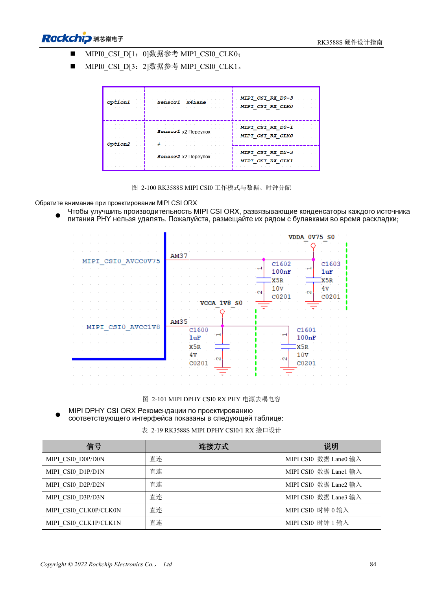
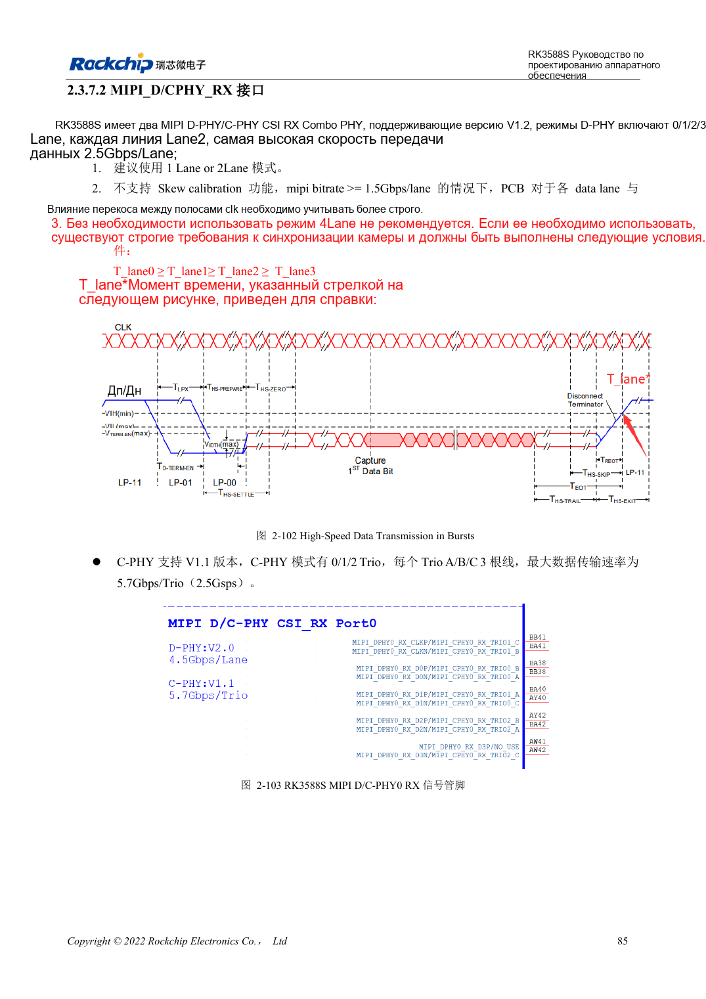

<!-- rk3588s-hardware-v12-20261109 -->

# Камеры RK3588S: CSI, D/C PHY и CIF

Основа — китайский RK3588S Hardware Design Guide V1.2 (2023-12-14), для проверки схем и PCB. Носители CM7S проектируют по интерфейсам модуля; Sige7S подходит для оценки ПО и периферии. Возможности SoC не равны разъёмам платы. Проверяйте SDK/BSP, ядро, ревизию, прошивку и мультиплексирование. Значения взяты из источника, не из измерений ArmSoM.

**RK3588S Hardware Design Guide V1.2 (2023-12-14), CN** · §2.3.7.1–2.3.7.3; §3.4.10; §3.4.22

## Планируйте PHY раздельно

RK3588S имеет один выделенный DPHY RX с 1×4 или 2×2 линиями и два приёмника D/C Combo. Опорная скорость выделенного DPHY — 2.5Gbps/lane. Режим DPHY Combo не поддерживает skew calibration; предпочтительны одна или две линии. Для четырёх линий требуется T_lane0≥T_lane1≥T_lane2≥T_lane3, особенно проверяйте временные условия при ≥1.5Gbps/lane.

## Уровни CIF и проверка системы

CIF использует VCCIO5/VCCIO6: оба питания согласуют с IO датчика и подтяжками I2C. Соединение MIPI не означает поддержку датчика в BSP: нужны драйвер, device tree и ISP. Начинают с одного потока, затем проверяют многопоточность, длительность, потерю кадров, такт и нагрев.

## Параметры и проверочная таблица

| Параметр | Значение источника |
| --- | --- |
| Скорость отдельного DPHY RX | 2.5Gbps/lane |
| Целевой импеданс DPHY | 100Ω ±10%; резерв 95Ω ±10% |
| DPHY пара / такт-данные | <6mil / <12mil |

## Исходные рисунки

Соответствующее английское руководство для этой партии не найдено. Все четыре версии используют снимки китайского оригинала с локализованными подписями. Откройте изображение в полном разрешении; текст и таблицы можно копировать. Номера относятся к физическим страницам PDF.

Китайский оригинал · PDF 99 · 2-100

Китайский оригинал · PDF 100 · 2-102

## Разработка с ArmSoM

CM7S подходит для собственного носителя: сначала определите встроенные питание, DDR и загрузку, затем проектируйте за пределами разъёмов. Sige7S служит базой оценки ПО и периферии. Для обоих изделий проверяйте вывод интерфейсов, контакты, уровни, образы и охлаждение по нужной ревизии. Схема SoC не является схемой подключения изделия.

- [ArmSoM CM7S](https://www.armsom.org/cm7s) · [CM7S Docs](https://docs.armsom.org/armsom-cm7s)
- [ArmSoM Sige7S](https://www.armsom.org/sige7s) · [Sige7S Docs](https://docs.armsom.org/armsom-sige7s)

## Читайте далее

- [RK3588S: 30 тем аппаратного проектирования](/ru/articles/rk3588s-hardware-design-series/)
- [PCIe RK3588S: линии, опорные такты и питание](/ru/articles/rk3588s-pcie-hardware-design/)
- [RK3588S и RK3588S2: PHY камер и совместимость](/ru/articles/rk3588s-rk3588s2-hardware-differences/)
