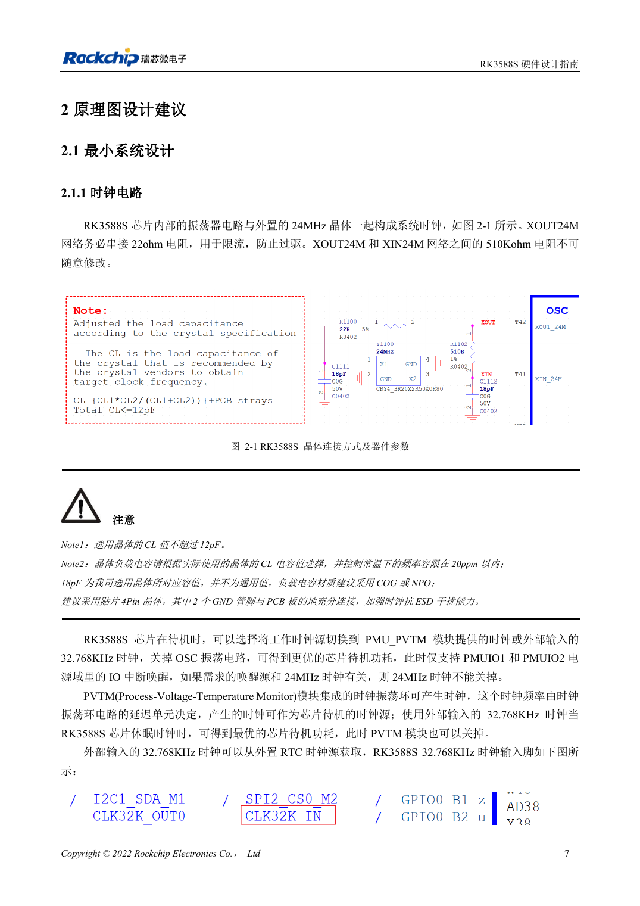
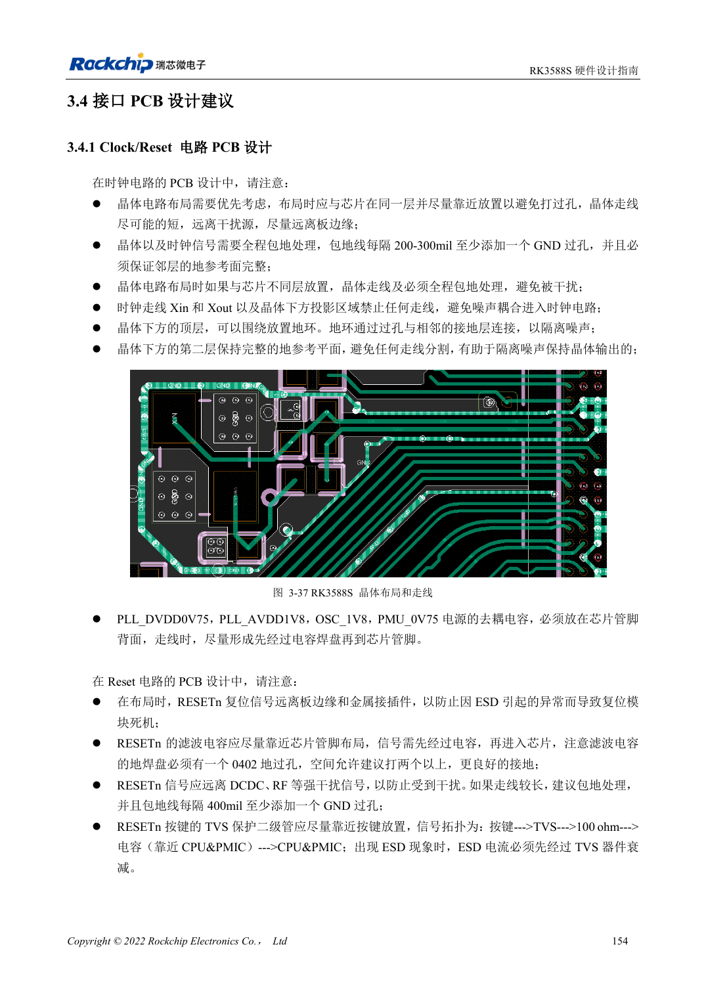

<!-- rk3588s-hardware-v12-20261109 -->

# Тактовые цепи RK3588S: 24MHz, 32kHz и размещение

Основа — китайский RK3588S Hardware Design Guide V1.2 (2023-12-14), для проверки схем и PCB. Носители CM7S проектируют по интерфейсам модуля; Sige7S подходит для оценки ПО и периферии. Возможности SoC не равны разъёмам платы. Проверяйте SDK/BSP, ядро, ревизию, прошивку и мультиплексирование. Значения взяты из источника, не из измерений ArmSoM.

**RK3588S Hardware Design Guide V1.2 (2023-12-14), CN** · §2.1.1; §3.4.1

## Подберите нагрузку кварца

22Ω у XOUT24M ограничивает возбуждение; 510kΩ между XOUT24M и XIN24M нельзя менять произвольно. CL кварца ≤12pF. Показанные 18pF относятся к эталону: нагрузку определяют по CL и паразитам, предпочтительно C0G/NP0 и четырёхконтактный кварц. Ёмкость щупа также влияет на генерацию.

## Проверьте пробуждение и PCB

Перед остановкой 24MHz проверьте зависимости источников пробуждения. Малопотребляющий путь использует PMU_PVTM или внешние 32.768kHz и соответствующие IO PMUIO1/2. Кварц размещают рядом с SoC на той же стороне; под кварцем/XIN/XOUT не проводят другие сигналы, сохраняют землю и ставят земляные переходы через 200–300mil.

## Параметры и проверочная таблица

| Параметр | Значение источника |
| --- | --- |
| Допуск 24MHz | ≤20ppm |
| Допуск 32.768kHz | ±30ppm |
| Скважность 32kHz | 45–55% |
| Амплитуда 32kHz | 0.7×VDD … VDD; VDD=PMUIO1 |

## Исходные рисунки

Соответствующее английское руководство для этой партии не найдено. Все четыре версии используют снимки китайского оригинала с локализованными подписями. Откройте изображение в полном разрешении; текст и таблицы можно копировать. Номера относятся к физическим страницам PDF.

Китайский оригинал · PDF 22 · 2-1

Китайский оригинал · PDF 169 · 3-37

## Разработка с ArmSoM

CM7S подходит для собственного носителя: сначала определите встроенные питание, DDR и загрузку, затем проектируйте за пределами разъёмов. Sige7S служит базой оценки ПО и периферии. Для обоих изделий проверяйте вывод интерфейсов, контакты, уровни, образы и охлаждение по нужной ревизии. Схема SoC не является схемой подключения изделия.

- [ArmSoM CM7S](https://www.armsom.org/cm7s) · [CM7S Docs](https://docs.armsom.org/armsom-cm7s)
- [ArmSoM Sige7S](https://www.armsom.org/sige7s) · [Sige7S Docs](https://docs.armsom.org/armsom-sige7s)

## Читайте далее

- [RK3588S: 30 тем аппаратного проектирования](/ru/articles/rk3588s-hardware-design-series/)
- [RK3588S и носитель CM7S: ресурсы и проверка](/ru/articles/rk3588s-cm7s-carrier-design/)
- [Сброс, watchdog и термозащита RK3588S](/ru/articles/rk3588s-reset-watchdog-hardware/)
