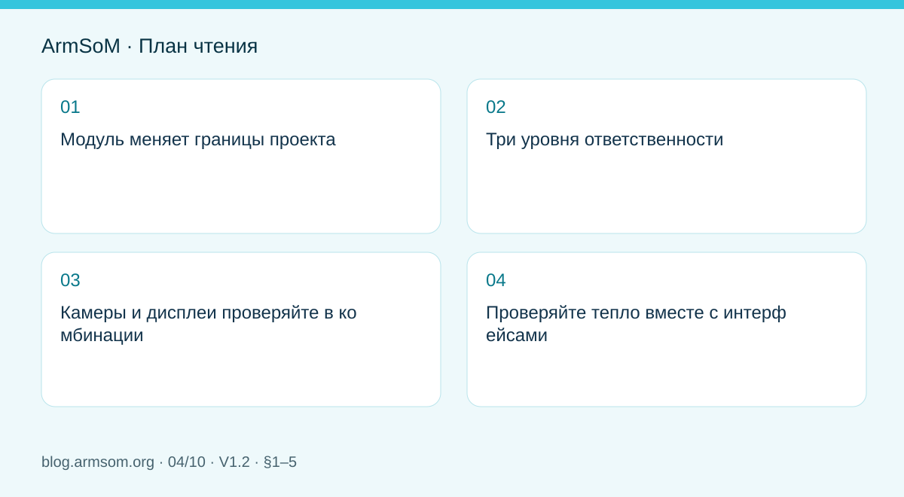
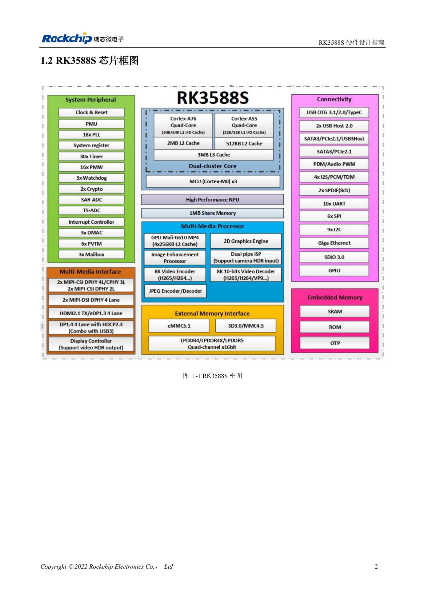

# Аппаратное проектирование RK3588S: от эталонной схемы к носителю CM7s

## Область применения и источники

Это тематическое инженерное руководство, а не постраничный перевод всего PDF. Примеры источника не являются измерениями ArmSoM. Напряжения, выводы, SDK/BSP и ядро сверяйте с фактической ревизией платы.

**Rockchip:** `RK3588S Hardware Design Guide-V1.2-20231214.pdf` · V1.2 · §1–5

## Модуль меняет границы проекта

CM7s интегрирует вычислительную платформу RK3588S. Носитель начинают с реальных выводов, механики, разъёмов и питания модуля, а не с копирования всей EVB. Разводка DDR и питание чипа объясняют архитектуру; задачи носителя — питание периферии, соединения, защита и охлаждение в корпусе.

RK3588S и RK3588 не имеют одинакового набора интерфейсов. Определения выводов RK3588S2 также нельзя незаметно подставлять вместо RK3588S. Зафиксируйте полное обозначение чипа, ревизию модуля и версию документа.

## Три уровня ответственности

| Уровень | Основные задачи | Документы |
| --- | --- | --- |
| Модуль | Процессор, память, загрузка, интегрированное питание | Схема и ревизия CM7s |
| Носитель | Сигналы, питание периферии, разъёмы, защита | Выводы модуля и схема носителя |
| Изделие | Кабели, охлаждение, корпус, EMC, нагрузка | Механика и план проверки |

На границе модуля всё равно проверяют уровни, последовательность Reset/Enable, неиспользуемые выводы и мультиплексирование. Интеграция не отменяет этих проверок.

## Камеры и дисплеи проверяйте в комбинации

Начните с конкретного сенсора или панели. Помимо видеолиний нужны управление, тактирование, сброс, питание сенсора либо подсветка. Запишите разрешение, частоту кадров, lane-конфигурацию, кабель и разъём; согласуйте драйвер и дерево устройств. Число интерфейсов SoC не определяет одновременную работу на носителе.

## Проверяйте тепло вместе с интерфейсами

Одновременные AI, видео, дисплей и накопитель создают иную нагрузку, чем рабочий стол без задач. Задайте тепловой путь к радиатору, корпусу или воздуху, учитывая крепёж и изоляцию. Фиксируйте температуру среды и системы, снижение частоты и полезную производительность. Краткий пик не равен длительной работе.

Sige7s или IO-платформа CM7s подходят для исходной проверки приложения. Разъёмы и механика различаются: результат относится к испытанной конфигурации и требует повторной проверки на собственном носителе.

## Иллюстрация из источника

Китайский оригинал; соответствующая английская иллюстрация в материалах не найдена. Эталонный проект, а не схема платы ArmSoM.

`RK3588S Hardware Design Guide-V1.2-20231214.pdf` · PDF p. 17.

## Продукты и документация

- **CM7s** — [Страница продукта](https://www.armsom.org/cm7s) · [Документация](https://docs.armsom.org/armsom-cm7s)
- **Sige7s** — [Страница продукта](https://www.armsom.org/sige7s) · [Документация](https://docs.armsom.org/armsom-sige7s)

## Другие статьи серии

- [Запуск платы RK3576: минимальная система и проверка первого включения](/ru/articles/rk3576-hardware-bringup/)
- [Плата-носитель ArmSoM CM5: питание, загрузка и планирование интерфейсов](/ru/articles/019-cm5-carrier-production/)
- [Скоростные интерфейсы RK3576: совместная проверка схемы и PCB](/ru/articles/rk3576-high-speed-interface-design/)
- [RK3588 для периферийного ИИ: питание, охлаждение и расширение](/ru/articles/rk3588-edge-ai-hardware-design/)
- [Проверка скоростной PCB RK3588: слои, импеданс и трассировка](/ru/articles/rk3588-high-speed-pcb-review/)
- [Аппаратная часть HMI на RK3506: выбор пути с CM1 или Forge1](/ru/articles/rk3506-industrial-hmi-hardware/)
- [Варианты RK3308: аппаратная совместимость для аудиопроектов P2 Pro](/ru/articles/rk3308-hardware-variant-compatibility/)
- [RK3588S и RK3588S2: что проверить перед изменением платы](/ru/articles/rk3588s-rk3588s2-hardware-differences/)
- [От прототипа Rockchip к серии: технологические требования и испытания](/ru/articles/rockchip-hardware-production-checklist/)
