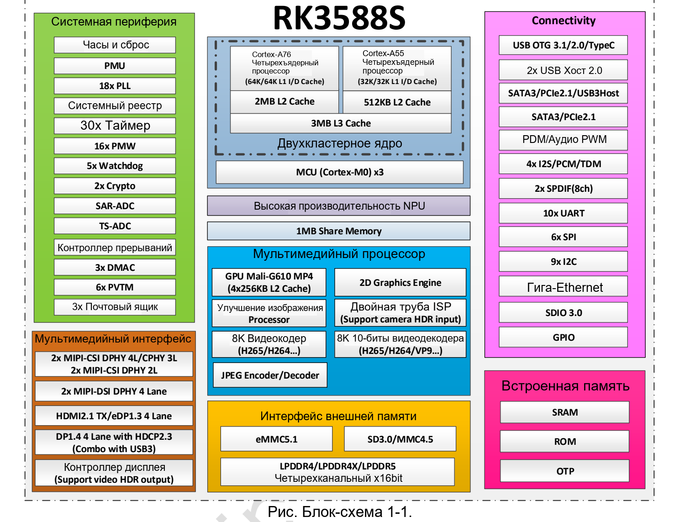
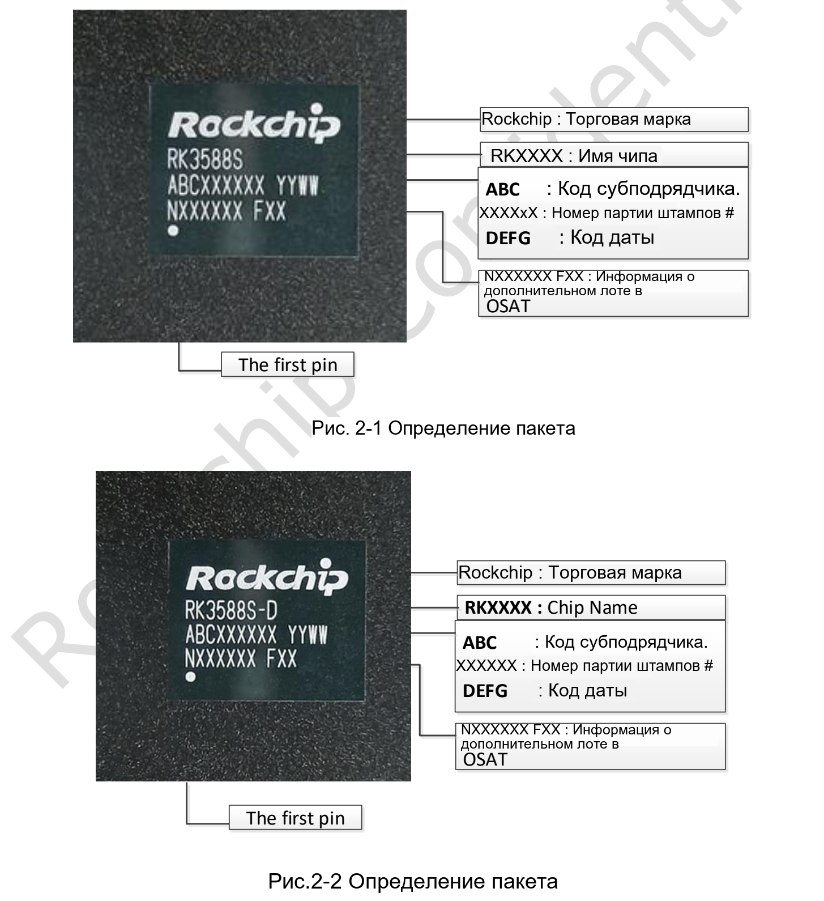
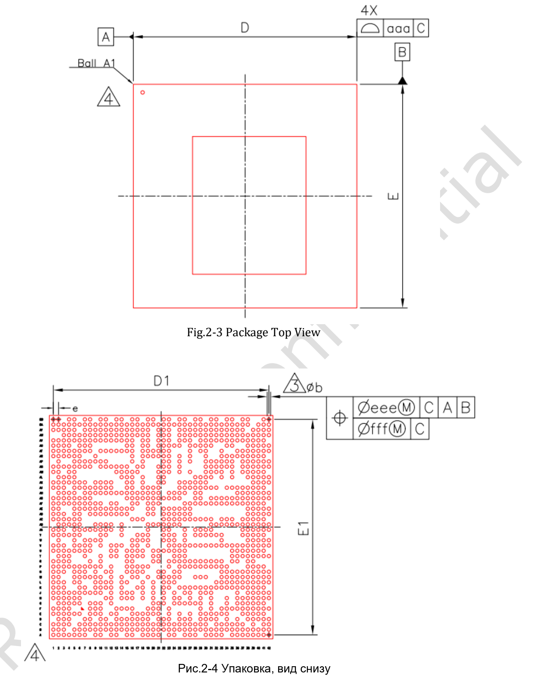
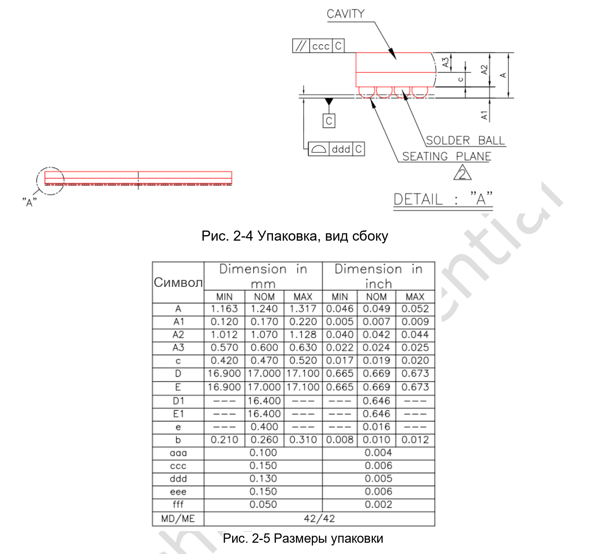

Руководство относится к предоставленному **Rockchip RK3588S Datasheet V1.3 от 2022-03-10, 35 страниц**. Это описание кристалла, а не замена схемам CM7S/Sige7S, механическим файлам или текущему SDK. Документ не представлен как новейшая редакция.

[Скачать исходный PDF (V1.3, около 2.46 MiB)](/assets/rk3588s/Rockchip-RK3588S-Datasheet-V1.3-20220310.pdf) · [Скачать редактируемый английский текст и таблицы](/docs/rk3588s/technical-reference-en.md)

Это русское руководство по чтению, не полный перевод datasheet. Английское приложение охватывает страницы 6–35 без обложки, истории изменений, отказа от ответственности и повторяющихся колонтитулов. Параметры и неоднозначности сохранены. Область действия объединённых ячеек уточняйте по PDF.

## Структура документа

| Страницы PDF | Содержание | Назначение |
|---|---|---|
| 6–16, глава 1 | CPU, память, видео, NPU, графика, интерфейсы, блок-схема | Архитектура и возможности |
| 17–28, глава 2 | Заказ, маркировка, корпус, контакты | Идентификация корпуса и сигналов |
| 29–34, глава 3 | Пределы, рабочие условия, IO, PLL, PHY, ADC | Электрическая проверка |
| 35, глава 4 | Тепловой режим и сопротивления | Тепловые предположения |

## Схема и чертежи корпуса

Английские чертежи сохраняют исходные размеры. Указаны FCCSP1253L, корпус 17 × 17 mm, шарики 0.26 mm и шаг 0.4 mm. Это размеры микросхемы, не плат CM7S или Sige7S.

## Предельные значения не являются рабочей целью

Раздел 3.1 задаёт абсолютные пределы, связанные с возможным повреждением. Для работы используют рекомендованные условия 3.2 вместе с последовательностью питания и руководством по аппаратуре. Пороги IO зависят от домена питания; нельзя считать GPIO совместимыми с логикой 5V по умолчанию.

Максимальные частоты CPU, GPU и NPU в этой редакции оставлены как TBD. Не подставляйте вместо них значения из более новой карточки продукта.

## Как понимать тепловые данные

| Параметр | Типичное значение V1.3 | Единица |
|---|---|---|
| Переход–среда θJA | 8.2 | °C/W |
| Переход–плата θJB | 3.7 | °C/W |
| Переход–корпус θJC | 0.01 | °C/W |

Источник описывает справочное моделирование: плата 10 слоёв, 200 × 130 mm, окружающая температура 25°C. Это не измерения системы ArmSoM и не прогноз нагрева любого корпуса. Раздел 4.1 требует температуру перехода ниже 125°C; это не допустимая температура окружающей среды 125°C.

## Сохранённые расхождения

- На обложке V1.3, в колонтитулах с 20-й страницы — V1.2.
- Пять SPI-контроллеров в тексте и 6× SPI на схеме: проверить TRM и мультиплексирование.
- Число HDMI/eDP требует сверки со схемой; нельзя обещать два выхода конкретной платы только по этому пункту.
- На странице 34 дважды использован Table 3-10; номера рисунков тоже расходятся.
- Тепловые значения, отрицательные Min/Max токов и повторные строки PHY с неясными условиями сохранены.

Для носителя CM7S начните с контактов модуля и питания. Для Sige7S — с портов, образа и драйверов. Datasheet объясняет границы кристалла, но не заменяет испытания платы.

## Материалы и продукты

- [RK3588S: восемь ядер CPU, NPU 6 TOPS и платформы ArmSoM](/ru/articles/rk3588s-chip-guide/)
- [CM7S или Sige7S: выбор платформы на RK3588S](/ru/articles/cm7s-sige7s-rk3588s-selection/)
- [Периферийный ИИ и мультимедиа на RK3588S: проектирование с CM7S и Sige7S](/ru/articles/rk3588s-edge-ai-multimedia/)

### Продукты и разработка

- [CM7S](https://www.armsom.org/cm7s) · [CM7S Docs](https://docs.armsom.org/armsom-cm7s)
- [Sige7S](https://www.armsom.org/sige7s) · [Sige7S Docs](https://docs.armsom.org/armsom-sige7s)
- [Rockchip RKNN-Toolkit2](https://github.com/airockchip/rknn-toolkit2) · [RKNN-LLM](https://github.com/airockchip/rknn-llm)
