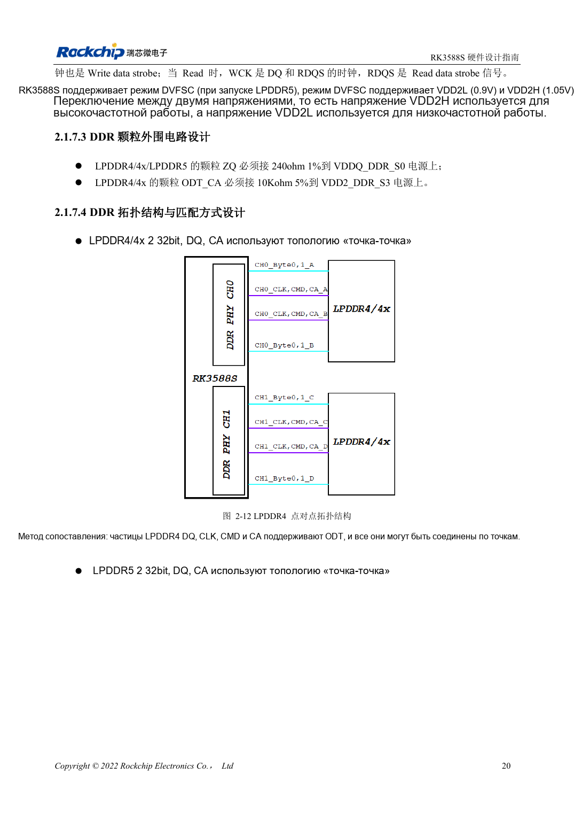
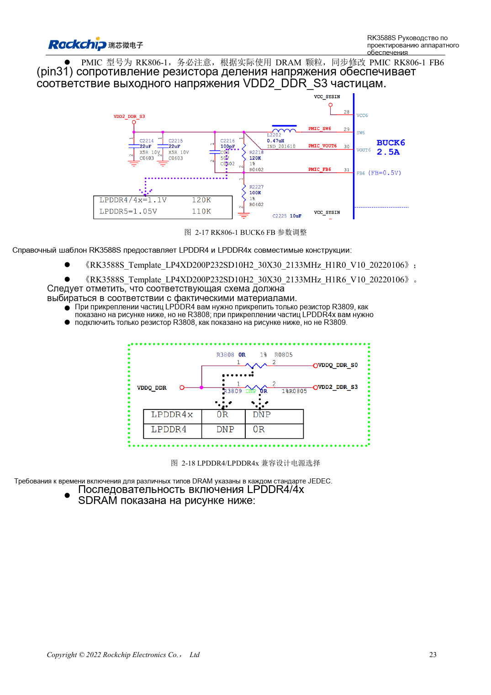

<!-- rk3588s-hardware-v12-20261109 -->

# DDR RK3588S: LPDDR4/4X/5 и конфигурация памяти

Основа — китайский RK3588S Hardware Design Guide V1.2 (2023-12-14), для проверки схем и PCB. Носители CM7S проектируют по интерфейсам модуля; Sige7S подходит для оценки ПО и периферии. Возможности SoC не равны разъёмам платы. Проверяйте SDK/BSP, ядро, ревизию, прошивку и мультиплексирование. Значения взяты из источника, не из измерений ArmSoM.

**RK3588S Hardware Design Guide V1.2 (2023-12-14), CN** · §2.1.7

## Выбирайте ёмкость и шаблон вместе

V1.2 описывает четыре 16-битных канала, всего 64 бита, до 8GB на канал и 32GB суммарно. 32-битные CH0/CH1 не должны иметь разную ёмкость, например 4GB+2GB. Это область данной версии, не других вариантов или BSP. Деталь памяти, корпус, прошивку и шаблон проверяют вместе.

## Напряжение и сигналы — не переименование

Две 32-битные детали используют DQ/CA точка-точка. В совместимом шаблоне LPDDR4: R3809 установлен, R3808 нет; LPDDR4X — наоборот. Обозначения относятся к эталону, на другой схеме сверяют сети. LPDDR5 требует своего WCK, сигналов и питания. CM7S уже содержат DDR, носитель проверяют по входу, интерфейсам и охлаждению.

## Параметры и проверочная таблица

| Параметр | Значение источника |
| --- | --- |
| Шина V1.2 | 4×16bit =64bit |
| Адресация V1.2 | 8GB/канал; 32GB всего |
| CH0 / CH1 | Одинаковая ёмкость |

## Исходные рисунки

Соответствующее английское руководство для этой партии не найдено. Все четыре версии используют снимки китайского оригинала с локализованными подписями. Откройте изображение в полном разрешении; текст и таблицы можно копировать. Номера относятся к физическим страницам PDF.

Китайский оригинал · PDF 35 · 2-12

Китайский оригинал · PDF 38 · 2-18

## Разработка с ArmSoM

CM7S подходит для собственного носителя: сначала определите встроенные питание, DDR и загрузку, затем проектируйте за пределами разъёмов. Sige7S служит базой оценки ПО и периферии. Для обоих изделий проверяйте вывод интерфейсов, контакты, уровни, образы и охлаждение по нужной ревизии. Схема SoC не является схемой подключения изделия.

- [ArmSoM CM7S](https://www.armsom.org/cm7s) · [CM7S Docs](https://docs.armsom.org/armsom-cm7s)
- [ArmSoM Sige7S](https://www.armsom.org/sige7s) · [Sige7S Docs](https://docs.armsom.org/armsom-sige7s)

## Читайте далее

- [RK3588S: 30 тем аппаратного проектирования](/ru/articles/rk3588s-hardware-design-series/)
- [RK3588S и RK806: один или два PMIC](/ru/articles/rk3588s-rk806-pmic-design/)
- [Трассировка DDR RK3588S: длина и задержка](/ru/articles/rk3588s-ddr-pcb-routing/)
