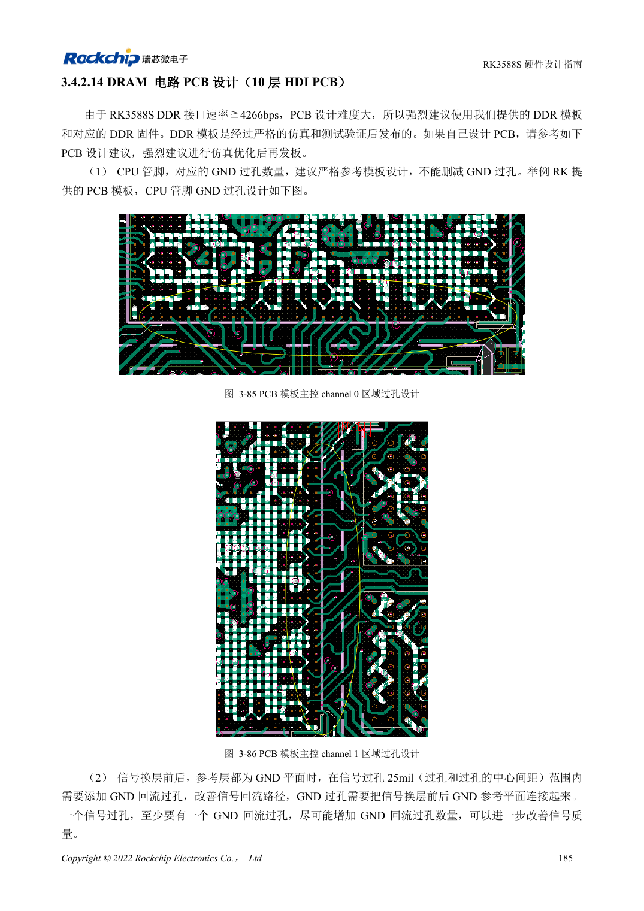
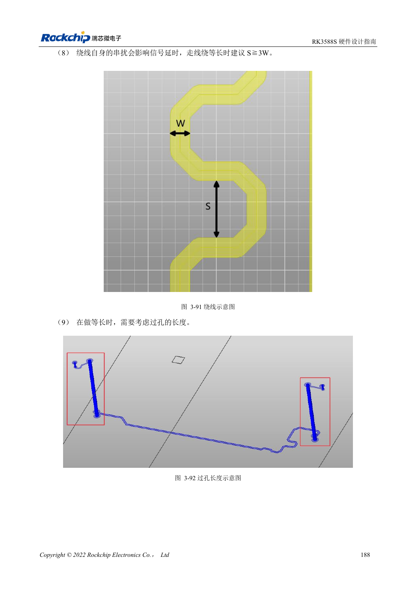

<!-- rk3588s-hardware-v12-20261109 -->

# Трассировка DDR RK3588S: длина и задержка

Основа — китайский RK3588S Hardware Design Guide V1.2 (2023-12-14), для проверки схем и PCB. Носители CM7S проектируют по интерфейсам модуля; Sige7S подходит для оценки ПО и периферии. Возможности SoC не равны разъёмам платы. Проверяйте SDK/BSP, ядро, ревизию, прошивку и мультиплексирование. Значения взяты из источника, не из измерений ArmSoM.

**RK3588S Hardware Design Guide V1.2 (2023-12-14), CN** · §3.4.2.14

## Используйте таблицы RK3588S

Таблицы 3-13, 3-14 и 3-15 в §3.4.2.14 относятся к LPDDR5, LPDDR4X и LPDDR4. Ограничения длины рассчитаны на внутренние слои 10-слойной HDI-платы. Не переносите правило 16ps для 8-слойной платы со сквозными отверстиями из другого руководства RK3588. DQ/DM: 45Ω, адрес/управление: 50Ω, пары: 90Ω, допуск ±10%.

## Задайте байтовые группы и зазоры

Для LPDDR5 разница DQ/DM и DQS/WCLK внутри байта ≤25mil, адреса/управления и CLK ≤40mil, внутри пары ≤5mil, DQS/WCLK и CLK ≤200mil. Для LPDDR4X DQS–CLK ≤250mil. Между данными минимум две ширины трассы; до строба желательно три, минимум две. Проверяйте журналы обучения, температуру, нагрузку на целевой частоте и повторные холодные старты.

## Параметры и проверочная таблица

| Параметр | Значение источника |
| --- | --- |
| Импеданс LPDDR5 DQ/DM | 45Ω ±10% |
| Адрес/управление LPDDR5 | 50Ω ±10% |
| Дифференциальная цель LPDDR5 | 90Ω ±10% |
| Разница в байте | DQ/DM ↔ DQS/WCLK: ≤25mil |
| Разница адресных линий | ≤40mil |
| Разница внутри пары | ≤5mil |

## Исходные рисунки

Соответствующее английское руководство для этой партии не найдено. Все четыре версии используют снимки китайского оригинала с локализованными подписями. Откройте изображение в полном разрешении; текст и таблицы можно копировать. Номера относятся к физическим страницам PDF.

Китайский оригинал · PDF 200 · 3-85

Китайский оригинал · PDF 203 · 3-91

## Разработка с ArmSoM

CM7S подходит для собственного носителя: сначала определите встроенные питание, DDR и загрузку, затем проектируйте за пределами разъёмов. Sige7S служит базой оценки ПО и периферии. Для обоих изделий проверяйте вывод интерфейсов, контакты, уровни, образы и охлаждение по нужной ревизии. Схема SoC не является схемой подключения изделия.

- [ArmSoM CM7S](https://www.armsom.org/cm7s) · [CM7S Docs](https://docs.armsom.org/armsom-cm7s)
- [ArmSoM Sige7S](https://www.armsom.org/sige7s) · [Sige7S Docs](https://docs.armsom.org/armsom-sige7s)

## Читайте далее

- [RK3588S: 30 тем аппаратного проектирования](/ru/articles/rk3588s-hardware-design-series/)
- [DDR RK3588S: LPDDR4/4X/5 и конфигурация памяти](/ru/articles/rk3588s-ddr-circuit-design/)
- [eMMC RK3588S: такт, подтяжки и Strobe](/ru/articles/rk3588s-emmc-hardware-design/)
