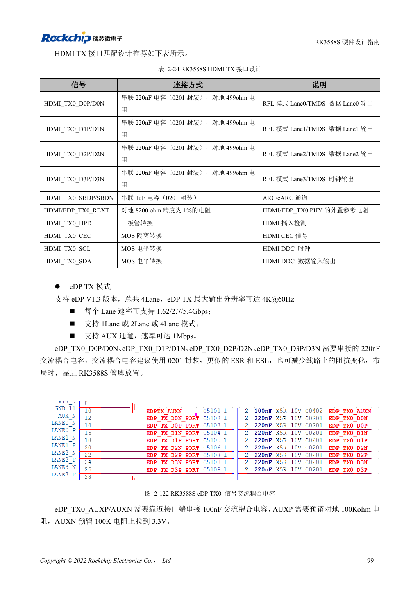
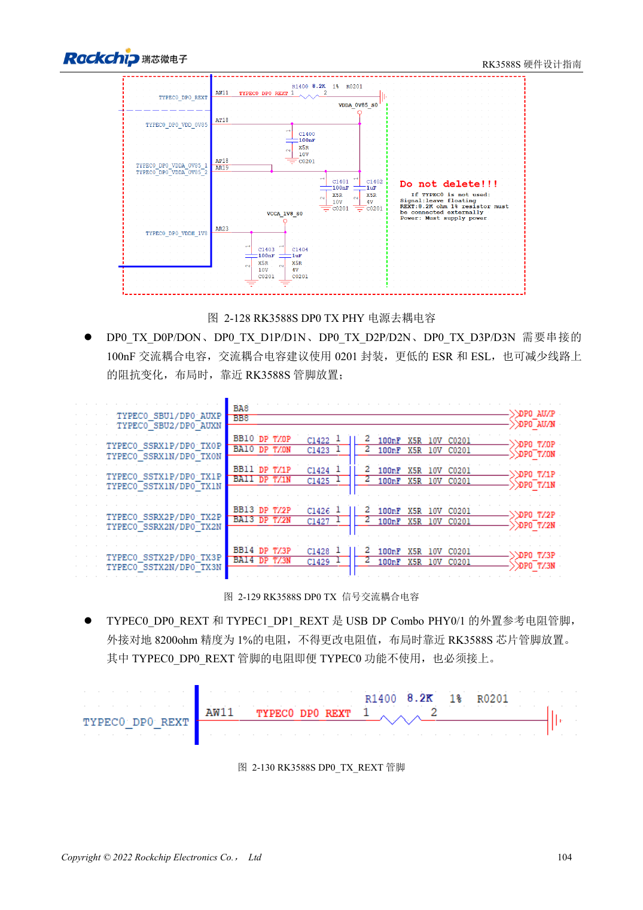

<!-- rk3588s-hardware-v12-20261109 -->

# DP и eDP RK3588S: PHY, AUX и развязка

Основа — китайский RK3588S Hardware Design Guide V1.2 (2023-12-14), для проверки схем и PCB. Носители CM7S проектируют по интерфейсам модуля; Sige7S подходит для оценки ПО и периферии. Возможности SoC не равны разъёмам платы. Проверяйте SDK/BSP, ядро, ревизию, прошивку и мультиплексирование. Значения взяты из источника, не из измерений ArmSoM.

**RK3588S Hardware Design Guide V1.2 (2023-12-14), CN** · §2.3.8.1; §2.3.8.3; §3.4.3; §3.4.11

## Похожие названия не означают одинаковую схему

DP0 делят PHY с USB Type-C, eDP — с HDMI TX. Основной DP использует 100nF, eDP — 220nF, AUX — 100nF. Импеданс, развязка и контакты не взаимозаменяемы. Кабель, разъём, дисплей и BSP входят в канал.

## Обязательные цепи TYPEC0

Сохраните три питания TYPEC0_DP0 и REXT 8.2kΩ, 1% даже при неиспользуемом интерфейсе, как требует руководство. eDP использует 220nF в основном канале и 100nF в AUX; проверьте импеданс разъёма и кабеля. У RK3588S один DP Combo. Остаточные TYPEC1 или TX1 не подтверждают второй интерфейс.

## Параметры и проверочная таблица

| Параметр | Значение источника |
| --- | --- |
| Импеданс DP / USB-DP | 100Ω / 95Ω; ±10% |
| Импеданс eDP | 90Ω ±10%; согласовать с кабелем |
| Связь основной линии DP / eDP | 100nF / 220nF |
| Связь AUX | 100nF |
| Длина/разница пары | <6in / <6mil |

## Исходные рисунки

Соответствующее английское руководство для этой партии не найдено. Все четыре версии используют снимки китайского оригинала с локализованными подписями. Откройте изображение в полном разрешении; текст и таблицы можно копировать. Номера относятся к физическим страницам PDF.

Китайский оригинал · PDF 114 · 2-122

Китайский оригинал · PDF 119 · 2-129

## Разработка с ArmSoM

CM7S подходит для собственного носителя: сначала определите встроенные питание, DDR и загрузку, затем проектируйте за пределами разъёмов. Sige7S служит базой оценки ПО и периферии. Для обоих изделий проверяйте вывод интерфейсов, контакты, уровни, образы и охлаждение по нужной ревизии. Схема SoC не является схемой подключения изделия.

- [ArmSoM CM7S](https://www.armsom.org/cm7s) · [CM7S Docs](https://docs.armsom.org/armsom-cm7s)
- [ArmSoM Sige7S](https://www.armsom.org/sige7s) · [Sige7S Docs](https://docs.armsom.org/armsom-sige7s)

## Читайте далее

- [RK3588S: 30 тем аппаратного проектирования](/ru/articles/rk3588s-hardware-design-series/)
- [Дисплеи MIPI RK3588S: D-PHY, C-PHY и панели](/ru/articles/rk3588s-mipi-display-hardware/)
- [Аудио RK3588S: I2S, PDM и массивы микрофонов](/ru/articles/rk3588s-audio-hardware-design/)
