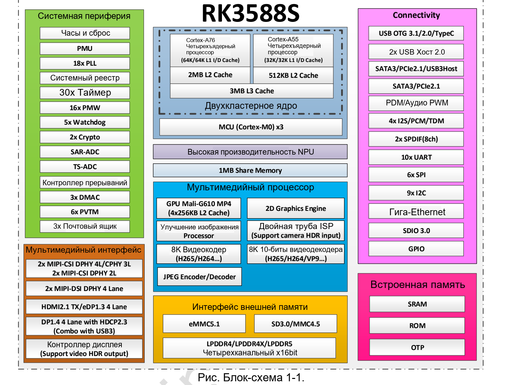

Эффективная система на RK3588S распределяет задачи между аппаратными блоками и избегает лишних копирований. CM7S и Sige7S могут стать её основой. Ниже описаны направления разработки, а не подтверждённые внедрения клиентов или результаты тестов.

## Локальный анализ изображения

Типичный тракт: камера или поток → захват/декодирование → масштабирование и преобразование формата → NPU → постобработка → экран или отправка результата. CPU выполняет прикладную логику, аппаратный кодек обрабатывает поддерживаемое видео, RGA — подходящие операции с изображением, NPU — преобразованные совместимые модели.

Начните прототип Sige7S с проверенного источника изображения. Собственная плата для CM7S нужна, когда сенсор, изоляция или корпус требуют иной аппаратуры. Одного успешного захвата недостаточно: экспозиция, баланс белого, искажения объектива и IQ влияют на качество распознавания.

## Интерактивные экраны и мультимедиа

Интегрированные графика, декодирование и вывод позволяют рассматривать RK3588S для информационных терминалов. Поддержка декодирования 8K не означает вывод 8K в любом браузере, проигрывателе и разъёме. Должны соответствовать формат, путь ускорения, кабель и дисплей.

Тестируйте реальные материалы: глубина цвета, кодек, субтитры и композиция UI меняют нагрузку. При параллельном ИИ измеряйте использование памяти, температуру и полную задержку, а не только максимум одного блока.

## Интеграция в специализированное устройство

CM7S позволяет спроектировать носитель с нужными разъёмами и коммуникациями. CAN или RS485 на системном уровне требуют трансиверов, защиты и иногда изоляции. Внутренний контроллер не равен готовому порту полевой шины.

## ПО и критерии приёмки

RKNN-Toolkit2 от Rockchip содержит инструменты преобразования и развёртывания. Старый RKNN-Toolkit несовместим с Toolkit2. Для языковых моделей отдельно оценивайте RKNN-LLM. Проверяйте операторы и примеры выбранной версии: поддержка фреймворка не гарантирует поддержку любой модели.

| Этап | Что записать |
|---|---|
| Преобразование | Версия инструмента, хеш модели, форма входа, калибровочные данные |
| Точность | Результаты до/после на одинаковом наборе |
| Развёртывание | Ревизия платы, образ, ядро, драйвер, runtime |
| Производительность | Полная задержка, пропускная способность, CPU, температура, мощность |
| Надёжность | Длительная работа, восстановление питания, неверные входы, ресурс хранения |

Начните с воспроизводимого примера, затем вводите свои данные и модель. Документация ArmSoM и статьи RKNN помогают выстроить процесс. Частоту кадров, энергопотребление и точность указывайте как свойства продукта только после измерений на целевом устройстве.

## Материалы и продукты

- [RK3588S: восемь ядер CPU, NPU 6 TOPS и платформы ArmSoM](/ru/articles/rk3588s-chip-guide/)
- [CM7S или Sige7S: выбор платформы на RK3588S](/ru/articles/cm7s-sige7s-rk3588s-selection/)
- [RK3588S Datasheet V1.3: загрузка, блок-схема и руководство по параметрам](/ru/articles/rk3588s-datasheet-v13/)

### Продукты и разработка

- [CM7S](https://www.armsom.org/cm7s) · [CM7S Docs](https://docs.armsom.org/armsom-cm7s)
- [Sige7S](https://www.armsom.org/sige7s) · [Sige7S Docs](https://docs.armsom.org/armsom-sige7s)
- [Rockchip RKNN-Toolkit2](https://github.com/airockchip/rknn-toolkit2) · [RKNN-LLM](https://github.com/airockchip/rknn-llm)

- [RKNN-Toolkit2 V2.5.0: YOLOv5](/ru/articles/rknn-v250-sdk-quickstart-yolov5/)
- [Rockchip MPP](/ru/articles/089-rockchip-mpp/)
- [RGA IM2D API](/ru/articles/129-rockchip-rga-im2d-api/)
