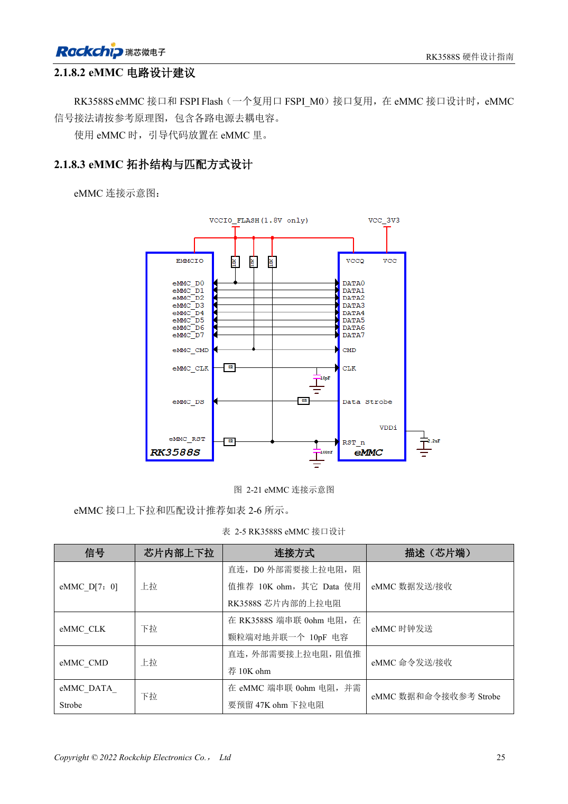
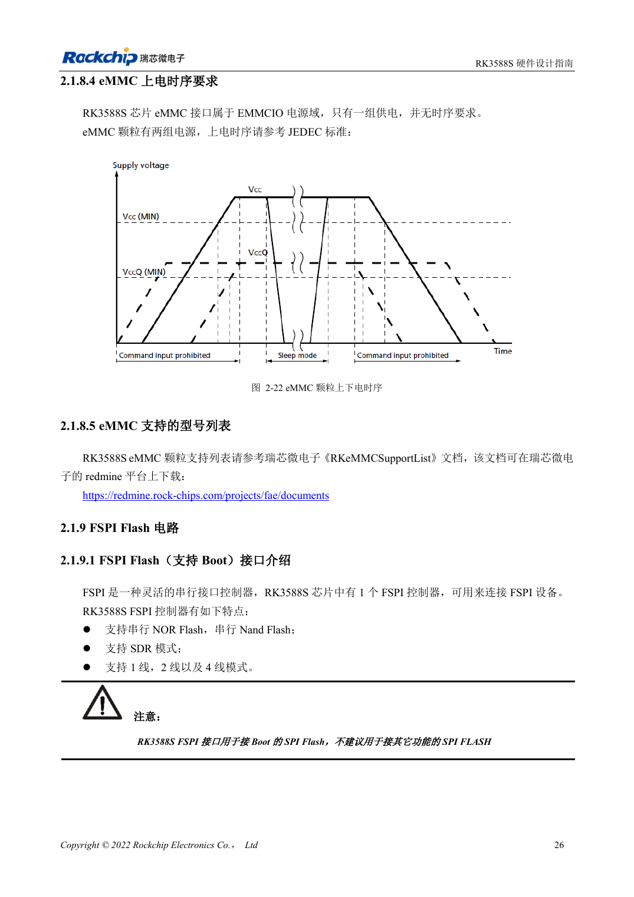

<!-- rk3588s-hardware-v12-20261109 -->

# eMMC RK3588S: такт, подтяжки и Strobe

Основа — китайский RK3588S Hardware Design Guide V1.2 (2023-12-14), для проверки схем и PCB. Носители CM7S проектируют по интерфейсам модуля; Sige7S подходит для оценки ПО и периферии. Возможности SoC не равны разъёмам платы. Проверяйте SDK/BSP, ядро, ревизию, прошивку и мультиплексирование. Значения взяты из источника, не из измерений ArmSoM.

**RK3588S Hardware Design Guide V1.2 (2023-12-14), CN** · §2.1.8; §3.4.12

## Используйте CLK из V1.2

Таблица 2-5: 0Ω в CLK у RK3588S, 10pF на землю у eMMC. D0/CMD имеют внешние 10kΩ вверх, остальные данные — внутренние подтяжки. Strobe: 0Ω у памяти и место для 47kΩ вниз. Сигналы не подключают по одному шаблону; расположение компонентов важно.

## Проверьте питание и режим

EMMCIO и два питания памяти — разные уровни; последовательность сверяют по конкретной детали. Проверяют список поддержки, Loader/BSP, целевой режим, холодный запуск, длительные передачи и восстановление после выключения. eMMC CM7S находится на модуле; замену или внешний доступ уточняют по модулю, не по схеме SoC.

## Параметры и проверочная таблица

| Параметр | Значение источника |
| --- | --- |
| CLK | 0Ω у SoC; 10pF у eMMC |
| D0 / CMD | 10kΩ подтяжка вверх |
| Строб | 0Ω у eMMC; резерв 47kΩ подтяжка вниз |
| PCB: импеданс/длина | 50Ω ±10% / <3.5in |
| Разница такт/данные | <120mil |

## Исходные рисунки

Соответствующее английское руководство для этой партии не найдено. Все четыре версии используют снимки китайского оригинала с локализованными подписями. Откройте изображение в полном разрешении; текст и таблицы можно копировать. Номера относятся к физическим страницам PDF.

Китайский оригинал · PDF 40 · 2-21

Китайский оригинал · PDF 41 · 2-22

## Разработка с ArmSoM

CM7S подходит для собственного носителя: сначала определите встроенные питание, DDR и загрузку, затем проектируйте за пределами разъёмов. Sige7S служит базой оценки ПО и периферии. Для обоих изделий проверяйте вывод интерфейсов, контакты, уровни, образы и охлаждение по нужной ревизии. Схема SoC не является схемой подключения изделия.

- [ArmSoM CM7S](https://www.armsom.org/cm7s) · [CM7S Docs](https://docs.armsom.org/armsom-cm7s)
- [ArmSoM Sige7S](https://www.armsom.org/sige7s) · [Sige7S Docs](https://docs.armsom.org/armsom-sige7s)

## Читайте далее

- [RK3588S: 30 тем аппаратного проектирования](/ru/articles/rk3588s-hardware-design-series/)
- [Трассировка DDR RK3588S: длина и задержка](/ru/articles/rk3588s-ddr-pcb-routing/)
- [FSPI Flash RK3588S: загрузка, питание и согласование](/ru/articles/rk3588s-fspi-boot-hardware/)
