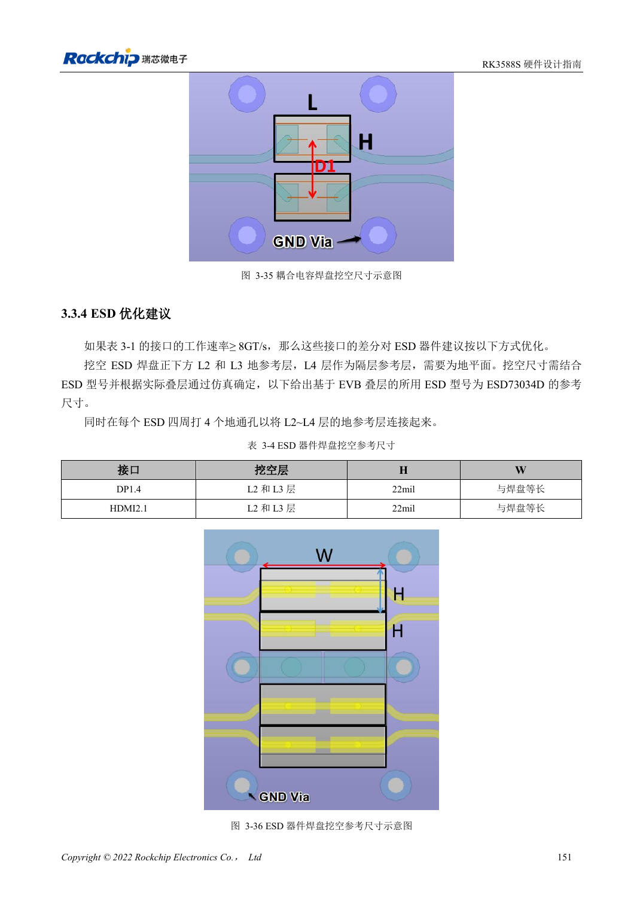

<!-- rk3588s-hardware-v12-20261109 -->

# ESD и EMI RK3588S: защита интерфейсов и возврат тока

Основа — китайский RK3588S Hardware Design Guide V1.2 (2023-12-14), для проверки схем и PCB. Носители CM7S проектируют по интерфейсам модуля; Sige7S подходит для оценки ПО и периферии. Возможности SoC не равны разъёмам платы. Проверяйте SDK/BSP, ядро, ревизию, прошивку и мультиплексирование. Значения взяты из источника, не из измерений ArmSoM.

**RK3588S Hardware Design Guide V1.2 (2023-12-14), CN** · §5; §3.3.4

## Защита у места входа тока

TVS ставят у разъёма или точки разряда с коротким низкоимпедансным возвратом. Сброс, такт и прерывания удаляют от края минимум на рекомендованные 5mm. Ёмкость и площадки ESD входят в анализ сигнала; большие номиналы не всегда лучше.

## EMI ищут от источника и связи

Сначала проверяют разрывы возврата, длинные ответвления, общий режим и импульсное питание, затем фильтры и экраны. Радиатор может излучать: предусмотрите заземление и испытания. Общие рекомендации резисторов не отменяют USB/HDMI/PCIe. Проверяйте реальный корпус, кабели и условия сертификации; рекомендации не означают сертификат.

## Параметры и проверочная таблица

| Параметр | Значение источника |
| --- | --- |
| Отступ чувствительных сетей | ≥5mm |
| От такта до резистора | ≤400mil |
| Край слоя питания | 20H; H=диэлектрик питание/земля |
| Высокоскоростная ESD | Предел ёмкости по интерфейсу |

## Исходные рисунки

Соответствующее английское руководство для этой партии не найдено. Все четыре версии используют снимки китайского оригинала с локализованными подписями. Откройте изображение в полном разрешении; текст и таблицы можно копировать. Номера относятся к физическим страницам PDF.

Китайский оригинал · PDF 166 · 3-36

## Разработка с ArmSoM

CM7S подходит для собственного носителя: сначала определите встроенные питание, DDR и загрузку, затем проектируйте за пределами разъёмов. Sige7S служит базой оценки ПО и периферии. Для обоих изделий проверяйте вывод интерфейсов, контакты, уровни, образы и охлаждение по нужной ревизии. Схема SoC не является схемой подключения изделия.

- [ArmSoM CM7S](https://www.armsom.org/cm7s) · [CM7S Docs](https://docs.armsom.org/armsom-cm7s)
- [ArmSoM Sige7S](https://www.armsom.org/sige7s) · [Sige7S Docs](https://docs.armsom.org/armsom-sige7s)

## Читайте далее

- [RK3588S: 30 тем аппаратного проектирования](/ru/articles/rk3588s-hardware-design-series/)
- [Тепловой расчёт RK3588S: эталон и проверка системы](/ru/articles/rk3588s-thermal-hardware-design/)
- [Монтаж и хранение RK3588S: оплавление, MSL3 и сушка](/ru/articles/rk3588s-assembly-storage-design/)
