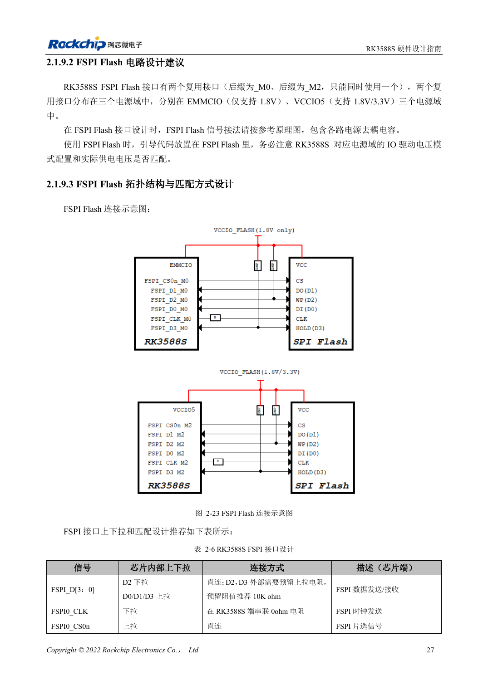

<!-- rk3588s-hardware-v12-20261109 -->

# FSPI Flash RK3588S: загрузка, питание и согласование

Основа — китайский RK3588S Hardware Design Guide V1.2 (2023-12-14), для проверки схем и PCB. Носители CM7S проектируют по интерфейсам модуля; Sige7S подходит для оценки ПО и периферии. Возможности SoC не равны разъёмам платы. Проверяйте SDK/BSP, ядро, ревизию, прошивку и мультиплексирование. Значения взяты из источника, не из измерений ArmSoM.

**RK3588S Hardware Design Guide V1.2 (2023-12-14), CN** · §2.1.9; §2.1.4; §3.4.15

## Определите загрузку и домен

FSPI хранит ранний код, в том числе инициализацию PCIe перед загрузкой SSD. Группа мультиплексирования определяет IO-домен; Flash питается от той же цепи. Совпадение корпуса не гарантирует замену: проверяют деталь, ёмкость, загрузчик и запись.

## Сохраните проверку и восстановление

Таблица 2-6 резервирует 10kΩ на D2/D3, 0Ω в CLK у SoC и прямой CS. Проверяют положение, длину и включение, затем повторяют холодный старт и сравнение полного чтения. В серии сохраняют USB-восстановление для повреждённой Flash.

## Противоречие мультиплексирования

Страница 42 PDF перечисляет только FSPI_M0 и FSPI_M2, но говорит о трёх доменах питания; описание загрузки также упоминает FSPI_M1. Это не подтверждает третий интерфейс. Проверьте M0/M2 по контактам EMMCIO/VCCIO5, загрузочной прошивке и TRM до выбора трассировки.

## Параметры и проверочная таблица

| Параметр | Значение источника |
| --- | --- |
| D2 / D3 | Резерв 10kΩ подтяжка вверх |
| CLK | 0Ω у SoC |
| Питание | Та же шина, что у выбранного FSPI IO |
| PCB: импеданс/длина | 50Ω ±10% / <4in |
| Разница такт/данные | <200mil |

## Исходные рисунки

Соответствующее английское руководство для этой партии не найдено. Все четыре версии используют снимки китайского оригинала с локализованными подписями. Откройте изображение в полном разрешении; текст и таблицы можно копировать. Номера относятся к физическим страницам PDF.

Китайский оригинал · PDF 42 · 2-23

## Разработка с ArmSoM

CM7S подходит для собственного носителя: сначала определите встроенные питание, DDR и загрузку, затем проектируйте за пределами разъёмов. Sige7S служит базой оценки ПО и периферии. Для обоих изделий проверяйте вывод интерфейсов, контакты, уровни, образы и охлаждение по нужной ревизии. Схема SoC не является схемой подключения изделия.

- [ArmSoM CM7S](https://www.armsom.org/cm7s) · [CM7S Docs](https://docs.armsom.org/armsom-cm7s)
- [ArmSoM Sige7S](https://www.armsom.org/sige7s) · [Sige7S Docs](https://docs.armsom.org/armsom-sige7s)

## Читайте далее

- [RK3588S: 30 тем аппаратного проектирования](/ru/articles/rk3588s-hardware-design-series/)
- [eMMC RK3588S: такт, подтяжки и Strobe](/ru/articles/rk3588s-emmc-hardware-design/)
- [SDMMC и SDIO Wi-Fi RK3588S: уровни и защита](/ru/articles/rk3588s-sdmmc-sdio-wifi-design/)
