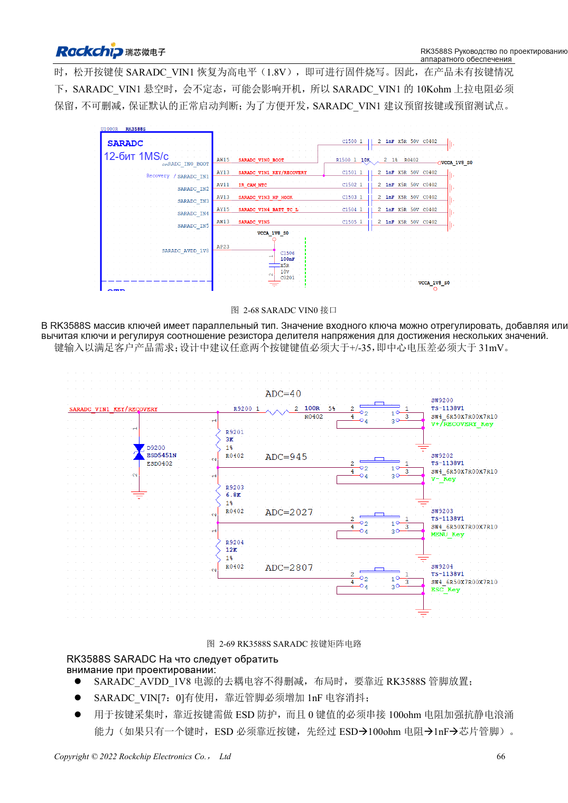

<!-- rk3588s-hardware-v12-20261109 -->

# GPIO и SARADC RK3588S: домены и кнопки

Основа — китайский RK3588S Hardware Design Guide V1.2 (2023-12-14), для проверки схем и PCB. Носители CM7S проектируют по интерфейсам модуля; Sige7S подходит для оценки ПО и периферии. Возможности SoC не равны разъёмам платы. Проверяйте SDK/BSP, ядро, ревизию, прошивку и мультиплексирование. Значения взяты из источника, не из измерений ArmSoM.

**RK3588S Hardware Design Guide V1.2 (2023-12-14), CN** · §2.1.10; §2.3.2; §2.3.16

## Сначала проверьте домены

PMUIO1, EMMCIO и VCCIO1 фиксированы на 1.8V; PMUIO2, VCCIO2, VCCIO4/5/6 выбирают 1.8V или 3.3V. Фиксированные вспомогательные выводы и выбираемые не смешивают S0/S3. Автоопределение напряжения не разрешает 5V.

## Не все ADC свободны

SARADC: 12 бит, 1MS/s, 0–1.8V, восемь входов; IN0_BOOT выделен, IN1 сохраняет recovery и 10kΩ вверх. На используемых входах 1nF у SoC, ESD перед резистором кнопки. Соотношение ±35 кодов/123mV неясно рядом с 12 битами; пороги определяют по реальному масштабу драйвера и напряжению.

## Параметры и проверочная таблица

| Параметр | Значение источника |
| --- | --- |
| SARADC | 12bit; 1MS/s; 0–1.8V |
| Зарезервированные входы | IN0_BOOT; IN1 восстановление |
| Входной фильтр | 1nF |
| Подтяжка восстановления | 10kΩ |

## Исходные рисунки

Соответствующее английское руководство для этой партии не найдено. Все четыре версии используют снимки китайского оригинала с локализованными подписями. Откройте изображение в полном разрешении; текст и таблицы можно копировать. Номера относятся к физическим страницам PDF.

Китайский оригинал · PDF 81 · 2-69

## Разработка с ArmSoM

CM7S подходит для собственного носителя: сначала определите встроенные питание, DDR и загрузку, затем проектируйте за пределами разъёмов. Sige7S служит базой оценки ПО и периферии. Для обоих изделий проверяйте вывод интерфейсов, контакты, уровни, образы и охлаждение по нужной ревизии. Схема SoC не является схемой подключения изделия.

- [ArmSoM CM7S](https://www.armsom.org/cm7s) · [CM7S Docs](https://docs.armsom.org/armsom-cm7s)
- [ArmSoM Sige7S](https://www.armsom.org/sige7s) · [Sige7S Docs](https://docs.armsom.org/armsom-sige7s)

## Читайте далее

- [RK3588S: 30 тем аппаратного проектирования](/ru/articles/rk3588s-hardware-design-series/)
- [Ethernet RK3588S: GMAC, PHY и направление такта](/ru/articles/rk3588s-gmac-hardware-design/)
- [Распределение UART, SPI, CAN, I2C и PWM RK3588S](/ru/articles/rk3588s-serial-control-hardware/)
