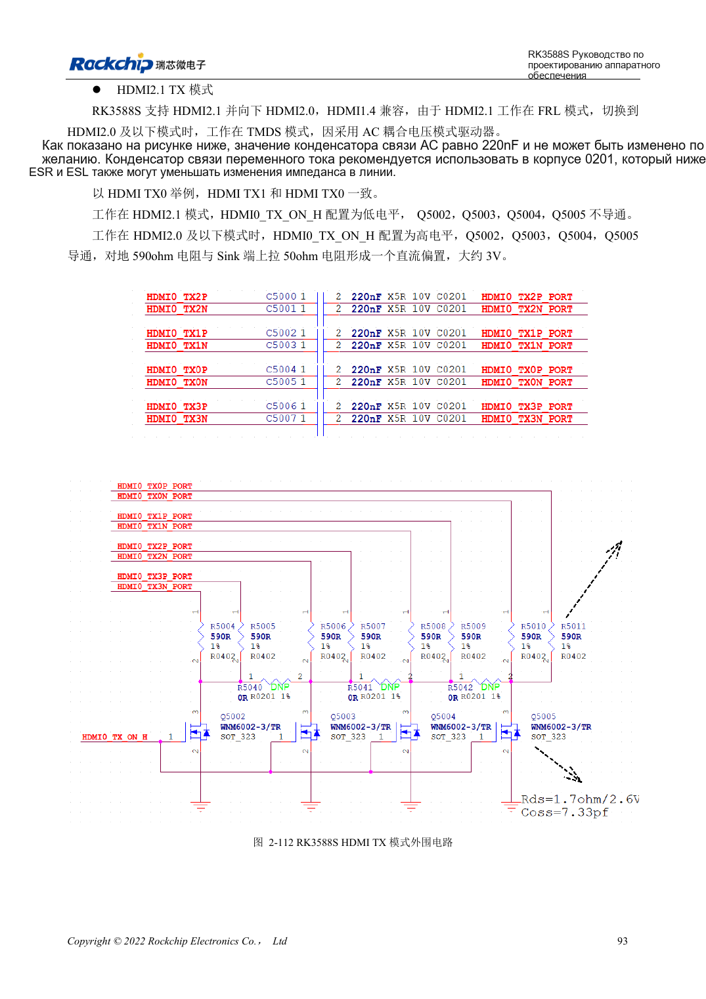
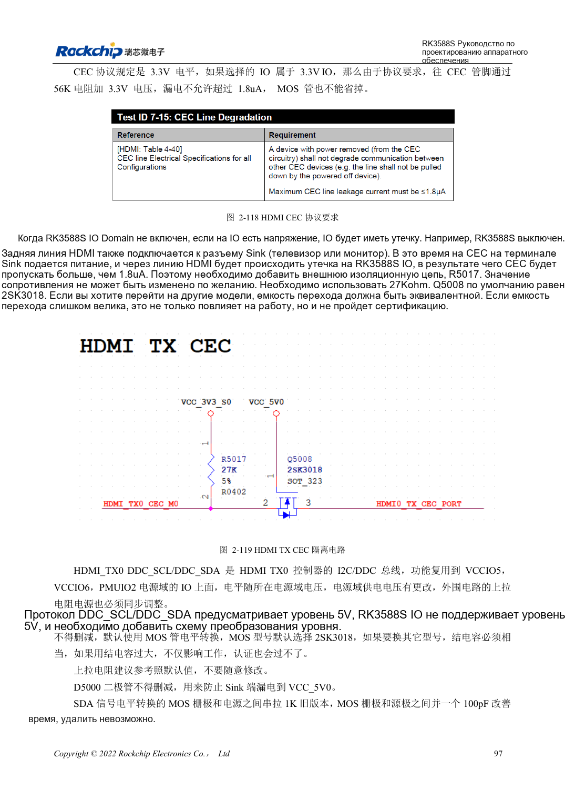

<!-- rk3588s-hardware-v12-20261109 -->

# HDMI TX RK3588S: FRL, TMDS и совместимость

Основа — китайский RK3588S Hardware Design Guide V1.2 (2023-12-14), для проверки схем и PCB. Носители CM7S проектируют по интерфейсам модуля; Sige7S подходит для оценки ПО и периферии. Возможности SoC не равны разъёмам платы. Проверяйте SDK/BSP, ядро, ревизию, прошивку и мультиплексирование. Значения взяты из источника, не из измерений ArmSoM.

**RK3588S Hardware Design Guide V1.2 (2023-12-14), CN** · §2.3.8.1; §3.4.6

## FRL и TMDS требуют разных состояний

HDMI2.1 использует FRL, совместимость с HDMI2.0 и ниже — TMDS. Эталон включает 220nF и переключаемое смещение, для TMDS — 590Ω совместно с приёмником. Важны выключенное состояние MOS и паразитная ёмкость. Появление картинки не позволяет удалять управление. Общий PHY HDMI/eDP ограничивает одновременность.

## Проверьте управление и высокую скорость

REXT — 8.2kΩ, 1%. DDC требует преобразования 5V, CEC TX — эталон 27kΩ и изоляцию выключенного IO. Pin18 разъёма: 4.8–5.3V. ESD HDMI2.1 ≤0.2pF. Проверяют hot-plug, выключенное подключение, дисплеи и кабели. Историческая отметка отсутствия поддержки относится к версии источника, не ко всем BSP.

## 590Ω и 499Ω требуют уточнения

Текст TMDS на странице 108 и разводка на странице 220 задают 590Ω, таблица 2-24 на странице 114 — 499Ω. Не устраняйте расхождение молча. До выпуска BOM уточните эталонную схему, конфигурацию PHY и рекомендации производителя. HDMI/eDP Combo один; остаточные обозначения TX1 не подтверждают второй интерфейс.

## Параметры и проверочная таблица

| Параметр | Значение источника |
| --- | --- |
| Связь/смещение TX | 220nF; 590Ω (PDF108/220) и 499Ω (PDF114) |
| REXT | 8.2kΩ ±1% |
| PCB: импеданс/длина | 100Ω ±10% / <4in |
| Переходы/зазор | Лучше без via / ≥7× ширина трассы |

## Исходные рисунки

Соответствующее английское руководство для этой партии не найдено. Все четыре версии используют снимки китайского оригинала с локализованными подписями. Откройте изображение в полном разрешении; текст и таблицы можно копировать. Номера относятся к физическим страницам PDF.

Китайский оригинал · PDF 108 · 2-112

Китайский оригинал · PDF 112 · 2-119

## Разработка с ArmSoM

CM7S подходит для собственного носителя: сначала определите встроенные питание, DDR и загрузку, затем проектируйте за пределами разъёмов. Sige7S служит базой оценки ПО и периферии. Для обоих изделий проверяйте вывод интерфейсов, контакты, уровни, образы и охлаждение по нужной ревизии. Схема SoC не является схемой подключения изделия.

- [ArmSoM CM7S](https://www.armsom.org/cm7s) · [CM7S Docs](https://docs.armsom.org/armsom-cm7s)
- [ArmSoM Sige7S](https://www.armsom.org/sige7s) · [Sige7S Docs](https://docs.armsom.org/armsom-sige7s)

## Читайте далее

- [RK3588S: 30 тем аппаратного проектирования](/ru/articles/rk3588s-hardware-design-series/)
- [RK3588S и RK3588S2: PHY камер и совместимость](/ru/articles/rk3588s-rk3588s2-hardware-differences/)
- [Дисплеи MIPI RK3588S: D-PHY, C-PHY и панели](/ru/articles/rk3588s-mipi-display-hardware/)
