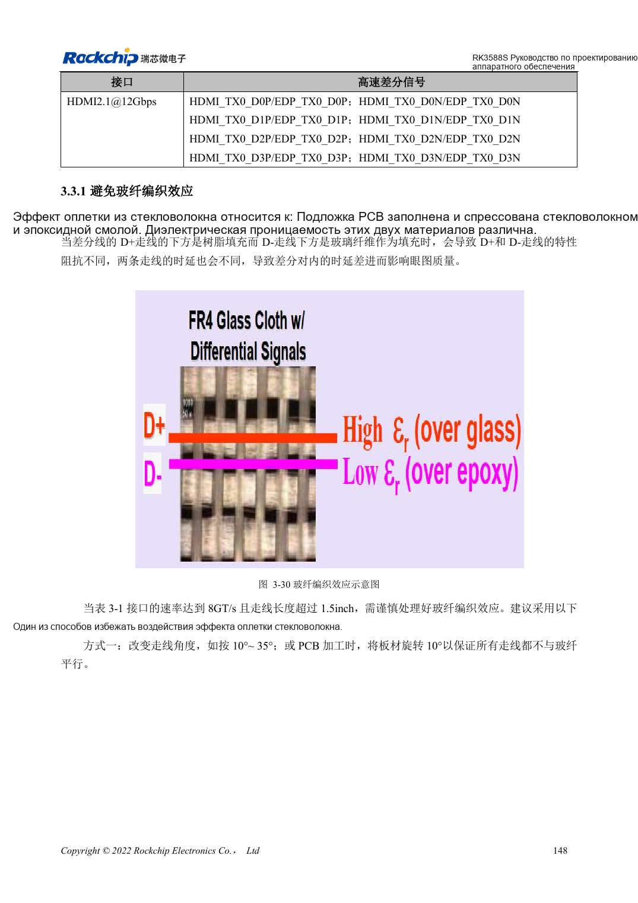
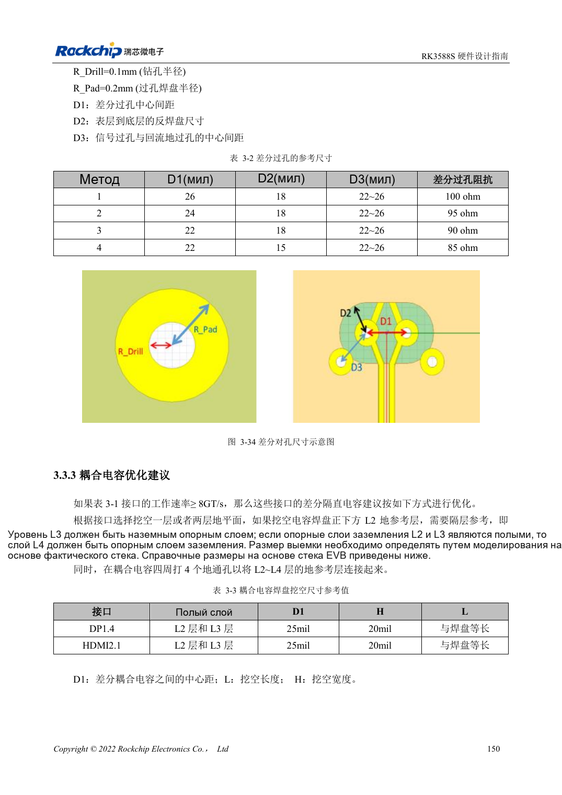
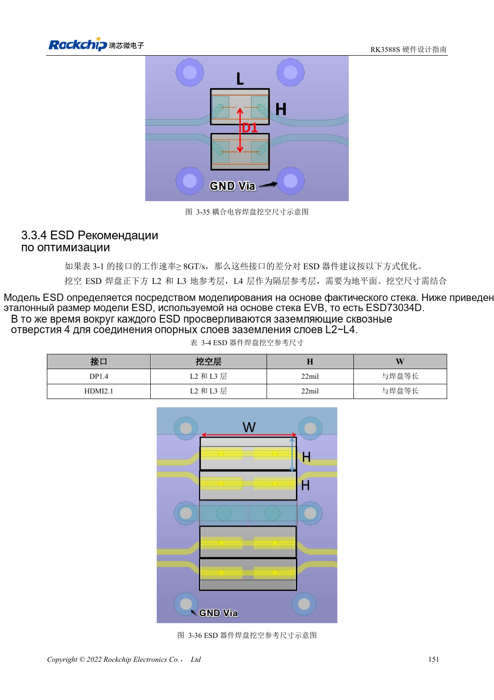

<!-- rk3588s-hardware-v12-20261109 -->

# Высокоскоростная PCB RK3588S: площадки и переходы от 8GT/s

Основа — китайский RK3588S Hardware Design Guide V1.2 (2023-12-14), для проверки схем и PCB. Носители CM7S проектируют по интерфейсам модуля; Sige7S подходит для оценки ПО и периферии. Возможности SoC не равны разъёмам платы. Проверяйте SDK/BSP, ядро, ревизию, прошивку и мультиплексирование. Значения взяты из источника, не из измерений ArmSoM.

**RK3588S Hardware Design Guide V1.2 (2023-12-14), CN** · §3.2–3.3

## Определите реальные быстрые каналы

Таблица 3-1 перечисляет DP1.4 8.1Gbps и HDMI2.1 12Gbps. Правила PCIe3.0 для RK3588 не добавляют эту функцию RK3588S. При ≥8GT/s и длине >1.5in оцените стеклоткань; один вариант — угол 10°–35°. Эталонные радиусы отверстия и площадки: 0.1mm и 0.2mm. Для другого стека нужна новая симуляция.

## Сохраните возврат тока после вырезов

Если под конденсатором убран L2, землю даёт L3; при вырезе L2/L3 — L4, со связью земель рядом. Размеры относятся к EVB и его деталям. Для высокоскоростных линий длиннее 1.5in учитывают стеклоткань, например поворот трасс. Модуль, носитель и разъём оценивают как единый канал.

## Параметры и проверочная таблица

| Параметр | Значение источника |
| --- | --- |
| Проверка стеклоткани | 8GT/s и длина >1.5in |
| Пример угла | 10°–35° |
| Радиусы via | Отверстие 0.1mm; площадка 0.2mm |

## Исходные рисунки

Соответствующее английское руководство для этой партии не найдено. Все четыре версии используют снимки китайского оригинала с локализованными подписями. Откройте изображение в полном разрешении; текст и таблицы можно копировать. Номера относятся к физическим страницам PDF.

Китайский оригинал · PDF 163 · 3-30

Китайский оригинал · PDF 165 · 3-34

Китайский оригинал · PDF 166 · 3-36

## Разработка с ArmSoM

CM7S подходит для собственного носителя: сначала определите встроенные питание, DDR и загрузку, затем проектируйте за пределами разъёмов. Sige7S служит базой оценки ПО и периферии. Для обоих изделий проверяйте вывод интерфейсов, контакты, уровни, образы и охлаждение по нужной ревизии. Схема SoC не является схемой подключения изделия.

- [ArmSoM CM7S](https://www.armsom.org/cm7s) · [CM7S Docs](https://docs.armsom.org/armsom-cm7s)
- [ArmSoM Sige7S](https://www.armsom.org/sige7s) · [Sige7S Docs](https://docs.armsom.org/armsom-sige7s)

## Читайте далее

- [RK3588S: 30 тем аппаратного проектирования](/ru/articles/rk3588s-hardware-design-series/)
- [Стек и fanout RK3588S: HDI и сквозные переходы](/ru/articles/rk3588s-pcb-stackup-fanout/)
- [Питание PCB и PDN RK3588S: медь, возврат и развязка](/ru/articles/rk3588s-power-pcb-pdn-design/)
