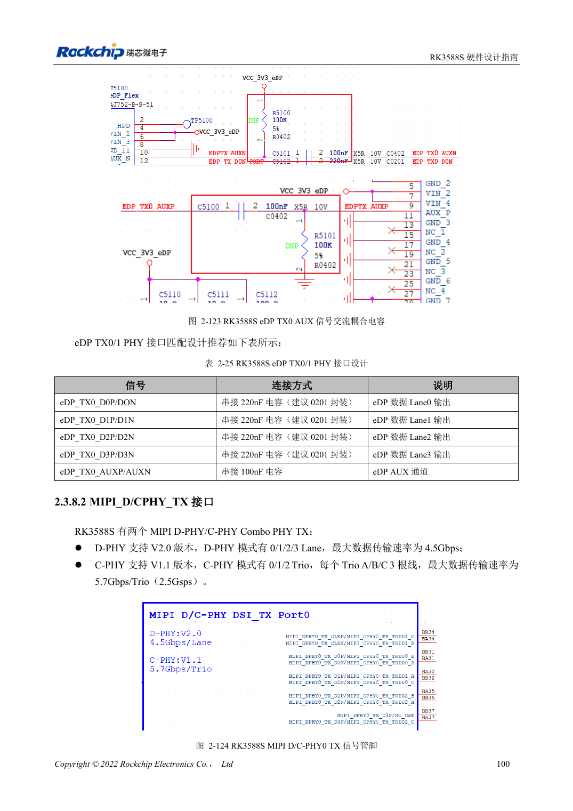
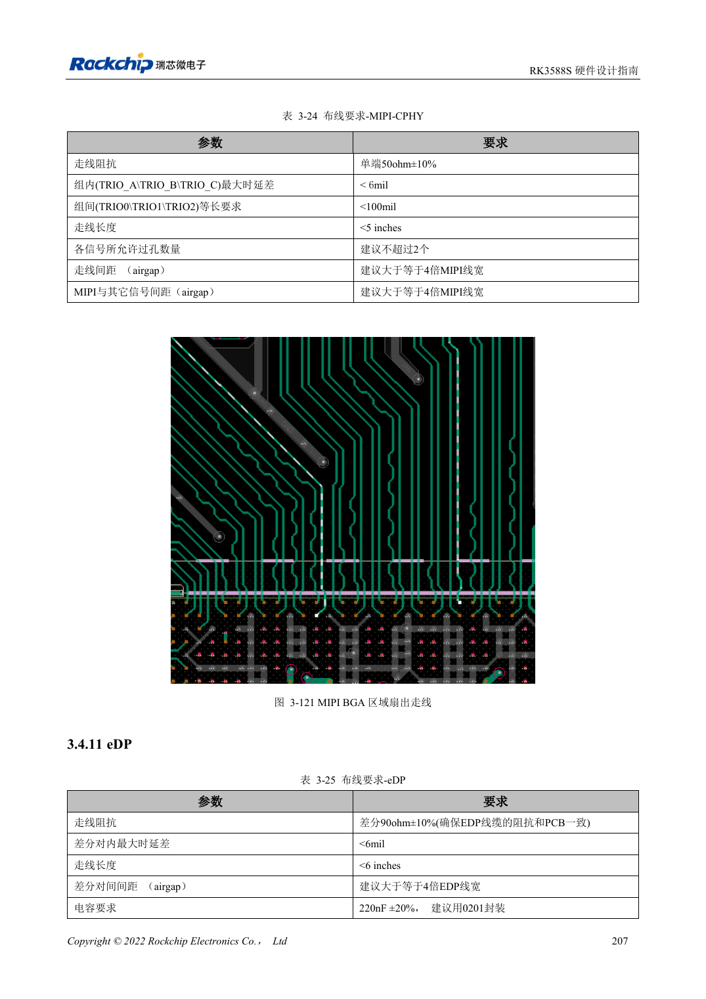

<!-- rk3588s-hardware-v12-20261109 -->

# Дисплеи MIPI RK3588S: D-PHY, C-PHY и панели

Основа — китайский RK3588S Hardware Design Guide V1.2 (2023-12-14), для проверки схем и PCB. Носители CM7S проектируют по интерфейсам модуля; Sige7S подходит для оценки ПО и периферии. Возможности SoC не равны разъёмам платы. Проверяйте SDK/BSP, ядро, ревизию, прошивку и мультиплексирование. Значения взяты из источника, не из измерений ArmSoM.

**RK3588S Hardware Design Guide V1.2 (2023-12-14), CN** · §2.3.8.2; §3.4.10; §3.4.21

## Lane и Trio проектируют отдельно

Два D/C Combo PHY предоставляют четыре двухпроводных Lane D-PHY либо три Trio A/B/C C-PHY. TX/RX одного PHY должны оба быть D-PHY или C-PHY. Сначала проверяют протокол панели, число Lane/Trio и тайминги.

## Панели нужны не только данные

Питание подсветки, enable, reset, I2C касания и прерывание согласуют по напряжению и порядку. Дифференциальный D-PHY и однопроводный C-PHY требуют разных DRC. Проверяют инициализацию на реальном BSP, изменение яркости, сон, помехи касания и длительное отображение.

## Параметры и проверочная таблица

| Параметр | Значение источника |
| --- | --- |
| Скорость D-PHY источника | 4.5Gbps/lane |
| Скорость C-PHY источника | 5.7Gbps/trio |
| Импеданс C-PHY | 50Ω ±10% несимметрично |
| C-PHY внутри/между тройками | <6mil / <100mil |
| Длина C-PHY | <5in |

## Исходные рисунки

Соответствующее английское руководство для этой партии не найдено. Все четыре версии используют снимки китайского оригинала с локализованными подписями. Откройте изображение в полном разрешении; текст и таблицы можно копировать. Номера относятся к физическим страницам PDF.

Китайский оригинал · PDF 115 · 2-124

Китайский оригинал · PDF 222 · 3-121

## Разработка с ArmSoM

CM7S подходит для собственного носителя: сначала определите встроенные питание, DDR и загрузку, затем проектируйте за пределами разъёмов. Sige7S служит базой оценки ПО и периферии. Для обоих изделий проверяйте вывод интерфейсов, контакты, уровни, образы и охлаждение по нужной ревизии. Схема SoC не является схемой подключения изделия.

- [ArmSoM CM7S](https://www.armsom.org/cm7s) · [CM7S Docs](https://docs.armsom.org/armsom-cm7s)
- [ArmSoM Sige7S](https://www.armsom.org/sige7s) · [Sige7S Docs](https://docs.armsom.org/armsom-sige7s)

## Читайте далее

- [RK3588S: 30 тем аппаратного проектирования](/ru/articles/rk3588s-hardware-design-series/)
- [HDMI TX RK3588S: FRL, TMDS и совместимость](/ru/articles/rk3588s-hdmi-tx-hardware-design/)
- [DP и eDP RK3588S: PHY, AUX и развязка](/ru/articles/rk3588s-dp-edp-hardware-design/)
