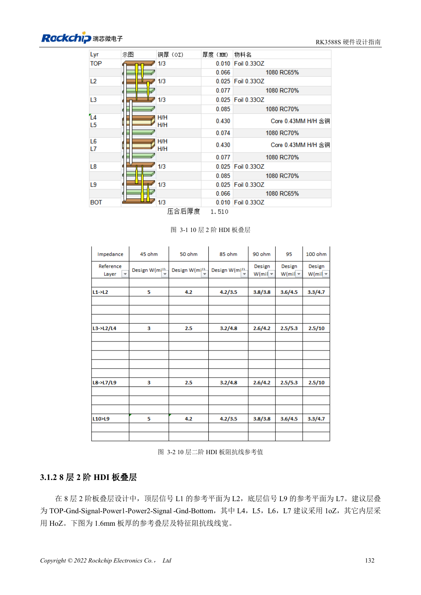
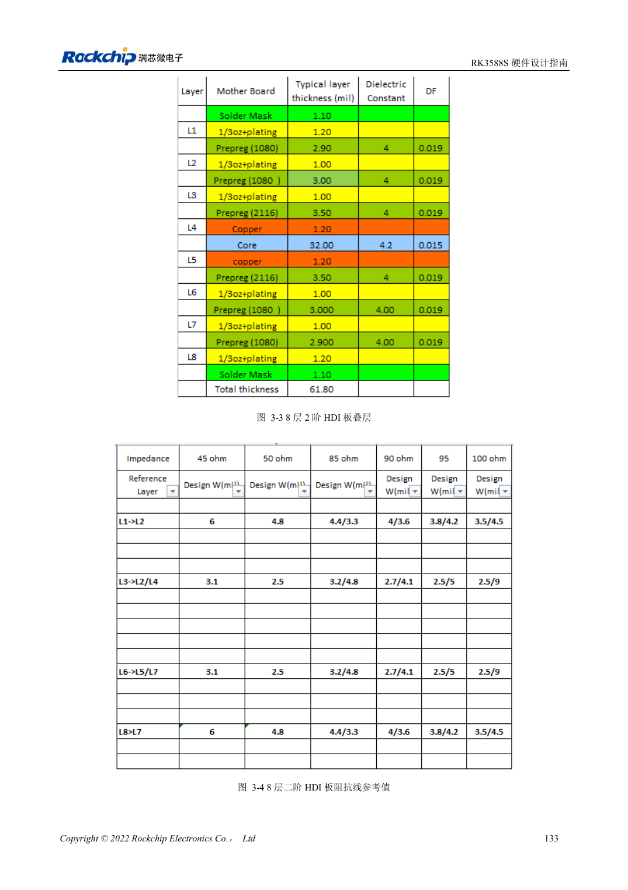
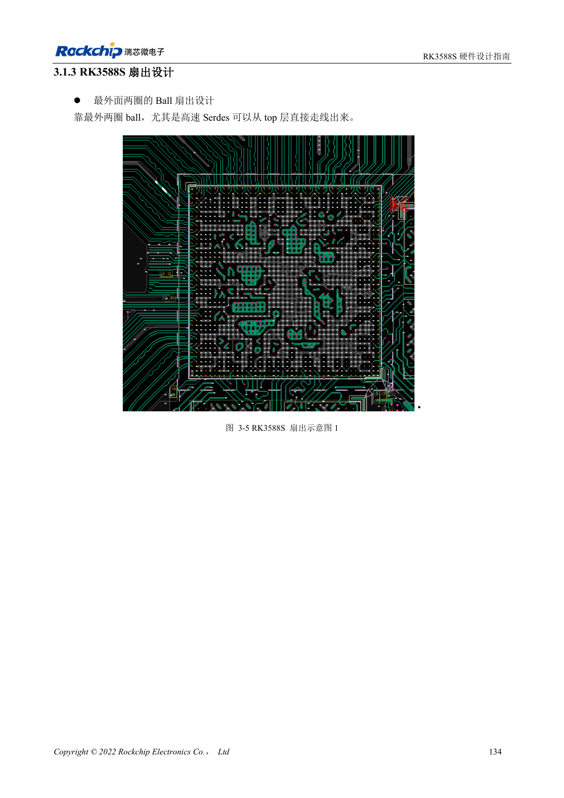

<!-- rk3588s-hardware-v12-20261109 -->

# Стек и fanout RK3588S: HDI и сквозные переходы

Основа — китайский RK3588S Hardware Design Guide V1.2 (2023-12-14), для проверки схем и PCB. Носители CM7S проектируют по интерфейсам модуля; Sige7S подходит для оценки ПО и периферии. Возможности SoC не равны разъёмам платы. Проверяйте SDK/BSP, ядро, ревизию, прошивку и мультиплексирование. Значения взяты из источника, не из измерений ArmSoM.

**RK3588S Hardware Design Guide V1.2 (2023-12-14), CN** · §3.1–3.2

## Оба варианта — HDI второго порядка

Руководство RK3588S предлагает 10- и 8-слойные HDI второго порядка, не 8-слойную плату RK3588 со сквозными отверстиями. Эталонная толщина 1.6mm; сигналы соседствуют с землёй, структура симметрична. На странице 147 низ восьмислойной платы ошибочно назван L9. Проверяйте рисунок и данные изготовителя.

## Разделяйте BGA и носитель

Два внешних ряда шаров можно вывести на верхнем слое; быстрые интерфейсы требуют меньше переходов. Ширины, microvia, скрытые переходы и antipad определяются технологией и импедансом. Носитель CM7S разводят от разъёмов, не копируя BGA RK3588S. Проверяйте полный канал модуля, разъёма и носителя.

## Параметры и проверочная таблица

| Параметр | Значение источника |
| --- | --- |
| Эталонные стеки | 10-слойный / 8-слойный HDI второго порядка |
| Пример толщины платы | 1.6mm |
| Область длины трасс | PCB + переходы + корпус |

## Исходные рисунки

Соответствующее английское руководство для этой партии не найдено. Все четыре версии используют снимки китайского оригинала с локализованными подписями. Откройте изображение в полном разрешении; текст и таблицы можно копировать. Номера относятся к физическим страницам PDF.

Китайский оригинал · PDF 147 · 3-1

Китайский оригинал · PDF 148 · 3-3

Китайский оригинал · PDF 149 · 3-5

## Разработка с ArmSoM

CM7S подходит для собственного носителя: сначала определите встроенные питание, DDR и загрузку, затем проектируйте за пределами разъёмов. Sige7S служит базой оценки ПО и периферии. Для обоих изделий проверяйте вывод интерфейсов, контакты, уровни, образы и охлаждение по нужной ревизии. Схема SoC не является схемой подключения изделия.

- [ArmSoM CM7S](https://www.armsom.org/cm7s) · [CM7S Docs](https://docs.armsom.org/armsom-cm7s)
- [ArmSoM Sige7S](https://www.armsom.org/sige7s) · [Sige7S Docs](https://docs.armsom.org/armsom-sige7s)

## Читайте далее

- [RK3588S: 30 тем аппаратного проектирования](/ru/articles/rk3588s-hardware-design-series/)
- [Распределение UART, SPI, CAN, I2C и PWM RK3588S](/ru/articles/rk3588s-serial-control-hardware/)
- [Высокоскоростная PCB RK3588S: площадки и переходы от 8GT/s](/ru/articles/rk3588s-high-speed-pcb-review/)
