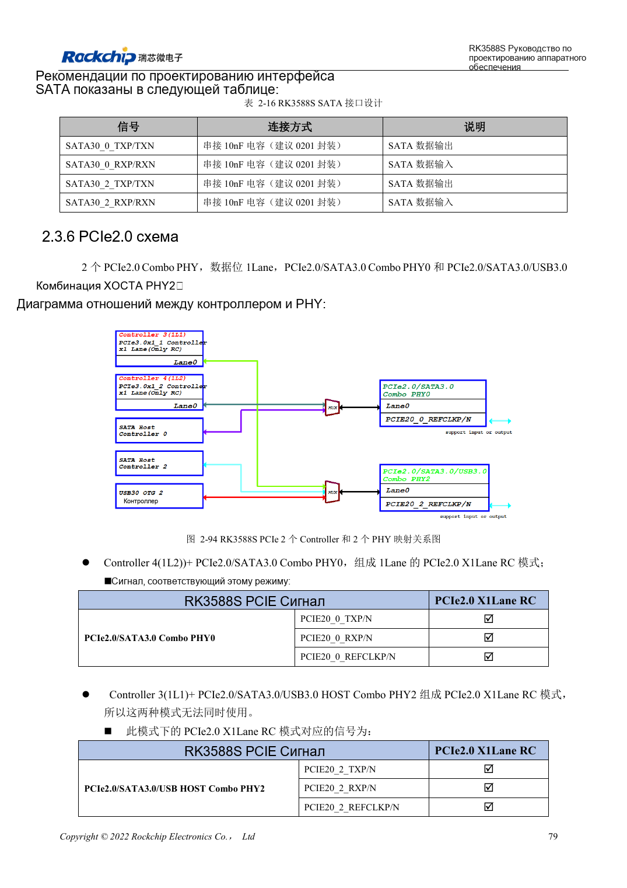
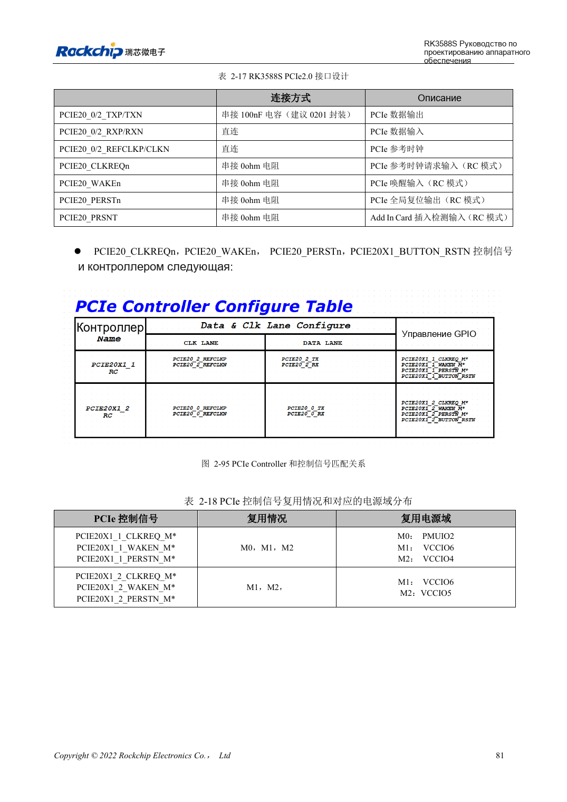

<!-- rk3588s-hardware-v12-20261109 -->

# PCIe RK3588S: линии, опорные такты и питание

Основа — китайский RK3588S Hardware Design Guide V1.2 (2023-12-14), для проверки схем и PCB. Носители CM7S проектируют по интерфейсам модуля; Sige7S подходит для оценки ПО и периферии. Возможности SoC не равны разъёмам платы. Проверяйте SDK/BSP, ядро, ревизию, прошивку и мультиплексирование. Значения взяты из источника, не из измерений ArmSoM.

**RK3588S Hardware Design Guide V1.2 (2023-12-14), CN** · §2.3.6; §3.4.4

## Проектируйте для PCIe2.0 x1

Глава RK3588S задаёт два RC PCIe2.0 x1 на PHY0/2, а не PCIe3.0 x4 от RK3588. На странице 95 осталось упоминание PCIe3.0; ограничение совместной работы на странице 94 недостаточно определено. Используйте схему распределения без обещания одновременной работы портов; уточняйте TRM и SDK. REFCLK по умолчанию направлен к EP.

## Управление и полный канал

CLKREQn/WAKEn требуют функциональных выводов одной группы Mx. PERSTn допускает GPIO; функциональный вывод должен принадлежать той же группе. Уровень управления стандартного слота 3.3V требует подходящего преобразования. Связь 100nF, данные 85Ω, REFCLK 100Ω. Проверяйте модуль, разъём и носитель вместе: холодный старт, скорость, пробуждение и длительный обмен.

## Параметры и проверочная таблица

| Параметр | Значение источника |
| --- | --- |
| Контроллеры PCIe | 2 × PCIe2.0 x1 RC |
| Импеданс данных PCIe | 85Ω ±10% |
| Импеданс REFCLK | 100Ω ±10% |
| Связь PCIe | 100nF ±20% |
| Разница пары данных / REFCLK | <6mil / <12mil |
| Длина/переходы | <6in / рекомендуется ≤2 |

## Исходные рисунки

Соответствующее английское руководство для этой партии не найдено. Все четыре версии используют снимки китайского оригинала с локализованными подписями. Откройте изображение в полном разрешении; текст и таблицы можно копировать. Номера относятся к физическим страницам PDF.

Китайский оригинал · PDF 94 · 2-94

Китайский оригинал · PDF 96 · 2-95

## Разработка с ArmSoM

CM7S подходит для собственного носителя: сначала определите встроенные питание, DDR и загрузку, затем проектируйте за пределами разъёмов. Sige7S служит базой оценки ПО и периферии. Для обоих изделий проверяйте вывод интерфейсов, контакты, уровни, образы и охлаждение по нужной ревизии. Схема SoC не является схемой подключения изделия.

- [ArmSoM CM7S](https://www.armsom.org/cm7s) · [CM7S Docs](https://docs.armsom.org/armsom-cm7s)
- [ArmSoM Sige7S](https://www.armsom.org/sige7s) · [Sige7S Docs](https://docs.armsom.org/armsom-sige7s)

## Читайте далее

- [RK3588S: 30 тем аппаратного проектирования](/ru/articles/rk3588s-hardware-design-series/)
- [SATA RK3588S: три контроллера и общие PHY](/ru/articles/rk3588s-sata-hardware-design/)
- [Камеры RK3588S: CSI, D/C PHY и CIF](/ru/articles/rk3588s-camera-hardware-design/)
