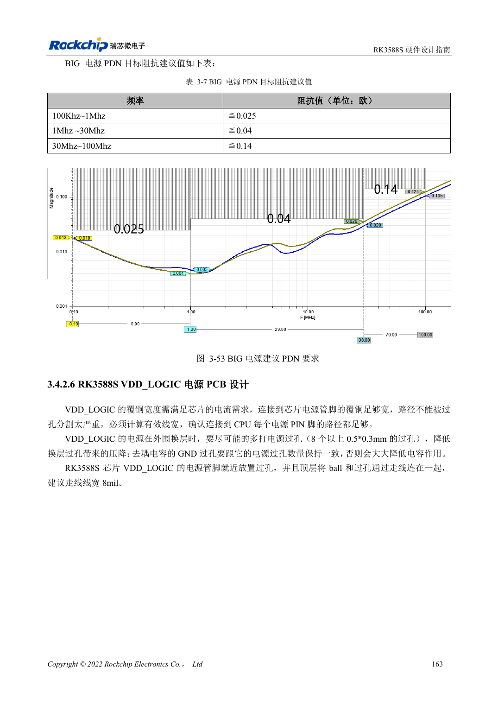

<!-- rk3588s-hardware-v12-20261109 -->

# Питание PCB и PDN RK3588S: медь, возврат и развязка

Основа — китайский RK3588S Hardware Design Guide V1.2 (2023-12-14), для проверки схем и PCB. Носители CM7S проектируют по интерфейсам модуля; Sige7S подходит для оценки ПО и периферии. Возможности SoC не равны разъёмам платы. Проверяйте SDK/BSP, ядро, ревизию, прошивку и мультиплексирование. Значения взяты из источника, не из измерений ArmSoM.

**RK3588S Hardware Design Guide V1.2 (2023-12-14), CN** · §3.4.2

## Одного количества конденсаторов мало

Число земляных переходов силовых конденсаторов Buck должно соответствовать положительной стороне. Проверяют эффективную ширину меди и сужения после переходов; избегают термобарьерных шеек на критическом питании. Размещение RK806 балансирует путь и нагрев, не только расстояние.

## Проверяйте импеданс по диапазонам

Таблица 3-7 задаёт частотно-зависимые цели BIG PDN, а не один номинал конденсатора. Модель включает регулятор, плоскости, переходы, корпус и ESR/ESL. Это рекомендации эталона, не измерения ArmSoM. Измеряйте провал и звон при скачке нагрузки вместе с температурой, частотой и ошибками.

## Параметры и проверочная таблица

| Параметр | Значение источника |
| --- | --- |
| BIG PDN 100kHz–1MHz | ≤0.025Ω |
| BIG PDN 1–30MHz | ≤0.04Ω |
| BIG PDN 30–100MHz | ≤0.14Ω |
| Ток via (<1V) | 0.5A; пример via 0.5×0.3mm |

## Исходные рисунки

Соответствующее английское руководство для этой партии не найдено. Все четыре версии используют снимки китайского оригинала с локализованными подписями. Откройте изображение в полном разрешении; текст и таблицы можно копировать. Номера относятся к физическим страницам PDF.

Китайский оригинал · PDF 178 · 3-53

## Разработка с ArmSoM

CM7S подходит для собственного носителя: сначала определите встроенные питание, DDR и загрузку, затем проектируйте за пределами разъёмов. Sige7S служит базой оценки ПО и периферии. Для обоих изделий проверяйте вывод интерфейсов, контакты, уровни, образы и охлаждение по нужной ревизии. Схема SoC не является схемой подключения изделия.

- [ArmSoM CM7S](https://www.armsom.org/cm7s) · [CM7S Docs](https://docs.armsom.org/armsom-cm7s)
- [ArmSoM Sige7S](https://www.armsom.org/sige7s) · [Sige7S Docs](https://docs.armsom.org/armsom-sige7s)

## Читайте далее

- [RK3588S: 30 тем аппаратного проектирования](/ru/articles/rk3588s-hardware-design-series/)
- [Высокоскоростная PCB RK3588S: площадки и переходы от 8GT/s](/ru/articles/rk3588s-high-speed-pcb-review/)
- [Тепловой расчёт RK3588S: эталон и проверка системы](/ru/articles/rk3588s-thermal-hardware-design/)
