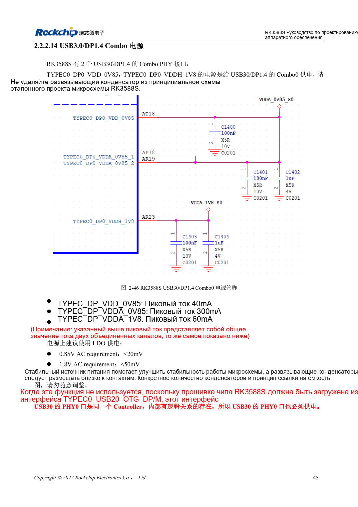
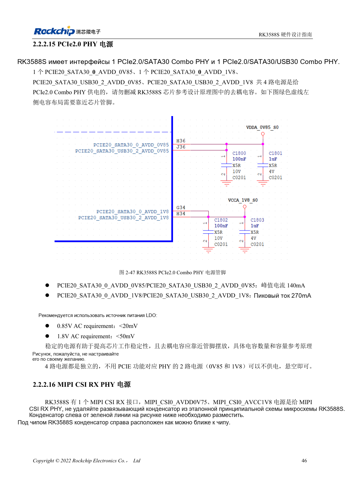

<!-- rk3588s-hardware-v12-20261109 -->

# Питание RK3588S: запуск и неиспользуемые PHY

Основа — китайский RK3588S Hardware Design Guide V1.2 (2023-12-14), для проверки схем и PCB. Носители CM7S проектируют по интерфейсам модуля; Sige7S подходит для оценки ПО и периферии. Возможности SoC не равны разъёмам платы. Проверяйте SDK/BSP, ядро, ревизию, прошивку и мультиплексирование. Значения взяты из источника, не из измерений ArmSoM.

**RK3588S Hardware Design Guide V1.2 (2023-12-14), CN** · §2.2.1–2.2.2

## Неиспользуемая функция не отменяет питание

Таблица 2-9 требует начального питания CPU, GPU, NPU, VDENC, DDR, PMU, SARADC, OTP, EMMCIO, VCCIO2, USB2 PHY и TYPEC0. Для каждой цепи фиксируют запуск, работу, сон, нагрузку, пульсации и развязку. Программное отключение не отменяет стартового питания.

## Проверяйте каждый Combo PHY

RK3588S имеет PHY0 PCIe2.0/SATA3.0 и PHY2 PCIe2.0/SATA3.0/USB3.0, каждый с питанием 0.85V и 1.8V. Источник допускает отключение неиспользуемого PHY, но сначала исключите его функции SATA/USB. Для TYPEC0 действует отдельное обязательное питание при запуске. Названия питания MIPI и описание пикового тока расходятся: сверяйте схему.

## Параметры и проверочная таблица

| Параметр | Значение источника |
| --- | --- |
| Пульсации аналогового PCIe2.0 | 0.85V: <20mV; 1.8V: <50mV |
| Питание PHY | PHY0 / PHY2: 0.85V + 1.8V |
| Обязательно при запуске | TYPEC0_DP0; USB2 PHY; таблица 2-9 |

## Исходные рисунки

Соответствующее английское руководство для этой партии не найдено. Все четыре версии используют снимки китайского оригинала с локализованными подписями. Откройте изображение в полном разрешении; текст и таблицы можно копировать. Номера относятся к физическим страницам PDF.

Китайский оригинал · PDF 60 · 2-46

Китайский оригинал · PDF 61 · 2-47

## Разработка с ArmSoM

CM7S подходит для собственного носителя: сначала определите встроенные питание, DDR и загрузку, затем проектируйте за пределами разъёмов. Sige7S служит базой оценки ПО и периферии. Для обоих изделий проверяйте вывод интерфейсов, контакты, уровни, образы и охлаждение по нужной ревизии. Схема SoC не является схемой подключения изделия.

- [ArmSoM CM7S](https://www.armsom.org/cm7s) · [CM7S Docs](https://docs.armsom.org/armsom-cm7s)
- [ArmSoM Sige7S](https://www.armsom.org/sige7s) · [Sige7S Docs](https://docs.armsom.org/armsom-sige7s)

## Читайте далее

- [RK3588S: 30 тем аппаратного проектирования](/ru/articles/rk3588s-hardware-design-series/)
- [Загрузка RK3588S: Maskrom, JTAG и UART](/ru/articles/rk3588s-boot-debug-hardware/)
- [Порядок питания RK3588S: RESETn и S0/S3](/ru/articles/rk3588s-power-sequencing-design/)
