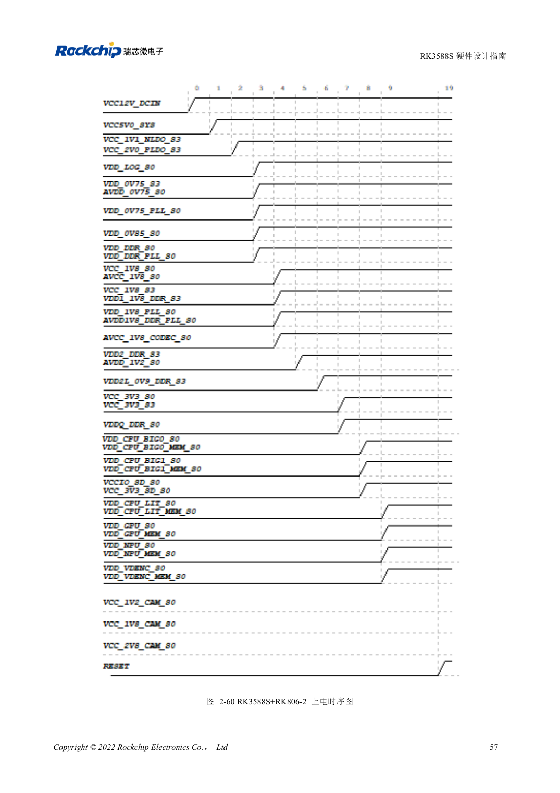

<!-- rk3588s-hardware-v12-20261109 -->

# Порядок питания RK3588S: RESETn и S0/S3

Основа — китайский RK3588S Hardware Design Guide V1.2 (2023-12-14), для проверки схем и PCB. Носители CM7S проектируют по интерфейсам модуля; Sige7S подходит для оценки ПО и периферии. Возможности SoC не равны разъёмам платы. Проверяйте SDK/BSP, ядро, ревизию, прошивку и мультиплексирование. Значения взяты из источника, не из измерений ArmSoM.

**RK3588S Hardware Design Guide V1.2 (2023-12-14), CN** · §2.1.10.3; §2.2.1.2–2.2.1.3

## Приоритет конкретной последовательности

Принцип меньшего напряжения первым не заменяет порядок MIPI_D/C_PHY_VDD → 1.8V → 1.2V. Используйте дерево питания, не сортировку чисел. Снимайте RESETn ≥1ms после последней стабилизации с учётом периферии. При выключении сначала активируйте RESETn, затем снимайте питание.

## Проверьте сон и обратное питание

Фиксированный вывод 1.8V и выбираемое питание домена должны вместе относиться к S0 либо S3. Измеряйте холодный старт, тёплый сброс, сон и выключение, проверяя обратное питание от USB, HDMI и контроллеров. Носитель соблюдает вход и enable модуля, не повторяя внутренние питания SoC.

## Параметры и проверочная таблица

| Параметр | Значение источника |
| --- | --- |
| Снятие сброса | ≥1ms после стабилизации последней шины |
| Выключение питания | RESETn низкий → питание выключено |
| Эталон MIPI D/C | VDD → 1.8V → 1.2V |

## Исходные рисунки

Соответствующее английское руководство для этой партии не найдено. Все четыре версии используют снимки китайского оригинала с локализованными подписями. Откройте изображение в полном разрешении; текст и таблицы можно копировать. Номера относятся к физическим страницам PDF.

Китайский оригинал · PDF 72 · 2-60

## Разработка с ArmSoM

CM7S подходит для собственного носителя: сначала определите встроенные питание, DDR и загрузку, затем проектируйте за пределами разъёмов. Sige7S служит базой оценки ПО и периферии. Для обоих изделий проверяйте вывод интерфейсов, контакты, уровни, образы и охлаждение по нужной ревизии. Схема SoC не является схемой подключения изделия.

- [ArmSoM CM7S](https://www.armsom.org/cm7s) · [CM7S Docs](https://docs.armsom.org/armsom-cm7s)
- [ArmSoM Sige7S](https://www.armsom.org/sige7s) · [Sige7S Docs](https://docs.armsom.org/armsom-sige7s)

## Читайте далее

- [RK3588S: 30 тем аппаратного проектирования](/ru/articles/rk3588s-hardware-design-series/)
- [Питание RK3588S: запуск и неиспользуемые PHY](/ru/articles/rk3588s-power-rail-planning/)
- [RK3588S и RK806: один или два PMIC](/ru/articles/rk3588s-rk806-pmic-design/)
