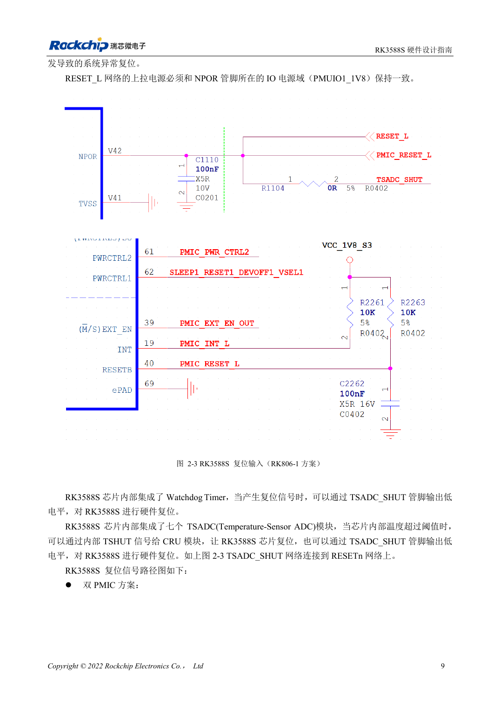
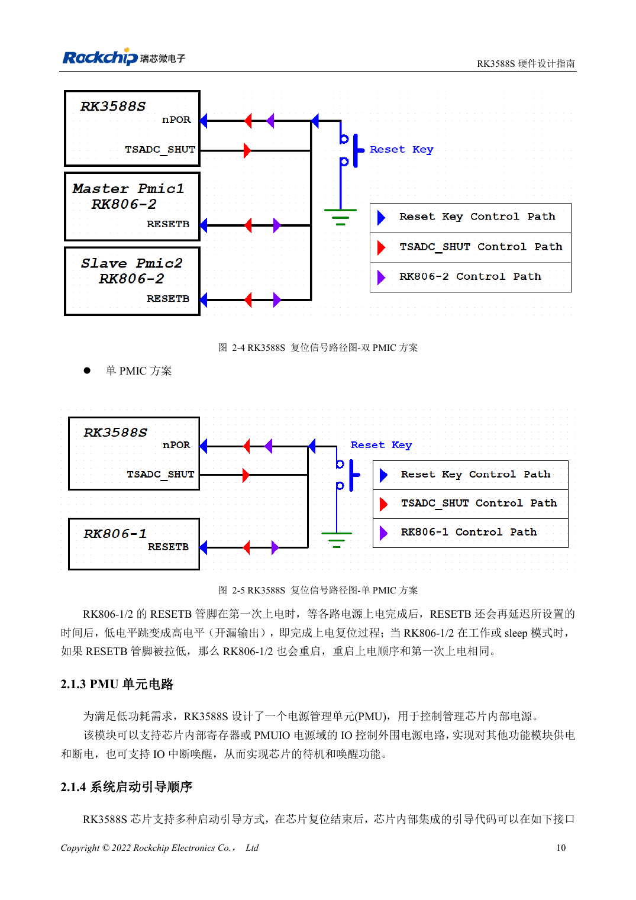

<!-- rk3588s-hardware-v12-20261109 -->

# Сброс, watchdog и термозащита RK3588S

Основа — китайский RK3588S Hardware Design Guide V1.2 (2023-12-14), для проверки схем и PCB. Носители CM7S проектируют по интерфейсам модуля; Sige7S подходит для оценки ПО и периферии. Возможности SoC не равны разъёмам платы. Проверяйте SDK/BSP, ядро, ревизию, прошивку и мультиплексирование. Значения взяты из источника, не из измерений ArmSoM.

**RK3588S Hardware Design Guide V1.2 (2023-12-14), CN** · §2.1.2; §3.4.1

## Импульс сброса отличается от задержки запуска

NPOR_u на V42 активен нулём. Указаны 100 периодов 24MHz и минимум 4μs; 100/24MHz≈4.167μs, поэтому ровно 4.000μs недостаточно. 100nF ставят у вывода, подтяжку — к PMUIO1_1V8. Ожидание ≥1ms после стабилизации последнего питания — отдельное требование.

## Проверьте всю сеть сброса

RK806-1/2 отпускает RESETB после стартовой задержки; ноль во время работы или сна повторяет последовательность питания. Watchdog и семь TSADC также участвуют в защите. Одновременно наблюдайте RESETn, питание и UART. Путь: кнопка → TVS → 100Ω → фильтр → CPU/PMIC; сброс удаляют от DC/DC, металлических разъёмов и края.

## Параметры и проверочная таблица

| Параметр | Значение источника |
| --- | --- |
| NPOR_u | V42; активный низкий |
| Минимальный сброс | 100 циклов @24MHz ≈4.167μs |
| Фильтрующий конденсатор | 100nF |
| Подтяжка | PMUIO1_1V8 |

## Исходные рисунки

Соответствующее английское руководство для этой партии не найдено. Все четыре версии используют снимки китайского оригинала с локализованными подписями. Откройте изображение в полном разрешении; текст и таблицы можно копировать. Номера относятся к физическим страницам PDF.

Китайский оригинал · PDF 24 · 2-3

Китайский оригинал · PDF 25 · 2-5

## Разработка с ArmSoM

CM7S подходит для собственного носителя: сначала определите встроенные питание, DDR и загрузку, затем проектируйте за пределами разъёмов. Sige7S служит базой оценки ПО и периферии. Для обоих изделий проверяйте вывод интерфейсов, контакты, уровни, образы и охлаждение по нужной ревизии. Схема SoC не является схемой подключения изделия.

- [ArmSoM CM7S](https://www.armsom.org/cm7s) · [CM7S Docs](https://docs.armsom.org/armsom-cm7s)
- [ArmSoM Sige7S](https://www.armsom.org/sige7s) · [Sige7S Docs](https://docs.armsom.org/armsom-sige7s)

## Читайте далее

- [RK3588S: 30 тем аппаратного проектирования](/ru/articles/rk3588s-hardware-design-series/)
- [Тактовые цепи RK3588S: 24MHz, 32kHz и размещение](/ru/articles/rk3588s-clock-hardware-design/)
- [Загрузка RK3588S: Maskrom, JTAG и UART](/ru/articles/rk3588s-boot-debug-hardware/)
