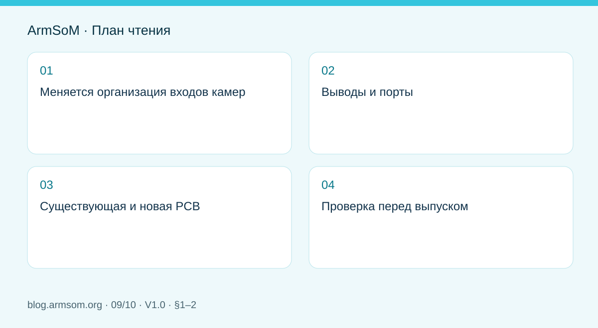
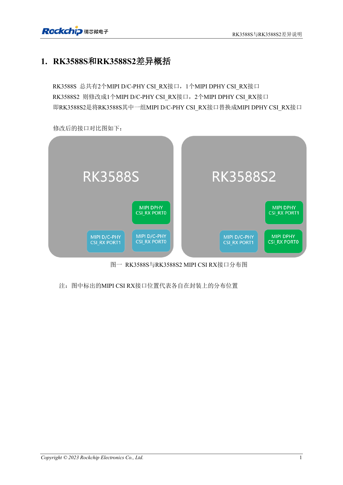

# RK3588S и RK3588S2: что проверить перед изменением платы

## Область применения и источники

Это тематическое инженерное руководство, а не постраничный перевод всего PDF. Примеры источника не являются измерениями ArmSoM. Напряжения, выводы, SDK/BSP и ядро сверяйте с фактической ревизией платы.

**Rockchip:** `RK3588S与RK3588S2差异说明_V1.0_20231214_CN.pdf` · V1.0 · §1–2

## Меняется организация входов камер

Глава 1 указывает для RK3588S два MIPI D/C-PHY CSI_RX и один DPHY. У RK3588S2 — один D/C-PHY и два DPHY. Меняются тип и расположение интерфейса, а не просто добавляется такой же порт.

Определите режим сенсора D-PHY/C-PHY, число lane и разводку разъёма. Нельзя автоматически сохранять прежние номера программных портов. Документация CM7s указывает RK3588S: этот материал не превращает модуль в продукт S2.

## Выводы и порты

| Позиция | RK3588S | RK3588S2 |
| --- | --- | --- |
| Место прежнего D/C-PHY CSI_RX PORT0 | D/C-PHY, 1×4 lane | DPHY CSI_RX PORT0, 1×4 или 2×2 lane |
| AN37/AN38 | GND | Новые MIPI_CSI0_CLK1P/MIPI_CSI0_CLK1N |
| D/C-PHY CSI_RX PORT1 | Исходный интерфейс | Функция неизменна |
| Место прежнего DPHY CSI_RX PORT0 | PORT0 | Переименован в DPHY CSI_RX PORT1 |

Изменение AN37/AN38 с земли на тактовые функции принципиально. При проверке просмотрите полный список шариков исходной таблицы, а не только имена портов.

## Существующая и новая PCB

Глава 2 требует совместимого патча Rockchip и изменения отображения интерфейсов при установке S2 на прежнюю PCB RK3588S. Для новой S2-платы нужна новая эталонная схема; документ указывает до пяти камер.

Это не обещание пяти разъёмов CM7s и не подтверждение любых сочетаний разрешений, частот и ISP. В записке нет имени патча, коммита BSP и полной таблицы одновременной работы. Получите реализацию для фактической версии ПО.

## Проверка перед выпуском

1. Установить маркировку чипа и ревизии PCB/модуля.
2. Сверить шарики, PHY, режим сенсора и монтаж.
3. Проверить патч, порты дерева устройств, такты и сброс.
4. Испытать одну камеру, затем целевую комбинацию, потери кадров и восстановление.
5. Сохранить аппаратную версию и сумму образа в производственной записи.

Замена чипа и испытания параллельных камер для статьи не выполнялись.

## Иллюстрация из источника

Китайский оригинал; соответствующая английская иллюстрация в материалах не найдена. Эталонный проект, а не схема платы ArmSoM.

`RK3588S与RK3588S2差异说明_V1.0_20231214_CN.pdf` · PDF p. 6.

## Продукты и документация

- **CM7s** — [Страница продукта](https://www.armsom.org/cm7s) · [Документация](https://docs.armsom.org/armsom-cm7s)

## Другие статьи серии

- [Запуск платы RK3576: минимальная система и проверка первого включения](/ru/articles/rk3576-hardware-bringup/)
- [Плата-носитель ArmSoM CM5: питание, загрузка и планирование интерфейсов](/ru/articles/019-cm5-carrier-production/)
- [Скоростные интерфейсы RK3576: совместная проверка схемы и PCB](/ru/articles/rk3576-high-speed-interface-design/)
- [Аппаратное проектирование RK3588S: от эталонной схемы к носителю CM7s](/ru/articles/rk3588s-cm7s-carrier-design/)
- [RK3588 для периферийного ИИ: питание, охлаждение и расширение](/ru/articles/rk3588-edge-ai-hardware-design/)
- [Проверка скоростной PCB RK3588: слои, импеданс и трассировка](/ru/articles/rk3588-high-speed-pcb-review/)
- [Аппаратная часть HMI на RK3506: выбор пути с CM1 или Forge1](/ru/articles/rk3506-industrial-hmi-hardware/)
- [Варианты RK3308: аппаратная совместимость для аудиопроектов P2 Pro](/ru/articles/rk3308-hardware-variant-compatibility/)
- [От прототипа Rockchip к серии: технологические требования и испытания](/ru/articles/rockchip-hardware-production-checklist/)
