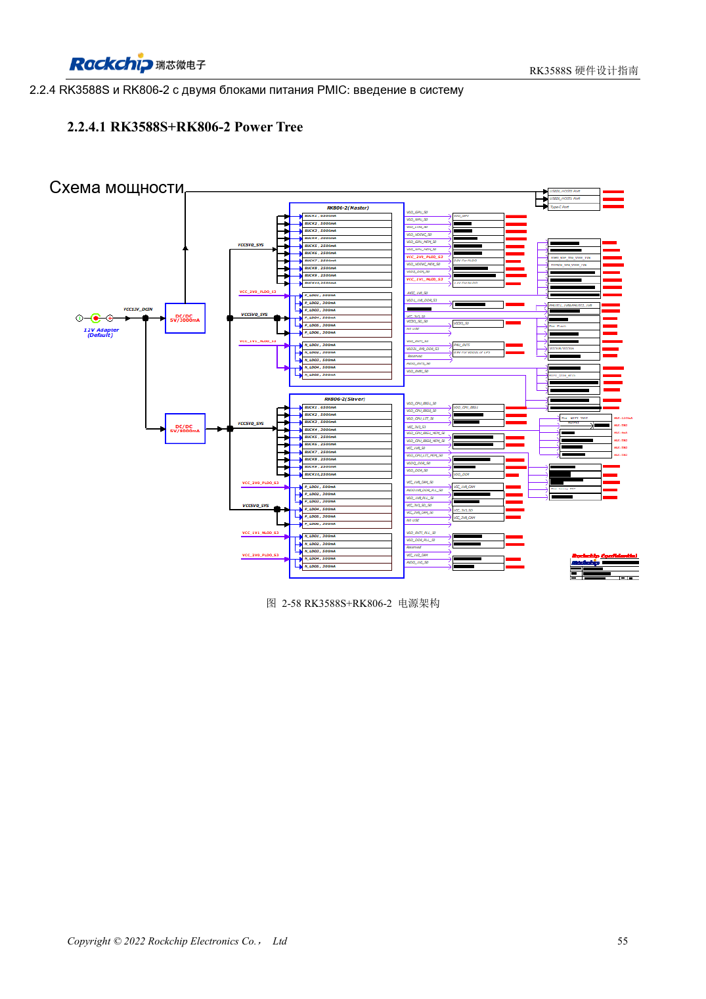
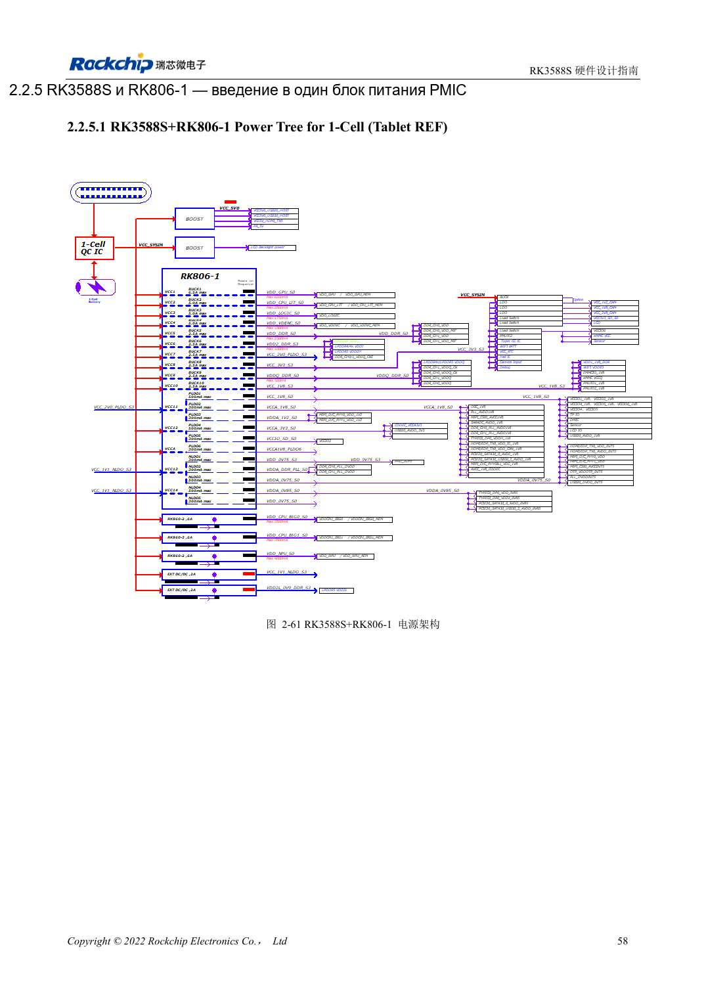

<!-- rk3588s-hardware-v12-20261109 -->

# RK3588S и RK806: один или два PMIC

Основа — китайский RK3588S Hardware Design Guide V1.2 (2023-12-14), для проверки схем и PCB. Носители CM7S проектируют по интерфейсам модуля; Sige7S подходит для оценки ПО и периферии. Возможности SoC не равны разъёмам платы. Проверяйте SDK/BSP, ядро, ревизию, прошивку и мультиплексирование. Значения взяты из источника, не из измерений ArmSoM.

**RK3588S Hardware Design Guide V1.2 (2023-12-14), CN** · §2.2.3–2.2.5

## Выберите полный эталон

Два RK806-2 и один RK806-1 с внешними источниками — разные архитектуры, а не схема без одной микросхемы. Вместе переносят выходы, напряжения, порядок, управление, сон и сброс. Вход PMIC 2.7–5.5V не является входной спецификацией платы ArmSoM.

## Синхронизация и размещение

EXT_EN задаёт ведущий/ведомый, SYNC/SYNC_CLK синхронизируют пару; VDC/PWRON/RESET соединяют по эталону. Один PMIC — ведущий с открытыми SYNC/SYNC_CLK. Важны силовые пути, земляные контуры конденсаторов и распределение нагрева. Максимальный ток не гарантируется непрерывно при любой температуре.

## Параметры и проверочная таблица

| Параметр | Значение источника |
| --- | --- |
| Вход RK806 | 2.7–5.5V |
| Корпус | 7×7mm QFN68 |
| Эталон двух PMIC | RK806-2 |
| Эталон одного PMIC | RK806-1 + внешнее питание |

## Исходные рисунки

Соответствующее английское руководство для этой партии не найдено. Все четыре версии используют снимки китайского оригинала с локализованными подписями. Откройте изображение в полном разрешении; текст и таблицы можно копировать. Номера относятся к физическим страницам PDF.

Китайский оригинал · PDF 70 · 2-58

Китайский оригинал · PDF 73 · 2-61

## Разработка с ArmSoM

CM7S подходит для собственного носителя: сначала определите встроенные питание, DDR и загрузку, затем проектируйте за пределами разъёмов. Sige7S служит базой оценки ПО и периферии. Для обоих изделий проверяйте вывод интерфейсов, контакты, уровни, образы и охлаждение по нужной ревизии. Схема SoC не является схемой подключения изделия.

- [ArmSoM CM7S](https://www.armsom.org/cm7s) · [CM7S Docs](https://docs.armsom.org/armsom-cm7s)
- [ArmSoM Sige7S](https://www.armsom.org/sige7s) · [Sige7S Docs](https://docs.armsom.org/armsom-sige7s)

## Читайте далее

- [RK3588S: 30 тем аппаратного проектирования](/ru/articles/rk3588s-hardware-design-series/)
- [Порядок питания RK3588S: RESETn и S0/S3](/ru/articles/rk3588s-power-sequencing-design/)
- [DDR RK3588S: LPDDR4/4X/5 и конфигурация памяти](/ru/articles/rk3588s-ddr-circuit-design/)
