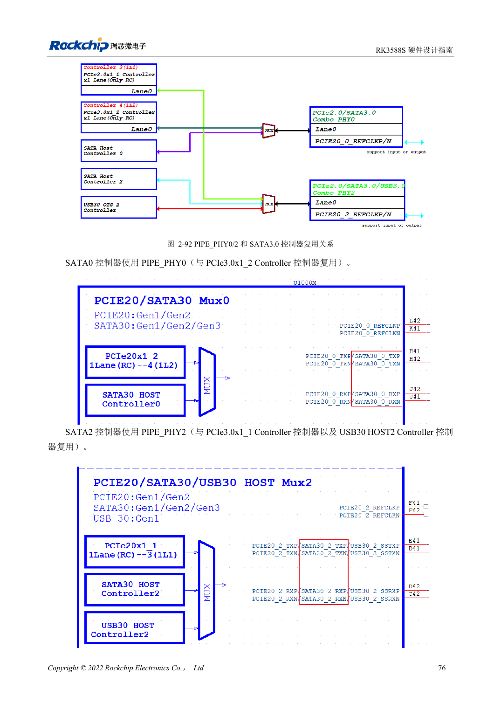
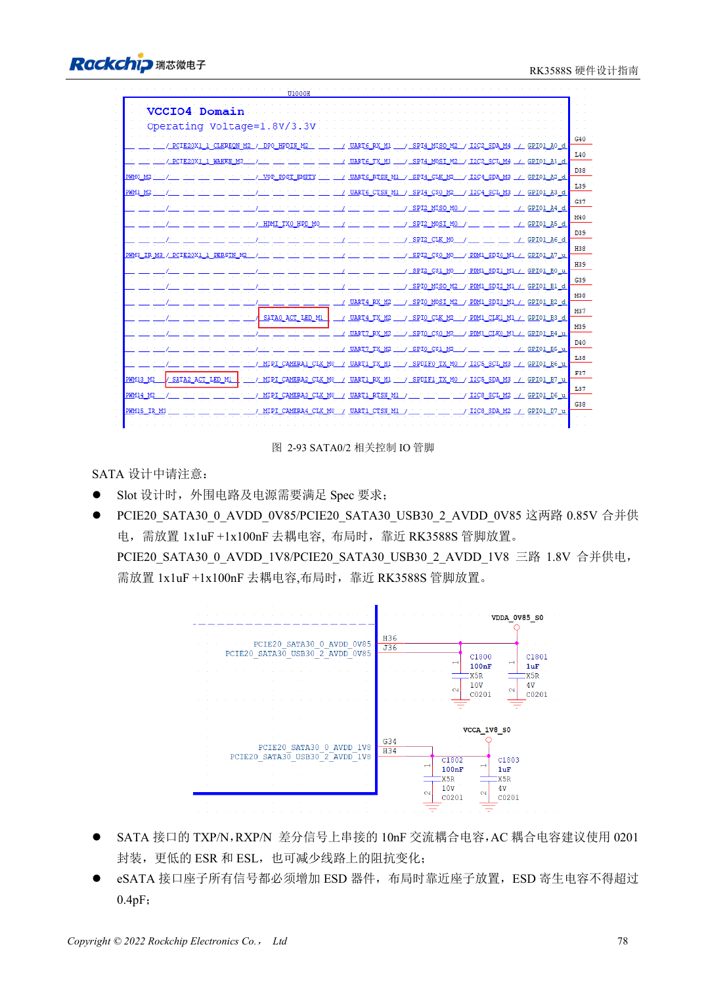

<!-- rk3588s-hardware-v12-20261109 -->

# SATA RK3588S: три контроллера и общие PHY

Основа — китайский RK3588S Hardware Design Guide V1.2 (2023-12-14), для проверки схем и PCB. Носители CM7S проектируют по интерфейсам модуля; Sige7S подходит для оценки ПО и периферии. Возможности SoC не равны разъёмам платы. Проверяйте SDK/BSP, ядро, ревизию, прошивку и мультиплексирование. Значения взяты из источника, не из измерений ArmSoM.

**RK3588S Hardware Design Guide V1.2 (2023-12-14), CN** · §2.3.5; §3.4.7

## Сначала составьте матрицу

Два SATA-контроллера RK3588S используют PIPE_PHY0 и PIPE_PHY2 совместно с PCIe2.0; PHY2 также обслуживает USB3 HOST2. Перечисленные 1.5/3/6Gbps и Port Multiplier не гарантируют вывод обоих портов на CM7S или Sige7S. Сначала проверьте доступность по документации изделия, затем разъёмы и BSP.

## Сигналы и питание диска проверяют отдельно

Эталон ставит 10nF в TX и RX, предпочтительно 0201; номиналы PCIe не подходят автоматически. SATA_CP_DET, MP_SWITCH и CP_POD — общие ресурсы, горячее подключение проектируют отдельно. Внешнее питание проверяют на пусковой ток диска, запись, ошибки и восстановление.

## Параметры и проверочная таблица

| Параметр | Значение источника |
| --- | --- |
| Связь SATA | 10nF ±20%; TX и RX |
| Дифференциальная цель | 100Ω ±10%; резерв источника 90Ω ±10% |
| Длина/разница пары | <6in / <6mil |
| Рекомендуемые переходы | Рекомендуется ≤2 |

## Исходные рисунки

Соответствующее английское руководство для этой партии не найдено. Все четыре версии используют снимки китайского оригинала с локализованными подписями. Откройте изображение в полном разрешении; текст и таблицы можно копировать. Номера относятся к физическим страницам PDF.

Китайский оригинал · PDF 91 · 2-92

Китайский оригинал · PDF 93 · 2-93

## Разработка с ArmSoM

CM7S подходит для собственного носителя: сначала определите встроенные питание, DDR и загрузку, затем проектируйте за пределами разъёмов. Sige7S служит базой оценки ПО и периферии. Для обоих изделий проверяйте вывод интерфейсов, контакты, уровни, образы и охлаждение по нужной ревизии. Схема SoC не является схемой подключения изделия.

- [ArmSoM CM7S](https://www.armsom.org/cm7s) · [CM7S Docs](https://docs.armsom.org/armsom-cm7s)
- [ArmSoM Sige7S](https://www.armsom.org/sige7s) · [Sige7S Docs](https://docs.armsom.org/armsom-sige7s)

## Читайте далее

- [RK3588S: 30 тем аппаратного проектирования](/ru/articles/rk3588s-hardware-design-series/)
- [USB и Type-C RK3588S: контроллеры, PHY и восстановление](/ru/articles/rk3588s-usb-typec-hardware-design/)
- [PCIe RK3588S: линии, опорные такты и питание](/ru/articles/rk3588s-pcie-hardware-design/)
