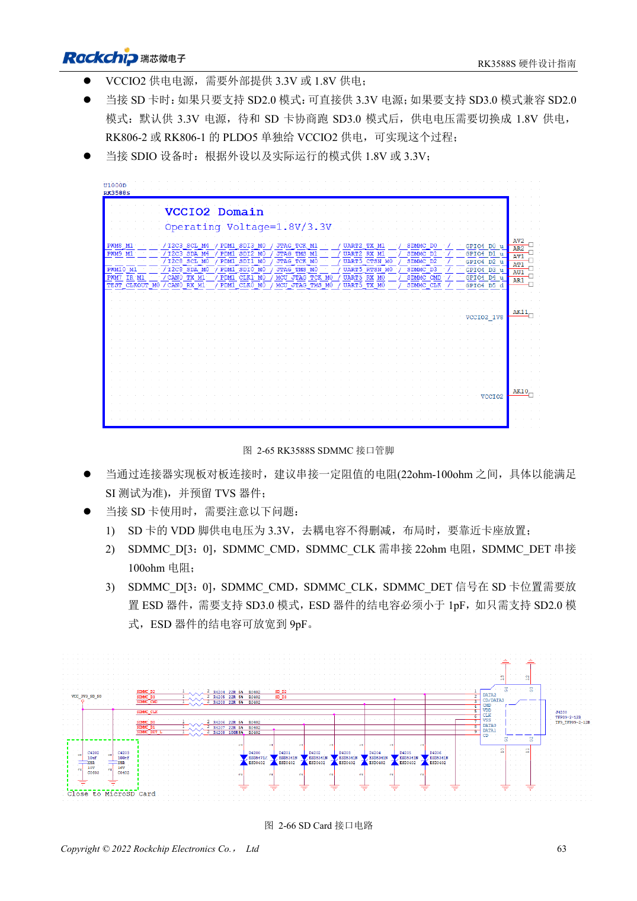

<!-- rk3588s-hardware-v12-20261109 -->

# SDMMC и SDIO Wi-Fi RK3588S: уровни и защита

Основа — китайский RK3588S Hardware Design Guide V1.2 (2023-12-14), для проверки схем и PCB. Носители CM7S проектируют по интерфейсам модуля; Sige7S подходит для оценки ПО и периферии. Возможности SoC не равны разъёмам платы. Проверяйте SDK/BSP, ядро, ревизию, прошивку и мультиплексирование. Значения взяты из источника, не из измерений ArmSoM.

**RK3588S Hardware Design Guide V1.2 (2023-12-14), CN** · §2.3.1; §3.4.13–3.4.14; §3.4.19

## Различайте питание карты и IO

VDD карты SD равен 3.3V. Переход VCCIO2 на 1.8V после согласования SD3.0 не означает смены питания карты. Выбор SDMMC/JTAG зависит от SDMMC_DET. Эталон: 22Ω на данных/CMD/CLK, 100Ω на DET, развязка и ESD у разъёма.

## Wi-Fi требует такта и RF-проверки

Сверьте IO модуля, направления UART/PCM и амплитуду 32.768kHz; предусмотрите π-согласование антенны. Нагрузку кварца выбирают по модулю; руководство указывает 10ppm при комнатной температуре. Для SD3.0 ёмкость ESD <1pF. Проверяют соединение, скорость, сон/пробуждение и циклы питания.

## Параметры и проверочная таблица

| Параметр | Значение источника |
| --- | --- |
| VDD карты SD | 3.3V |
| Ёмкость ESD SD3.0 | <1pF |
| ESD только для SD2.0 | ≤9pF |
| Data/CMD/CLK; DET | 22Ω; 100Ω |
| PCB: импеданс/длина | 50Ω ±10% / <4in |
| Разница такт/данные | <120mil |

## Исходные рисунки

Соответствующее английское руководство для этой партии не найдено. Все четыре версии используют снимки китайского оригинала с локализованными подписями. Откройте изображение в полном разрешении; текст и таблицы можно копировать. Номера относятся к физическим страницам PDF.

Китайский оригинал · PDF 78 · 2-66

## Разработка с ArmSoM

CM7S подходит для собственного носителя: сначала определите встроенные питание, DDR и загрузку, затем проектируйте за пределами разъёмов. Sige7S служит базой оценки ПО и периферии. Для обоих изделий проверяйте вывод интерфейсов, контакты, уровни, образы и охлаждение по нужной ревизии. Схема SoC не является схемой подключения изделия.

- [ArmSoM CM7S](https://www.armsom.org/cm7s) · [CM7S Docs](https://docs.armsom.org/armsom-cm7s)
- [ArmSoM Sige7S](https://www.armsom.org/sige7s) · [Sige7S Docs](https://docs.armsom.org/armsom-sige7s)

## Читайте далее

- [RK3588S: 30 тем аппаратного проектирования](/ru/articles/rk3588s-hardware-design-series/)
- [FSPI Flash RK3588S: загрузка, питание и согласование](/ru/articles/rk3588s-fspi-boot-hardware/)
- [USB и Type-C RK3588S: контроллеры, PHY и восстановление](/ru/articles/rk3588s-usb-typec-hardware-design/)
