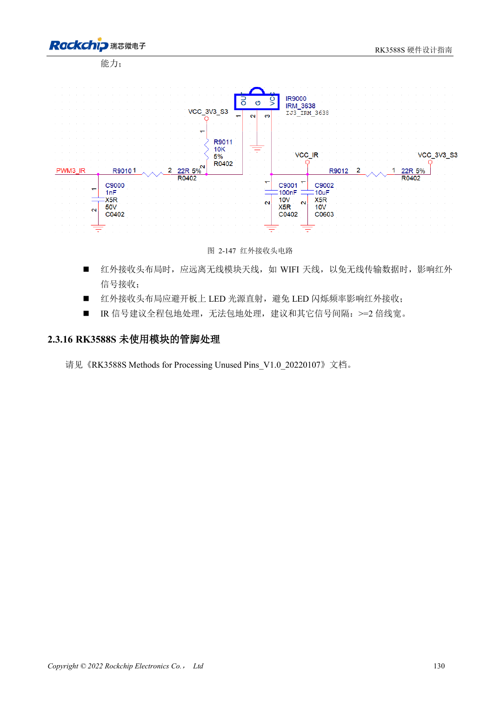

<!-- rk3588s-hardware-v12-20261109 -->

# Распределение UART, SPI, CAN, I2C и PWM RK3588S

Основа — китайский RK3588S Hardware Design Guide V1.2 (2023-12-14), для проверки схем и PCB. Носители CM7S проектируют по интерфейсам модуля; Sige7S подходит для оценки ПО и периферии. Возможности SoC не равны разъёмам платы. Проверяйте SDK/BSP, ядро, ревизию, прошивку и мультиплексирование. Значения взяты из источника, не из измерений ArmSoM.

**RK3588S Hardware Design Guide V1.2 (2023-12-14), CN** · §2.3.11–2.3.15

## Не смешивайте Mx-группы

M0/M1/M2 для UART, SPI, CAN и I2C — варианты мультиплексирования, не дополнительные контроллеры. Выбирайте полную допустимую группу и питание. SPI2 по умолчанию обслуживает PMIC, не занимайте его произвольно. CAN требует внешнего трансивера: TX/RX SoC не являются дифференциальной шиной.

## Проверяйте протоколы периферии

Эталонная подтяжка I2C — 2.2kΩ; номинал зависит от нагрузки и напряжения. HDMI DDC выделен отдельно. V1.2 задаёт CAN2.0B, 1Mbps, не подтверждая CAN FD. Проверьте скорость и flow control UART, режим и CS SPI, фронты I2C и уровни CAN-трансивера, затем сон и сброс; сохраните измерения.

## Параметры и проверочная таблица

| Параметр | Значение источника |
| --- | --- |
| UART / общий SPI | 10 / 5 контроллеры |
| Область CAN источника | 3 контроллеры; CAN2.0B; 1Mbps |
| Эталон I2C | До 400Kbit/s; 2.2kΩ подтяжка вверх |
| Число PWM источника | 4 контроллеры ×4 каналы |

## Исходные рисунки

Соответствующее английское руководство для этой партии не найдено. Все четыре версии используют снимки китайского оригинала с локализованными подписями. Откройте изображение в полном разрешении; текст и таблицы можно копировать. Номера относятся к физическим страницам PDF.

Китайский оригинал · PDF 145 · 2-147

## Разработка с ArmSoM

CM7S подходит для собственного носителя: сначала определите встроенные питание, DDR и загрузку, затем проектируйте за пределами разъёмов. Sige7S служит базой оценки ПО и периферии. Для обоих изделий проверяйте вывод интерфейсов, контакты, уровни, образы и охлаждение по нужной ревизии. Схема SoC не является схемой подключения изделия.

- [ArmSoM CM7S](https://www.armsom.org/cm7s) · [CM7S Docs](https://docs.armsom.org/armsom-cm7s)
- [ArmSoM Sige7S](https://www.armsom.org/sige7s) · [Sige7S Docs](https://docs.armsom.org/armsom-sige7s)

## Читайте далее

- [RK3588S: 30 тем аппаратного проектирования](/ru/articles/rk3588s-hardware-design-series/)
- [GPIO и SARADC RK3588S: домены и кнопки](/ru/articles/rk3588s-gpio-saradc-hardware/)
- [Стек и fanout RK3588S: HDI и сквозные переходы](/ru/articles/rk3588s-pcb-stackup-fanout/)
