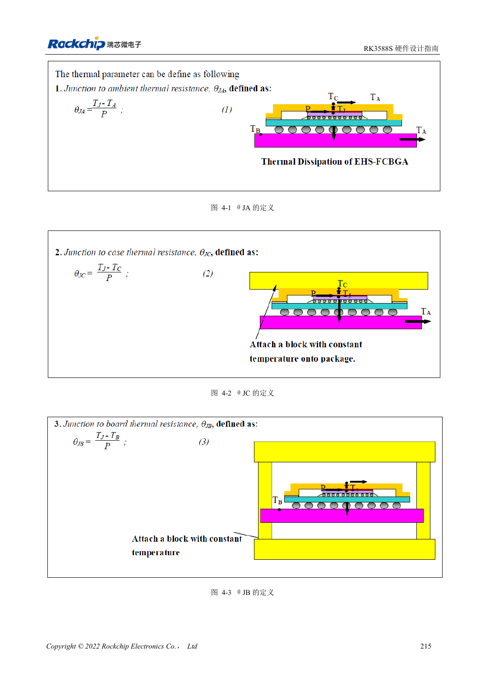

<!-- rk3588s-hardware-v12-20261109 -->

# Тепловой расчёт RK3588S: эталон и проверка системы

Основа — китайский RK3588S Hardware Design Guide V1.2 (2023-12-14), для проверки схем и PCB. Носители CM7S проектируют по интерфейсам модуля; Sige7S подходит для оценки ПО и периферии. Возможности SoC не равны разъёмам платы. Проверяйте SDK/BSP, ядро, ревизию, прошивку и мультиплексирование. Значения взяты из источника, не из измерений ArmSoM.

**RK3588S Hardware Design Guide V1.2 (2023-12-14), CN** · §4

## Модель не равна нагреву модуля

Таблица 4-1 рассчитана для конкретного корпуса и JEDEC-модели PCB: 200×140mm, 1.6mm, 10 слоёв, без радиатора. Её нельзя прямо переносить на CM7S, носитель CM7S или корпус Sige7S. θJA, θJB и θJC относятся к разным точкам и не взаимозаменяемы.

## Проверьте теплоотвод и защиту

Проверяют путь к термоинтерфейсу, радиатору, корпусу и среде, прижим и изоляцию. Интервал RK3588S/RK806 20–50mm — рекомендация платы, не переделка модуля. Под реальной политикой BSP измеряют длительную нагрузку, частоту, температуру и задержку; отключение защиты не доказывает производительность.

## Параметры и проверочная таблица

| Параметр | Значение источника |
| --- | --- |
| θJA / θJB / θJC источника | 8.2 / 3.7 / 0.01 °C/W; моделирование |
| PCB источника | 200×140mm; 1.6mm; 10 слоёв |
| Расстояние PMIC–SoC | RK3588S–RK806: 20–50mm |

## Исходные рисунки

Соответствующее английское руководство для этой партии не найдено. Все четыре версии используют снимки китайского оригинала с локализованными подписями. Откройте изображение в полном разрешении; текст и таблицы можно копировать. Номера относятся к физическим страницам PDF.

Китайский оригинал · PDF 230 · 4-1

## Разработка с ArmSoM

CM7S подходит для собственного носителя: сначала определите встроенные питание, DDR и загрузку, затем проектируйте за пределами разъёмов. Sige7S служит базой оценки ПО и периферии. Для обоих изделий проверяйте вывод интерфейсов, контакты, уровни, образы и охлаждение по нужной ревизии. Схема SoC не является схемой подключения изделия.

- [ArmSoM CM7S](https://www.armsom.org/cm7s) · [CM7S Docs](https://docs.armsom.org/armsom-cm7s)
- [ArmSoM Sige7S](https://www.armsom.org/sige7s) · [Sige7S Docs](https://docs.armsom.org/armsom-sige7s)

## Читайте далее

- [RK3588S: 30 тем аппаратного проектирования](/ru/articles/rk3588s-hardware-design-series/)
- [Питание PCB и PDN RK3588S: медь, возврат и развязка](/ru/articles/rk3588s-power-pcb-pdn-design/)
- [ESD и EMI RK3588S: защита интерфейсов и возврат тока](/ru/articles/rk3588s-esd-emi-hardware-design/)
