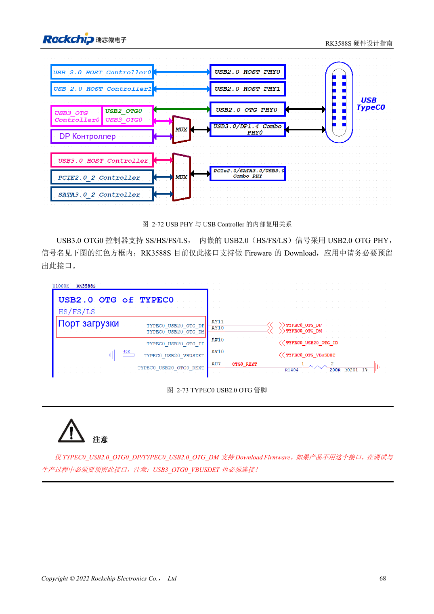
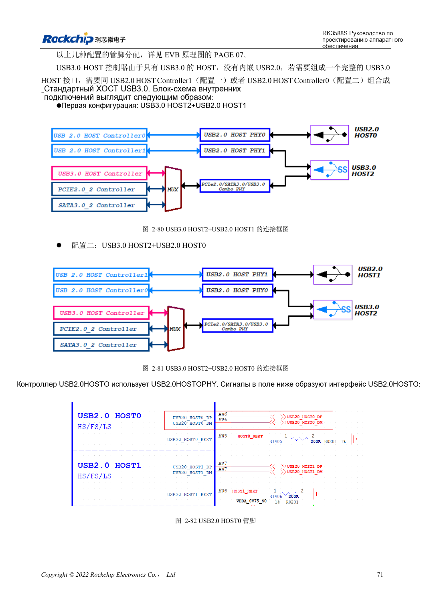

<!-- rk3588s-hardware-v12-20261109 -->

# USB и Type-C RK3588S: контроллеры, PHY и восстановление

Основа — китайский RK3588S Hardware Design Guide V1.2 (2023-12-14), для проверки схем и PCB. Носители CM7S проектируют по интерфейсам модуля; Sige7S подходит для оценки ПО и периферии. Возможности SoC не равны разъёмам платы. Проверяйте SDK/BSP, ядро, ревизию, прошивку и мультиплексирование. Значения взяты из источника, не из измерений ArmSoM.

**RK3588S Hardware Design Guide V1.2 (2023-12-14), CN** · §2.3.4; §3.4.8–3.4.9

## Различайте контроллеры и порты

RK3588S имеет один USB3 OTG, один USB3 HOST и два USB2 HOST. Отдельный USB3 HOST не содержит USB2 и объединяется с USB2 HOST. Сохраните прошивку через USB2 OTG0 и VBUSDET. Совместно проверьте USB3/DP, обе ориентации Type-C и внешний CC-контроллер.

## Проверьте роли питания и канал

USB3 HOST2 делит ресурсы с SATA/PCIe; все три не считаются одновременно доступными. Проверяют источник/приёмник VBUS, обратное питание, разъёмы и кабели. Сначала USB2-восстановление, затем USB3, длительный обмен, горячее подключение и обе ориентации Type-C. Длина включает модуль и разъёмы.

## Два предела ёмкости ESD

Схемная часть на странице 90 задаёт ≤0.3pF, PCB на странице 221 — ≤0.2pF. Сохраняйте обе ссылки и используйте более строгий бюджет ≤0.2pF при подборе, учитывая паразиты площадок, разъёма и компонента. Это не подтверждает готовую квалификацию выбранного элемента.

## Параметры и проверочная таблица

| Параметр | Значение источника |
| --- | --- |
| Импеданс USB2 | 90Ω ±10%; разница пары <20mil |
| Импеданс USB3 | 90Ω ±10%; разница пары <6mil |
| Длина/via USB3 | <6in; рекомендуется ≤2 |
| Ёмкость ESD USB3 | ≤0.2pF |

## Исходные рисунки

Соответствующее английское руководство для этой партии не найдено. Все четыре версии используют снимки китайского оригинала с локализованными подписями. Откройте изображение в полном разрешении; текст и таблицы можно копировать. Номера относятся к физическим страницам PDF.

Китайский оригинал · PDF 83 · 2-72

Китайский оригинал · PDF 86 · 2-80

## Разработка с ArmSoM

CM7S подходит для собственного носителя: сначала определите встроенные питание, DDR и загрузку, затем проектируйте за пределами разъёмов. Sige7S служит базой оценки ПО и периферии. Для обоих изделий проверяйте вывод интерфейсов, контакты, уровни, образы и охлаждение по нужной ревизии. Схема SoC не является схемой подключения изделия.

- [ArmSoM CM7S](https://www.armsom.org/cm7s) · [CM7S Docs](https://docs.armsom.org/armsom-cm7s)
- [ArmSoM Sige7S](https://www.armsom.org/sige7s) · [Sige7S Docs](https://docs.armsom.org/armsom-sige7s)

## Читайте далее

- [RK3588S: 30 тем аппаратного проектирования](/ru/articles/rk3588s-hardware-design-series/)
- [SDMMC и SDIO Wi-Fi RK3588S: уровни и защита](/ru/articles/rk3588s-sdmmc-sdio-wifi-design/)
- [SATA RK3588S: три контроллера и общие PHY](/ru/articles/rk3588s-sata-hardware-design/)
