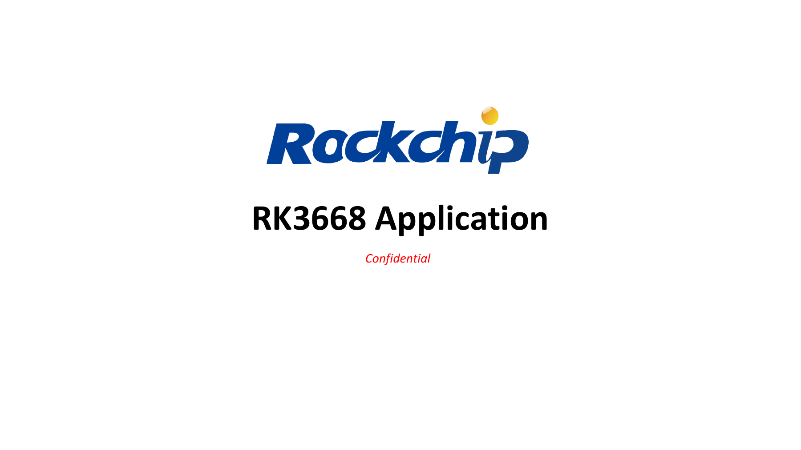
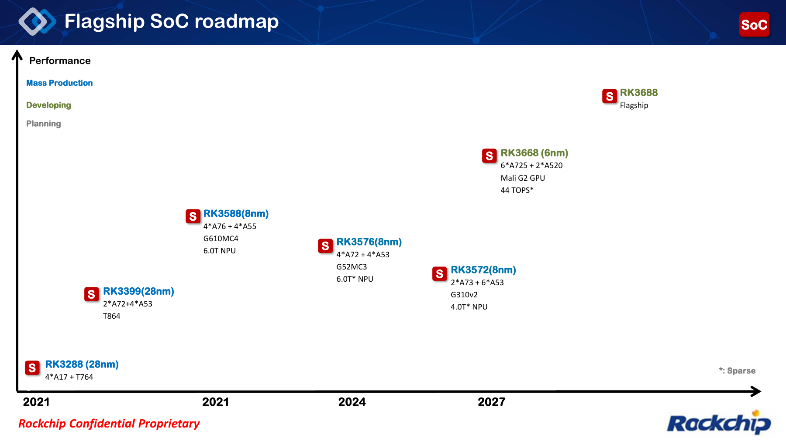
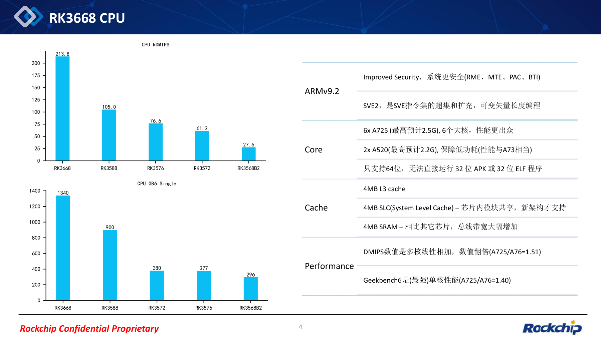
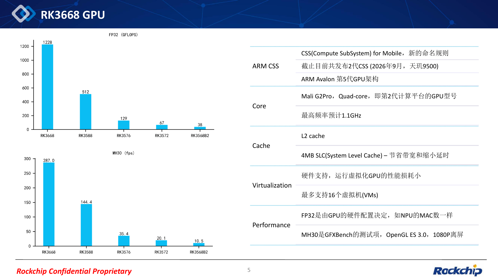
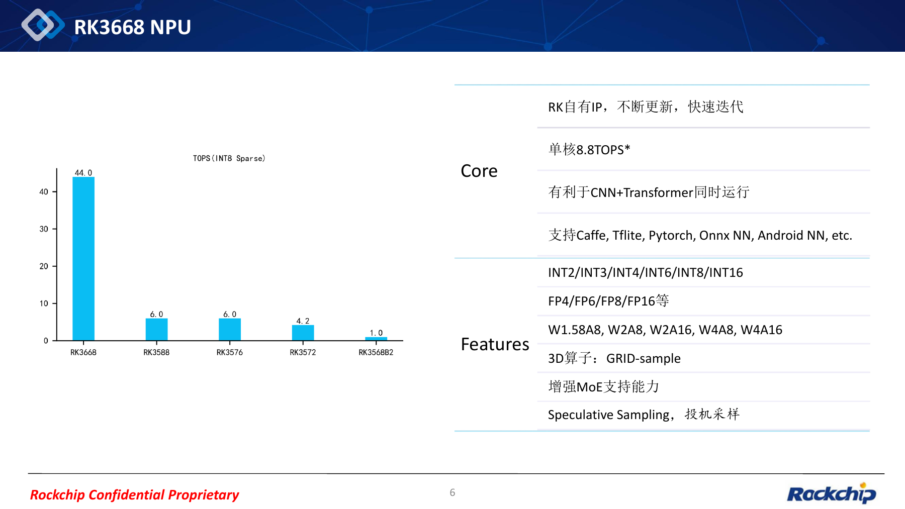
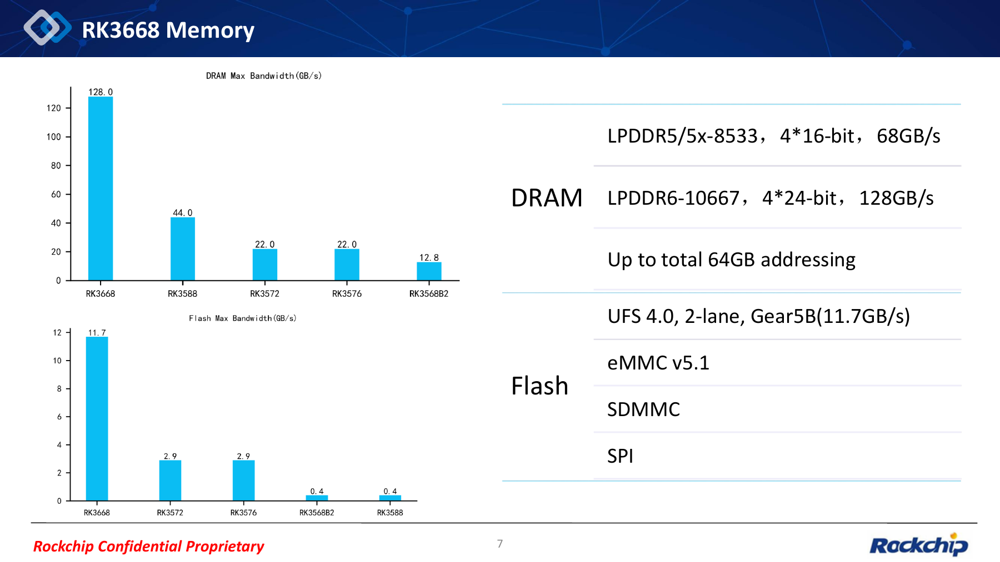
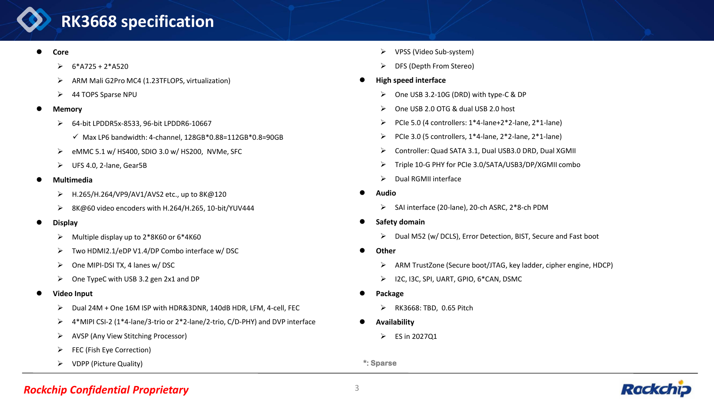
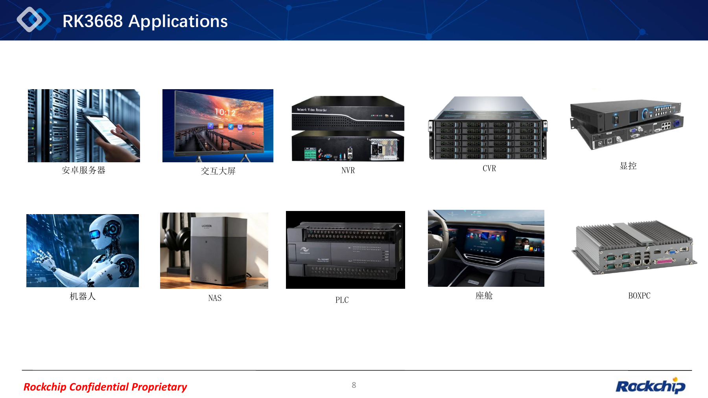

RK3668 объединяет универсальные вычисления, локальный ИИ, видео, дисплеи и высокоскоростное расширение в одной планируемой платформе. Материалы RK3668 Application показывают направление нового флагманского SoC Rockchip и полезны при подготовке будущих продуктов ArmSoM.

Статья основана на предоставленном **PDF REL02: дата в имени файла 2026-10-09, всего 9 страниц**. Все страницы сохранены как чёткие изображения, открывающиеся в полном размере; неизменённый PDF можно скачать ниже. Источник смешивает китайский и английский, поэтому четыре версии статьи используют одинаковые оригиналы с локализованными пояснениями. **Числа диаграмм принадлежат источнику, а не испытаниям ArmSoM. Ожидаемые частоты, сроки образцов и интерфейсы не являются окончательными серийными характеристиками.**

*Страница 1 исходного PDF: Обложка RK3668 Application.*

## 1. План развития: не смешивать RK3668 и RK3688

На странице 2 RK3668 представлен как платформа 6nm с 6× Cortex-A725 + 2× Cortex-A520, Mali G2 GPU и разреженной производительностью NPU 44 TOPS. RK3688 обозначен отдельно как последующий флагман. **Характеристики RK3668 нельзя выдавать за характеристики RK3688.**

Страница 3 указывает **первый квартал 2027 года** для инженерных образцов ES. Это план, а не срок массового выпуска или появления изделия ArmSoM. Корпус обозначен TBD, шаг — 0.65; окончательных габаритов нет. Исторические сокращённые сведения на схеме следует проверять по документации каждой модели.

*Страница 2 исходного PDF: План развития флагманских SoC.*

## 2. CPU и GPU: подготовка программной миграции

CPU Armv9.2 состоит из шести Cortex-A725 с **ожидаемой максимальной частотой 2.5GHz** и двух Cortex-A520 с **ожидаемой частотой 2.2GHz**. Перечислены SVE2, функции RME, MTE, PAC, BTI, а также 4MB L3, 4MB SLC и 4MB SRAM.

Ключевое ограничение — **только 64-битные программы**: источник прямо исключает непосредственный запуск 32-битных APK и ELF. Заранее проверьте приложения Android, закрытые библиотеки, службы периферии и алгоритмы. Наличие аппаратной функции безопасности не означает её включение по умолчанию в каждом SDK.

GPU — Mali G2 Pro MC4 с **ожидаемой максимальной частотой 1.1GHz**. Указана аппаратная виртуализация до 16 VM. Это не обещание производительности каждого экземпляра: нужны проверки драйверов, планирования и совместной нагрузки. FP32 и GFXBench MH30 измеряют разные свойства.

|Показатель источника|RK3668|RK3588|
|---|---|---|
|CPU kDMIPS|213.8|105.0|
|Geekbench 6 single-core|1340|900|
|GPU FP32 (GFLOPS)|1228|512|
|GFXBench MH30 (fps)|287.0|144.4|

Единица CPU-диаграммы — **kDMIPS**, а не просто DMIPS. Источник описывает многоядерное значение как линейную сумму, GB6 — как одноядерный тест. MH30 использует OpenGL ES 3.0 и 1080P offscreen. Полные условия испытаний не приведены, поэтому числа не являются гарантией для готового изделия.

*Страница 4 исходного PDF: Архитектура CPU и сравнение производительности.*

*Страница 5 исходного PDF: GPU, производительность и виртуализация.*

## 3. NPU: обязательно учитывать INT8 Sparse

Заголовок диаграммы на странице 6 — **TOPS (INT8 Sparse)**, значение RK3668 — 44.0. Отдельно указано 8.8 TOPS на ядро и совместная работа CNN/Transformer. Деление этих чисел не доказывает внутреннюю организацию NPU; показатели с разными методиками нельзя сравнивать напрямую.

Целочисленные форматы: INT2/INT3/INT4/INT6/INT8/INT16. Плавающая точка: FP4/FP6/FP8/FP16. Комбинации: W1.58A8, W2A8, W2A16, W4A8, W4A16. Перечислены трёхмерный GRID-sample, расширенная поддержка MoE и speculative sampling. Среди программных средств названы Caffe, TFLite, PyTorch, ONNX NN и Android NN.

Это направления для оценки зрительно-языковых систем, робототехники и периферийного ИИ. Поддержка конкретной модели, точность квантования, длина контекста, tokens/s и длительное энергопотребление не установлены. На образцах с соответствующим SDK нужны проверки конвертации, операторов, памяти и полной задержки.

*Страница 6 исходного PDF: Форматы NPU и разреженные вычисления.*

## 4. Память: 128 GB/s — заявленное значение документа

Страница 7 перечисляет LPDDR5/5X-8533, 4×16-bit, 68 GB/s; LPDDR6-10667, 4×24-bit, 128 GB/s; адресацию до 64GB. **Предел адресации не означает установку 64GB на каждую плату.**

На странице 3 отдельно приведены 64-bit LPDDR5x-8533, 96-bit LPDDR6-10667 и `128GB*0.88=112GB*0.8=90GB`. Это другая форма представления, чем номинальная полоса на странице 7. Коэффициенты полностью не объяснены; ни 90, ни 112, ни 128 здесь не объявляются измеренной полосой приложения.

Накопители: UFS 4.0, две линии, Gear5B (11.7 GB/s), eMMC 5.1, SDMMC и SPI. В обзоре также названы NVMe, SFC, eMMC HS400 и «SDIO 3.0 w/ HS200». Последняя формулировка сохранена на исходном изображении; соответствие режима следует уточнять по окончательной документации. Пиковая полоса UFS не равна устойчивой скорости файловой системы.

*Страница 7 исходного PDF: Память и пропускная способность.*

## 5. Мультимедиа, расширение и домен безопасности

Ниже характеристики сгруппированы по задачам проектирования. Полный текст доступен на изображении страницы 3.

|Блок|Сведения источника|
|---|---|
|Декодирование|H.265/H.264/VP9/AV1/AVS2 и др.; до 8K@120|
|Кодирование|H.264/H.265; до 8K@60; 10-bit/YUV444|
|Дисплеи|До 2×8K60 или 6×4K60; два combo HDMI2.1/eDP1.4/DP с DSC; один 4-lane MIPI-DSI TX с DSC; Type-C + DP|
|Видеовход|Два 24MP + один 16MP ISP; HDR, 3DNR, 140dB HDR, LFM, 4-cell, FEC; 4×MIPI CSI-2, C/D-PHY и DVP|
|Обработка изображения|AVSP — сшивка, FEC — коррекция fisheye, VDPP — качество, VPSS — видеоподсистема, DFS — стереоглубина|
|Расширение|PCIe 5.0/3.0; 4×SATA3.1, два USB3.0 DRD, два XGMII, 3×10G combo PHY, два RGMII|
|USB|1×USB3.2-10G DRD с Type-C/DP; 1×USB2.0 OTG; 2×USB2.0 host|
|Аудио|SAI (в источнике 20-lane), 20-ch ASRC, 2×8-ch PDM|
|Safety domain|Два M52 с DCLS, обнаружение ошибок, BIST, безопасная и быстрая загрузка|
|Безопасность и прочие I/O|Arm TrustZone, Secure boot/JTAG, key ladder, cipher engine, HDCP; I2C/I3C/SPI/UART/GPIO, 6×CAN, DSMC|

Для PCIe 5.0 написано «4 controllers», но перечислено `1*4-lane+2*2-lane, 2*1-lane`: итоговое количество и разбивка неоднозначны. Для PCIe 3.0 указаны пять контроллеров: 1×4, 2×2 и 2×1. **Нельзя складывать линии, контроллеры и combo PHY, чтобы получить число одновременно доступных разъёмов платы.** Нужны таблицы мультиплексирования, комбинаций линий и ограничений совместной работы.

Максимумы декодирования 8K, кодирования и нескольких дисплеев также приведены отдельно. Они не доказывают одновременную работу всех форматов, выходов и задач ИИ на пределе. Функции safety domain не подтверждают конкретный уровень сертификации функциональной безопасности.

*Страница 3 исходного PDF: Обзор характеристик RK3668.*

## 6. Десять направлений применения на практике

На странице 8 перечислены серверы Android, интерактивные дисплеи, NVR, CVR, управление отображением, роботы, NAS, PLC, автомобильные кокпиты и BOX PC. Таблица ниже — инженерный анализ, а не список поставленных решений:

| Сценарий | Что оценивать | Проверки перед выпуском |
| --- | --- | --- |
| Сервер Android, BOX PC | Многоядерный CPU, виртуализация GPU, экземпляры | 64-битные зависимости, ресурсы, образы и длительная нагрузка |
| Робототехника | ISP, стереоглубина, NPU, CAN | Синхронизация датчиков, точность модели, задержка управления |
| NVR, CVR | Видеовход, кодеки и ИИ | Реальное число каналов, битрейт, накопители и охлаждение |
| Дисплеи и управление отображением | Несколько выходов, обработка изображения/видео | Комбинации разрешений, мультиплексирование, задержка, драйверы |
| NAS | PCIe, SATA, сеть и память | Доступные PHY, сочетания накопителей, сеть и питание |
| PLC, интеллектуальный кокпит | Safety domain, CAN и периферия | Реальное время, обработка сбоев, ПО и сертификация |

Начинайте с узкого места приложения. Для NAS важно не только поколение PCIe, но и совместное использование ресурсов сетью и SATA. Для робота важны не только TOPS, но и задержка от получения данных до управления.

*Страница 8 исходного PDF: Десять направлений применения.*

## 7. Планы продуктов ArmSoM

ArmSoM планирует следить за RK3668 и продвигать соответствующие продукты, как только образцы, SDK и проверка аппаратуры позволят перейти к готовым решениям. Документ не подтверждает названия моделей ArmSoM, форм-факторы, объём RAM, выведенные интерфейсы, цены или даты продаж.

Уже сейчас полезно собрать 64-битные зависимости, модели/операторы, требования к камерам, дисплеям и накопителям, бюджеты питания и охлаждения. Следите за [сайтом ArmSoM](https://www.armsom.org/) и [документацией](https://docs.armsom.org/). Предыдущий [обзор RK3668 на китайском](/zh/articles/rockchip-rk3668-outlook/) даёт контекст; эта статья добавляет оригинальные страницы и PDF для непосредственной проверки.

## 8. Скачать исходный PDF

<a href="/downloads/rk3668/RK3668-SoC-Application-REL02-20261009.pdf" download>Скачать оригинал RK3668 Application REL02 (9 страниц, около 1.41 MB)</a>

Файл не изменён: сохранены оформление, диаграммы и исходные обозначения. Снимки также сохраняют смешанный язык оригинала и не выдаются за переведённые изображения. Статья даёт интерпретацию и анализ применения; проектирование требует официального datasheet, руководства по аппаратуре и SDK.

*Страница 9 исходного PDF: Заключительный слайд оригинала.*
