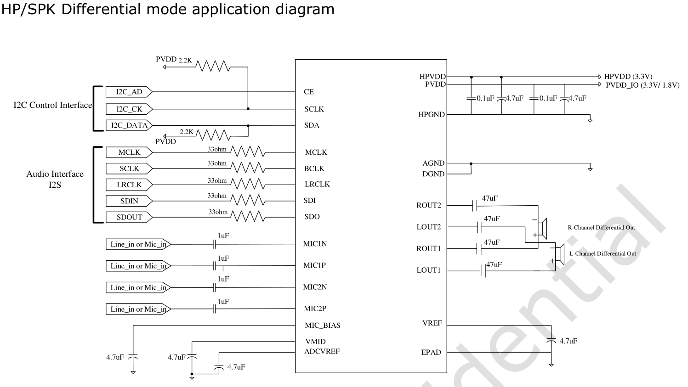

Обновлено по RK730 Datasheet V1.2. Параметры принадлежат производителю, а не аппаратным измерениям ArmSoM. Сверяйте ревизию кристалла, подключения платы, SDK/BSP и драйвер. Все рисунки взяты из предоставленного английского оригинала.

*Аудиокодек RK730: микрофоны, тактирование I2S и дифференциальные выходы*

## Сначала определить связь кодека с платой

RK730 содержит два канала ADC, два DAC, микрофонный усилитель и драйверы наушников. Это вариант для аудиосистем семейства RK3506, однако статья не подтверждает наличие RK730 на каждой ревизии CM1 или Forge1. До расширения определите установленный кодек, доступный SAI/I2S, управляющую шину, напряжения и драйвер BSP.

## Параметры сигнальной цепи

| Блок | Параметр V1.0 | Практическое значение |
| --- | --- | --- |
| ADC | 24-bit; 8–192kHz; SNR 100dB; типичный THD+N −95dB | Микрофон, питание и разводка влияют на шум системы |
| Микрофонный усилитель | До +54dB; дифференциальный/псевдодифференциальный вход | Сначала согласовать амплитуду, затем аналоговое и цифровое усиление |
| DAC | 24-bit; 8–192kHz; SNR 98dB; THD+N −85dB | Это не характеристики внешнего усилителя и динамика |
| Наушники | 50mW на 32Ω; 100mW на 16Ω | Мощность указывать вместе с нагрузкой |
| Дифференциальный выход | До 4.8Vpp при питании 3.3V | Подключение отличается от однополярного выхода относительно земли |
| Управление / данные | I2C до 400kHz; I2S/PCM | Доступ по I2C не доказывает правильность аудиотактов |

Список функций на стр. 8 даёт динамический диапазон ADC 100dB, аналоговая таблица на стр. 14 — 101dB с другими подробностями. Здесь используется список функций, без объединения значений в результат измерения. Ранние данные презентации RK3506 не заменяют этот более поздний datasheet.

## Внешнее питание и выводы NC в V1.2

В V1.2 `PVDD` питает цифровые I/O и формирует внутреннее питание цифрового ядра. `HPVDD` питает выход наушников и формирует питание аналогового ядра. Рекомендуемый диапазон PVDD — 1.62–3.6 V, типично 1.8/3.3 V; HPVDD — 3.0–3.6 V, типично 3.3 V. **Выводы 2 и 17 теперь NC; их, как и вывод 9, оставляют неподключёнными.** Подключение DVDD/AVDD из V1.0 переносить нельзя. VREF, VMID и ADCVREF требуют развязки по опорной схеме и не служат универсальными выходами питания.

## Обновлённый выбор PLL и оставшаяся неоднозначность

В таблице 4-2 V1.2 вход 24 MHz для `1001–1011` явно относится к **MCLK**; страница исправлена. `0110/0111/1000` используют BCLK 3.072/2.822/2.048 MHz. Изменены и описания 0x6–0x8 в `CODEC_SYSPLL_3[7:4]`. Для `0111` новый документ по-прежнему указывает 2.822 MHz: значение сохранено, перед применением следует сверить драйвер и такты, не подменяя его на 2.8224 MHz. `1111` не задаёт допустимого выбора. Семейство 48 kHz включает 12/24/48/96/192 kHz; 44.1 kHz — 11.025/22.05/44.1/88.2/176.4 kHz; 32 kHz — 8/16/32/64/128 kHz.

## После появления связи по I2C

CE в низком/высоком состоянии выбирает `0x16`/`0x17`. Уточните формат адреса в драйвере, не выполняйте сдвиг по предположению. Затем проверьте питание, такты, маршруты ADC/DAC, mute, усиление и режим выхода. Непроверенный на плате скрипт записи регистров здесь не предлагается.

Есть копирование моносигнала ADC и смешивание sidetone. Для переговорного устройства отдельно определите мониторинг, опору эхокомпенсации и обратный захват динамика. Микшер не заменяет полноценный алгоритм AEC.

## Опорная схема и проверка версии

Обновление основано на RK730 Datasheet V1.2 (2025-08-08, 47 страниц). В опорной схеме изменены подтяжки 10 kΩ → 2.2 kΩ, отдельные развязывающие конденсаторы 10 µF → 4.7 µF, выходные разделительные 220 µF → 47 µF и отдельные опорные 2.2 µF → 4.7 µF. Следуйте новым узлам схемы, не заменяйте все похожие компоненты на других платах. Старый абзац дифференциального выхода с повтором ROUT2 удалён из новой версии. Для SCL, вывода 28, направление по-прежнему указано O; его следует уточнить по реальному интерфейсу управления.

## Проверка проектов CM1 и Forge1

Установите, действительно ли используется RK730, и получите соответствующий драйвер и device tree. Проверьте воспроизведение, запись, полный дуплекс, переключение частоты и suspend/resume. При одновременной нагрузке сети, экрана и накопителя фиксируйте шум, искажения, щелчки и пропуски отсчётов. Ссылки на продукты помогают выбрать хост, но не подтверждают совместимость кодека.

## Продукты и документация

- **CM1** — [Продукт](https://www.armsom.org/cm1) · [Документация](https://docs.armsom.org/armsom-cm1)
- **Forge1** — [Продукт](https://www.armsom.org/armsom-forge1) · [Документация](https://docs.armsom.org/armsom-forge1)

<!-- datasheet-series-20261110 -->

## Другие статьи о RK730

- [RK730 обзор](/ru/articles/rk730-audio-codec-design/)
- [RK730: корпус QFN28, выводы и питание аудиокодека](/ru/articles/rk730-package-power-pinout/)
- [RK730: PLL, I2S, sidetone и адресация I2C](/ru/articles/rk730-clocks-audio-i2c/)
- [RK730: 65 регистров, значения сброса и группы управления](/ru/articles/rk730-register-map-reference/)
- [RK730: питание, запуск и останов ADC/DAC](/ru/articles/rk730-power-adc-dac-sequences/)

<!-- datasheet-related-20261110 -->
## Другие datasheet

Ссылки предназначены для сравнения платформ; электрические условия и выводы не взаимозаменяемы.

- [RK3506B](/ru/articles/rk3506b-datasheet-v10/)
- [RK3576](/ru/articles/rk3576-datasheet-v10/)
- [RK3588](/ru/articles/rk3588-datasheet-v14/)
- [RK3528](/ru/articles/rk3528-datasheet-v10/)
- [RK3568](/ru/articles/rk3568-datasheet-v12/)
