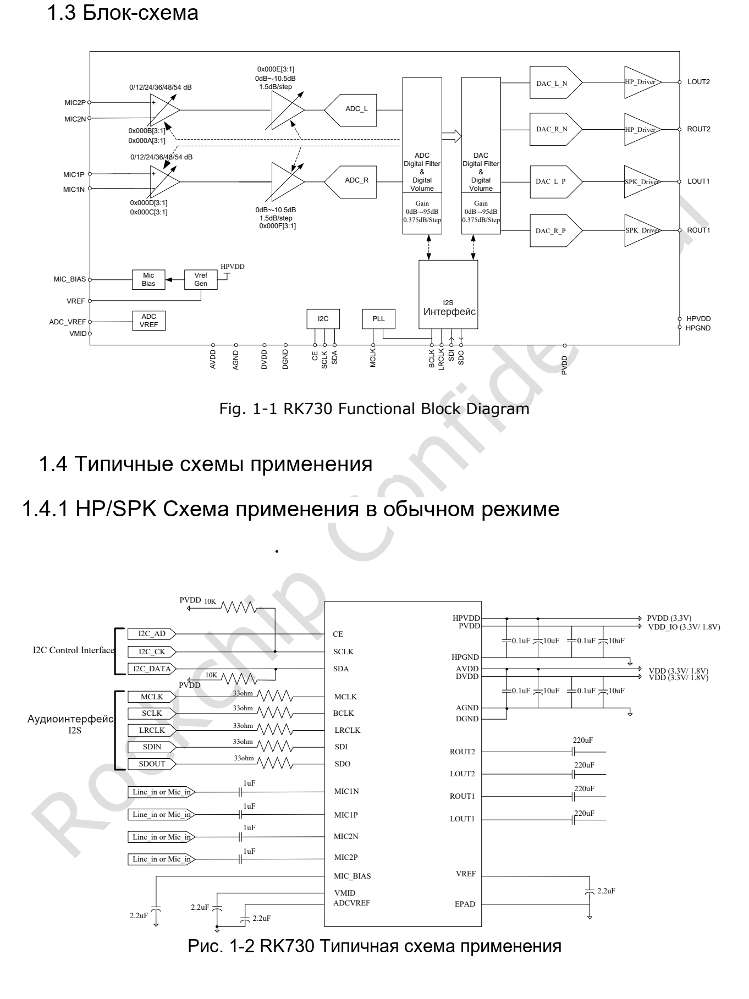
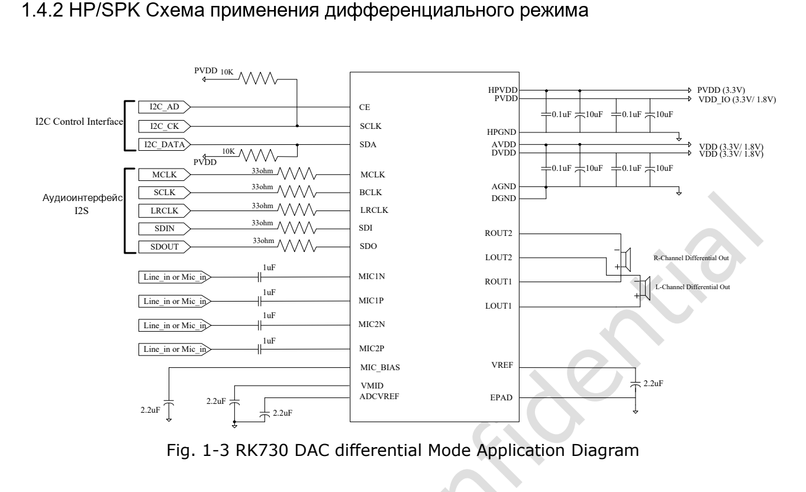

Это тематическое руководство по исходному документу: ключевые параметры, ограничения и оригинальные иллюстрации. Оно не заменяет полный перевод, таблицу выводов или регистров. Примеры производителя не являются измерениями ArmSoM. Перед применением проверьте ревизию платы, схему, SDK/BSP, ядро и драйверы; новых аппаратных испытаний для статьи не проводилось.

**Основной источник：** `Rockchip RK730 Datasheet V1.0-20241118.pdf` · PDF 46 стр..

## Сначала определить связь кодека с платой

RK730 содержит два канала ADC, два DAC, микрофонный усилитель и драйверы наушников. Это вариант для аудиосистем семейства RK3506, однако статья не подтверждает наличие RK730 на каждой ревизии CM1 или Forge1. До расширения определите установленный кодек, доступный SAI/I2S, управляющую шину, напряжения и драйвер BSP.

*RK730: блок-схема и обычное включение — Оригинал на английском. `Rockchip RK730 Datasheet V1.0-20241118.pdf`, PDF p. 9.*

## Параметры сигнальной цепи

| Блок | Параметр V1.0 | Практическое значение |
| --- | --- | --- |
| ADC | 24-bit; 8–192kHz; SNR 100dB; типичный THD+N −95dB | Микрофон, питание и разводка влияют на шум системы |
| Микрофонный усилитель | До +54dB; дифференциальный/псевдодифференциальный вход | Сначала согласовать амплитуду, затем аналоговое и цифровое усиление |
| DAC | 24-bit; 8–192kHz; SNR 98dB; THD+N −85dB | Это не характеристики внешнего усилителя и динамика |
| Наушники | 50mW на 32Ω; 100mW на 16Ω | Мощность указывать вместе с нагрузкой |
| Дифференциальный выход | До 4.8Vpp при питании 3.3V | Подключение отличается от однополярного выхода относительно земли |
| Управление / данные | I2C до 400kHz; I2S/PCM | Доступ по I2C не доказывает правильность аудиотактов |

Список функций на стр. 8 даёт динамический диапазон ADC 100dB, аналоговая таблица на стр. 14 — 101dB с другими подробностями. Здесь используется список функций, без объединения значений в результат измерения. Ранние данные презентации RK3506 не заменяют этот более поздний datasheet.

## Четыре питания и обратные токи

`PVDD` питает цифровые I/O, `DVDD` цифровое ядро, `AVDD` аналоговую часть, `HPVDD` выход наушников. Для первых трёх рекомендуются 1.62–3.6V с типичными 1.8/3.3V; для HPVDD — 3.0–3.6V, типично 3.3V. Сходные имена не делают домены взаимозаменяемыми.

В схеме показаны цепи VREF, VMID, ADCVREF и MIC_BIAS. Проверьте развязку, возвратные токи, аналоговые линии и нагрузки вместе с BOM и инициализацией драйвера. Типовая схема не заменяет полный анализ проекта.

## Частота дискретизации и тактирование

PLL обычно получает опору от `MCLK`, возможен также `BCLK`. На стр. 16 перечислены семейства 48k, 44.1k и 32k. Режим master/slave SAI/I2S, BCLK, LRCLK, значащие биты и слоты хоста должны соответствовать кодеку. При отсутствии звука сначала проверяют такты и маршруты, затем громкость.

Таблица буквально содержит `2.822MHz` для BCLK и указывает BCLK источником для `24MHz`. Значения сохранены, а не исправлены на привычные аудиочастоты. Перед применением этих комбинаций нужна проверка по уточнённым материалам чипа/BSP.

## После появления связи по I2C

CE в низком/высоком состоянии выбирает `0x16`/`0x17`. Уточните формат адреса в драйвере, не выполняйте сдвиг по предположению. Затем проверьте питание, такты, маршруты ADC/DAC, mute, усиление и режим выхода. Непроверенный на плате скрипт записи регистров здесь не предлагается.

Есть копирование моносигнала ADC и смешивание sidetone. Для переговорного устройства отдельно определите мониторинг, опору эхокомпенсации и обратный захват динамика. Микшер не заменяет полноценный алгоритм AEC.

*Дифференциальное включение RK730 — Оригинал на английском. `Rockchip RK730 Datasheet V1.0-20241118.pdf`, PDF p. 10.*

## Неоднозначности дифференциального режима

Текст стр. 17 задаёт правую нагрузку между `ROUT2` и `Rout2`, хотя схема содержит ROUT1/ROUT2. На стр. 13 тактовый вывод I2C отмечен как выход `O`, встречаются имена SCL/SCLK. Эти расхождения сохранены в записи проверки. До подключения уточните официальную ревизию и схему, не следуйте противоречивому тексту буквально.

## Проверка проектов CM1 и Forge1

Установите, действительно ли используется RK730, и получите соответствующий драйвер и device tree. Проверьте воспроизведение, запись, полный дуплекс, переключение частоты и suspend/resume. При одновременной нагрузке сети, экрана и накопителя фиксируйте шум, искажения, щелчки и пропуски отсчётов. Ссылки на продукты помогают выбрать хост, но не подтверждают совместимость кодека.

## Продукты и документация

- **CM1** — [Продукт](https://www.armsom.org/cm1) · [Документация](https://docs.armsom.org/armsom-cm1)
- **Forge1** — [Продукт](https://www.armsom.org/forge1) · [Документация](https://docs.armsom.org/armsom-forge1)

<!-- datasheet-series-20261110 -->

## Серия по datasheet и исходный PDF

- [RK730 обзор](/ru/articles/rk730-audio-codec-design/)
- [RK730: корпус QFN28, выводы и питание аудиокодека](/ru/articles/rk730-package-power-pinout/)
- [RK730: PLL, I2S, sidetone и адресация I2C](/ru/articles/rk730-clocks-audio-i2c/)
- [RK730: 65 регистров, значения сброса и группы управления](/ru/articles/rk730-register-map-reference/)
- [RK730: питание, запуск и останов ADC/DAC](/ru/articles/rk730-power-adc-dac-sequences/)
- [Скачать полный исходный PDF](/assets/datasheet-series-20261110/Rockchip-RK730-Datasheet-V1.0-20241118.pdf)

<!-- datasheet-related-20261110 -->
## Другие datasheet

Ссылки предназначены для сравнения платформ; электрические условия и выводы не взаимозаменяемы.

- [RK3506B](/ru/articles/rk3506b-datasheet-v10/)
- [RK3576](/ru/articles/rk3576-datasheet-v10/)
- [RK3588](/ru/articles/rk3588-datasheet-v14/)
- [RK3528](/ru/articles/rk3528-datasheet-v10/)
- [RK3568](/ru/articles/rk3568-datasheet-v12/)
