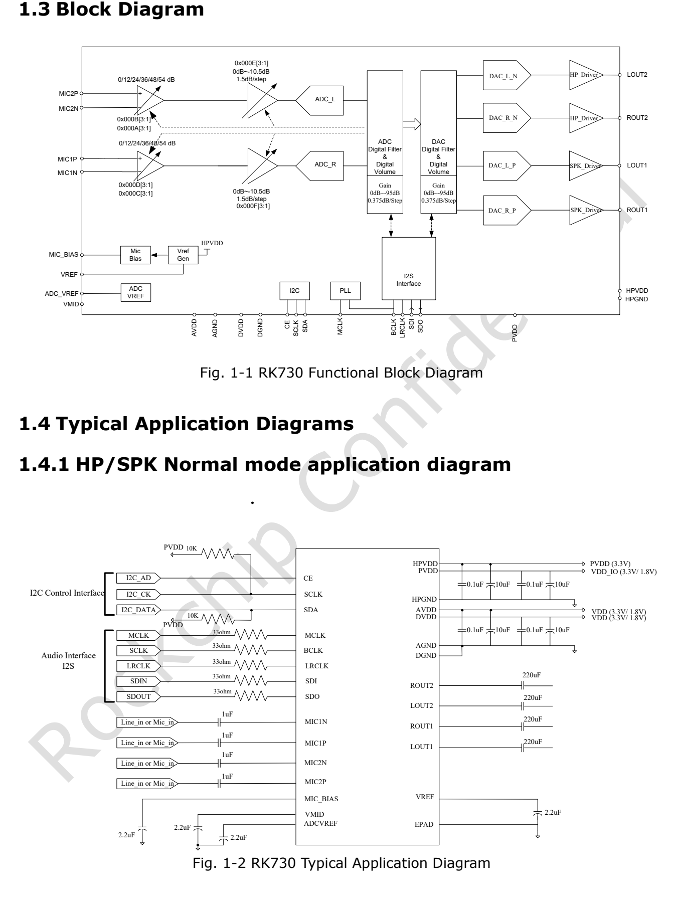
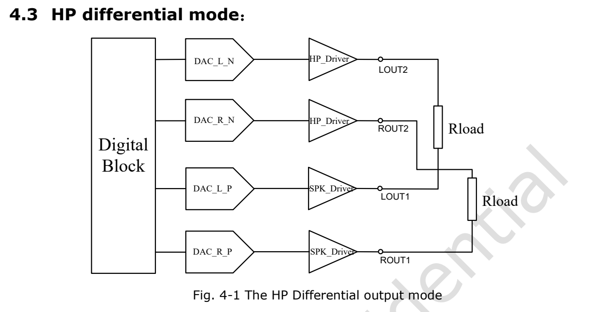
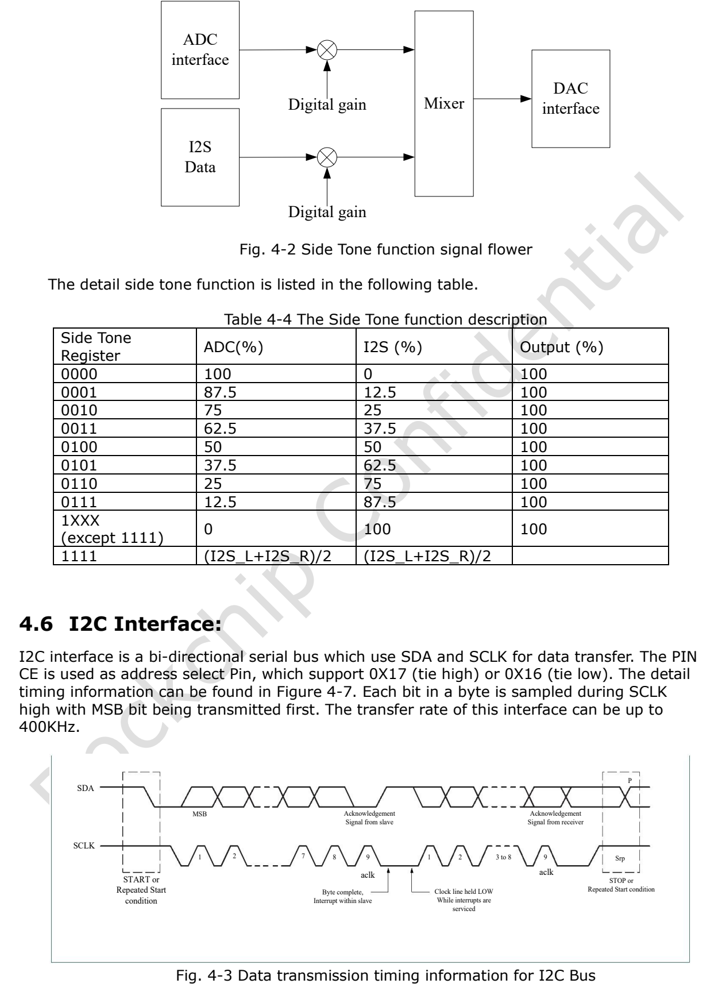

Статья основана на указанной редакции datasheet. Значения являются спецификациями производителя, а не измерениями ArmSoM; новых аппаратных испытаний не проводилось. Проверьте ревизию кристалла, схему платы, SDK/BSP, ядро и драйверы. Пояснения и редактируемые таблицы помогают чтению; полная спецификация и не рассмотренные подробно битовые поля находятся в исходном PDF.

**RK730 · Rockchip RK730 Datasheet V1.0-20241118.pdf · PDF 16–19.**

*Английский оригинал, PDF, стр. 9.*

## Сначала определите источник тактов

Перед настройкой задайте направления MCLK, BCLK, LRCLK, SDI и SDO. Источник тактов, семейство частот, разрядность и ширина слота должны совпадать. Ответ I2C не подтверждает правильные аудиотакты. При отсутствии звука сначала проверьте питание и такты, затем mute, разрешение каналов и аналоговый тракт.

## Таблица выбора PLL

| Выбор 4 bit | Опорная частота MHz | Семейство частот | Источник |
|---|---|---|---|
| 0000 | 12.288 | 48 kHz | MCLK |
| 0001 | 12.288 | 44.1 kHz | MCLK |
| 0010 | 12.288 | 32 kHz | MCLK |
| 0011 | 12 | 48 kHz | MCLK |
| 0100 | 12 | 44.1 kHz | MCLK |
| 0101 | 12 | 32 kHz | MCLK |
| 0110 | 3.072 | 48 kHz | BCLK |
| 0111 | 2.822 | 44.1 kHz | BCLK |
| 1000 | 2.048 | 32 kHz | BCLK |
| 1001 | 24 | 48 kHz | BCLK |
| 1010 | 24 | 44.1 kHz | BCLK |
| 1011 | 24 | 32 kHz | BCLK |
| 1100 | 6.144 | 48 kHz | MCLK |
| 1101 | 11.2896 | 44.1 kHz | MCLK |
| 1110 | 8.192 | 32 kHz | MCLK |
| 1111 | — | — | — |

## Два пункта PLL, которые нельзя исправлять произвольно

В строке 0111 указано 2.822 MHz, без замены на 2.8224 MHz. Строки 1001–1011 явно задают BCLK 24 MHz, не MCLK. У 1111 нет действующего выбора. Семейство частот не доказывает произвольную Fs в любом режиме; сопоставляйте таблицу с драйвером и измерениями.

## Копирование ADC и микширование sidetone

| Параметр | Спецификация / примечание |
|---|---|
| ADC 00 | L → L; R → R |
| ADC 01 | L → L/R |
| ADC 10 | R → L/R |
| ADC 11 | L ↔ R |
| Sidetone 0000 | ADC 100% / I2S 0% |
| Sidetone 0001 | ADC 87.5% / I2S 12.5% |
| Sidetone 0010 | ADC 75% / I2S 25% |
| Sidetone 0011 | ADC 62.5% / I2S 37.5% |
| Sidetone 0100 | ADC 50% / I2S 50% |
| Sidetone 0101 | ADC 37.5% / I2S 62.5% |
| Sidetone 0110 | ADC 25% / I2S 75% |
| Sidetone 0111 | ADC 12.5% / I2S 87.5% |
| Sidetone 1XXX (≠1111) | ADC 0% / I2S 100% |
| Sidetone 1111 | (I2S_L + I2S_R) / 2 |

## Дифференциальный выход и исходная схема

Копирование действует только в тракте ADC. Схема дифференциального выхода объединяет ROUT1/ROUT2 и LOUT1/LOUT2, но текст повторяет «ROUT2 and Rout2»; по этому повтору нельзя выполнять соединение. Строку микширования 1111 сверяйте с колонками оригинала и драйвером, не предполагая дополнительных аналоговых путей.

*Английский оригинал, PDF, стр. 17.*

## Выбор адреса I2C

Адреса приведены в 7-bit виде, бит R/W добавляется отдельно. CE выбирает адрес ведомого на шине, смещение регистра — другой уровень. 0x16/0x17 не номера регистров. Предел I2C — 400 kbit/s. Проверьте уровни I/O и питание подтяжек; согласуйте ручной доступ с драйвером ядра.

| Параметр | Спецификация / примечание |
|---|---|
| CE = 0 | 0x16 |
| CE = 1 | 0x17 |

## Дополнительные иллюстрации источника

*Английский оригинал, PDF, стр. 18.*

## Продукты ArmSoM и границы применения

CM1 и Forge1 приведены как платформы для проектов с аудиопериферией. Наличие RK730 на этих платах и готовая поддержка драйвера здесь не утверждаются. Сначала проверьте доступность I2S, I2C, тактовых сигналов и нужных уровней напряжения.

- [CM1](https://www.armsom.org/cm1) · [Docs](https://docs.armsom.org/armsom-cm1)
- [Forge1](https://www.armsom.org/forge1) · [Docs](https://docs.armsom.org/armsom-forge1)

## Серия по datasheet и исходный PDF

- [RK730 обзор](/ru/articles/rk730-audio-codec-design/)
- [RK730: корпус QFN28, выводы и питание аудиокодека](/ru/articles/rk730-package-power-pinout/)
- [RK730: PLL, I2S, sidetone и адресация I2C](/ru/articles/rk730-clocks-audio-i2c/)
- [RK730: 65 регистров, значения сброса и группы управления](/ru/articles/rk730-register-map-reference/)
- [RK730: питание, запуск и останов ADC/DAC](/ru/articles/rk730-power-adc-dac-sequences/)
- [Скачать полный исходный PDF](/assets/datasheet-series-20261110/Rockchip-RK730-Datasheet-V1.0-20241118.pdf)
