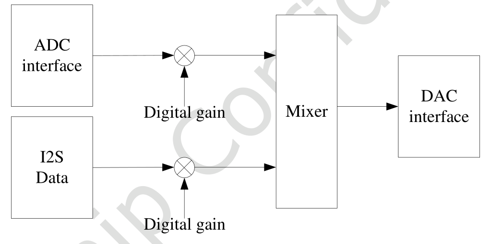
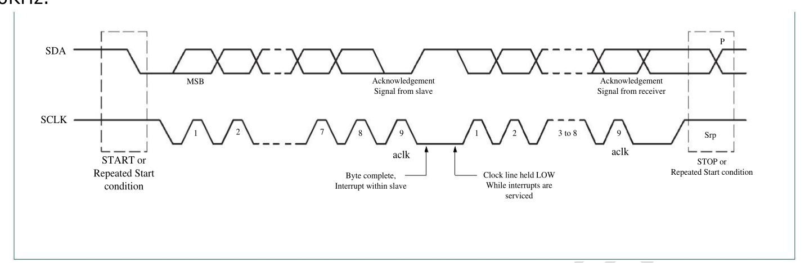
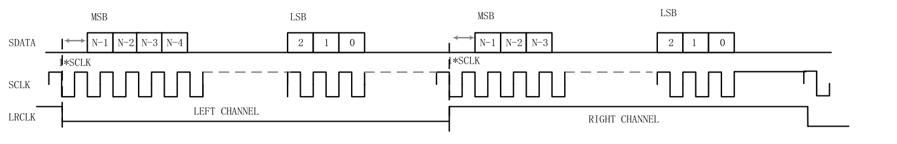
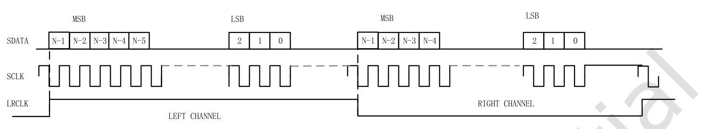
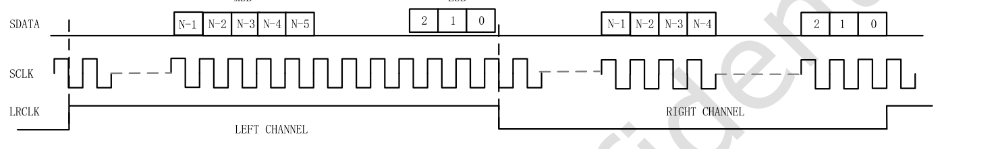
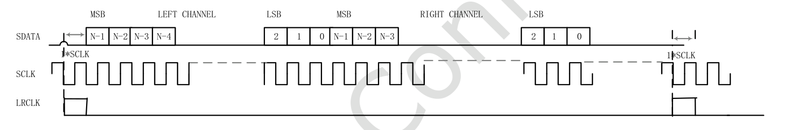
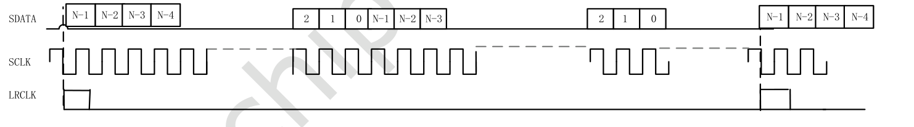

Обновлено по RK730 Datasheet V1.2. Параметры принадлежат производителю, а не аппаратным измерениям ArmSoM. Сверяйте ревизию кристалла, подключения платы, SDK/BSP и драйвер. Все рисунки взяты из предоставленного английского оригинала.

*RK730: PLL, I2S, sidetone и адресация I2C*

## Сначала определите источник тактов

Перед настройкой задайте направления MCLK, BCLK, LRCLK, SDI и SDO. Источник тактов, семейство частот, разрядность и ширина слота должны совпадать. Ответ I2C не подтверждает правильные аудиотакты. При отсутствии звука сначала проверьте питание и такты, затем mute, разрешение каналов и аналоговый тракт.

## Таблица выбора PLL

| Выбор 4 bit | Опорная частота MHz | Семейство частот | Источник |
|---|---|---|---|
| 0000 | 12.288 | 48 kHz | MCLK |
| 0001 | 12.288 | 44.1 kHz | MCLK |
| 0010 | 12.288 | 32 kHz | MCLK |
| 0011 | 12 | 48 kHz | MCLK |
| 0100 | 12 | 44.1 kHz | MCLK |
| 0101 | 12 | 32 kHz | MCLK |
| 0110 | 3.072 | 48 kHz | BCLK |
| 0111 | 2.822 | 44.1 kHz | BCLK |
| 1000 | 2.048 | 32 kHz | BCLK |
| 1001 | 24 | 48 kHz | MCLK |
| 1010 | 24 | 44.1 kHz | MCLK |
| 1011 | 24 | 32 kHz | MCLK |
| 1100 | 6.144 | 48 kHz | MCLK |
| 1101 | 11.2896 | 44.1 kHz | MCLK |
| 1110 | 8.192 | 32 kHz | MCLK |
| 1111 | — | — | — |

## Обновлённый выбор PLL и оставшаяся неоднозначность

В таблице 4-2 V1.2 вход 24 MHz для `1001–1011` явно относится к **MCLK**; страница исправлена. `0110/0111/1000` используют BCLK 3.072/2.822/2.048 MHz. Изменены и описания 0x6–0x8 в `CODEC_SYSPLL_3[7:4]`. Для `0111` новый документ по-прежнему указывает 2.822 MHz: значение сохранено, перед применением следует сверить драйвер и такты, не подменяя его на 2.8224 MHz. `1111` не задаёт допустимого выбора. Семейство 48 kHz включает 12/24/48/96/192 kHz; 44.1 kHz — 11.025/22.05/44.1/88.2/176.4 kHz; 32 kHz — 8/16/32/64/128 kHz.

## Копирование ADC и микширование sidetone

| Параметр | Спецификация / примечание |
|---|---|
| ADC 00 | L → L; R → R |
| ADC 01 | L → L/R |
| ADC 10 | R → L/R |
| ADC 11 | L ↔ R |
| Sidetone 0000 | ADC 100% / I2S 0% |
| Sidetone 0001 | ADC 87.5% / I2S 12.5% |
| Sidetone 0010 | ADC 75% / I2S 25% |
| Sidetone 0011 | ADC 62.5% / I2S 37.5% |
| Sidetone 0100 | ADC 50% / I2S 50% |
| Sidetone 0101 | ADC 37.5% / I2S 62.5% |
| Sidetone 0110 | ADC 25% / I2S 75% |
| Sidetone 0111 | ADC 12.5% / I2S 87.5% |
| Sidetone 1XXX (≠1111) | ADC 0% / I2S 100% |
| Sidetone 1111 | (I2S_L + I2S_R) / 2 |

## Сигнальный тракт sidetone

*Цифровое смешивание ADC и I2S*

## Выбор адреса I2C

Адреса приведены в 7-bit виде, бит R/W добавляется отдельно. CE выбирает адрес ведомого на шине, смещение регистра — другой уровень. 0x16/0x17 не номера регистров. Предел I2C — 400 kbit/s. Проверьте уровни I/O и питание подтяжек; согласуйте ручной доступ с драйвером ядра.

| Параметр | Спецификация / примечание |
|---|---|
| CE = 0 | 0x16 |
| CE = 1 | 0x17 |

*Временная диаграмма I2C*

## SPI и пять временных диаграмм цифрового аудио

V1.2 добавляет описание ведомого SPI: низкий SPI_CSn выбирает интерфейс, SPI_CLK формирует ведущий, SPI_DIN считывается по нарастающему фронту. Запись состоит из трёх 8-битных слов: 7-битный адрес микросхемы с битом R/W, адрес регистра и данные. Полная таблица мультиплексирования SPI на 28 выводов отсутствует, поэтому по названиям сигналов нельзя выводить схему подключения. Сначала уточните ревизию и опорную схему. Аудиоформаты — I2S, левое и правое выравнивание, DSP/PCM с вариантами A/B. Проверяйте по диаграммам фронты кадра, задержку первого бита относительно LRCLK и разрядность данных.

*SPI*

*I2S*

*Левое выравнивание*

*Правое выравнивание*

*DSP/PCM A*

*DSP/PCM B*

## Продукты ArmSoM и границы применения

CM1 и Forge1 приведены как платформы для проектов с аудиопериферией. Наличие RK730 на этих платах и готовая поддержка драйвера здесь не утверждаются. Сначала проверьте доступность I2S, I2C, тактовых сигналов и нужных уровней напряжения.

- [CM1](https://www.armsom.org/cm1) · [Docs](https://docs.armsom.org/armsom-cm1)
- [Forge1](https://www.armsom.org/armsom-forge1) · [Docs](https://docs.armsom.org/armsom-forge1)

## Другие статьи о RK730

- [RK730 обзор](/ru/articles/rk730-audio-codec-design/)
- [RK730: корпус QFN28, выводы и питание аудиокодека](/ru/articles/rk730-package-power-pinout/)
- [RK730: PLL, I2S, sidetone и адресация I2C](/ru/articles/rk730-clocks-audio-i2c/)
- [RK730: 65 регистров, значения сброса и группы управления](/ru/articles/rk730-register-map-reference/)
- [RK730: питание, запуск и останов ADC/DAC](/ru/articles/rk730-power-adc-dac-sequences/)
