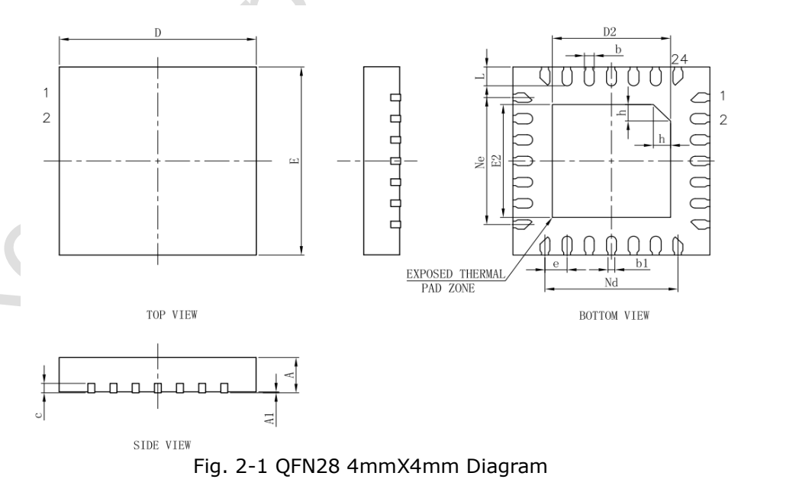
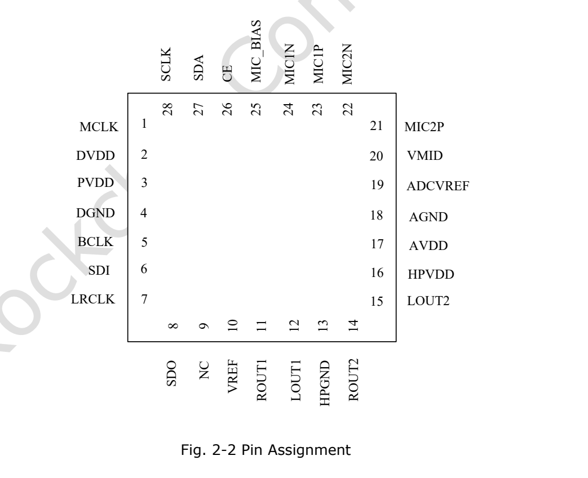

Статья основана на указанной редакции datasheet. Значения являются спецификациями производителя, а не измерениями ArmSoM; новых аппаратных испытаний не проводилось. Проверьте ревизию кристалла, схему платы, SDK/BSP, ядро и драйверы. Пояснения и редактируемые таблицы помогают чтению; полная спецификация и не рассмотренные подробно битовые поля находятся в исходном PDF.

**RK730 · Rockchip RK730 Datasheet V1.0-20241118.pdf · PDF 7–15.**

*Английский оригинал, PDF, стр. 11.*

## Аудиовозможности и область применения

RK730 — внешний аудиокодек с двумя ADC, двумя DAC и выходами наушников. Интеграция зависит от I2S/I2C, питания, тактов и драйверов, а не только SoC. Мощность, динамический диапазон и искажения имеют разные условия испытаний, не единую рабочую точку.

| Параметр | Спецификация / примечание |
|---|---|
| ADC / DAC | 2 / 2 · 24 bit · 8–192 kHz |
| Выходная мощность | 50 mW / 32 Ω; 100 mW / 16 Ω |
| Дифференциальный выход | 4.8 Vpp at 3.3 V supply |
| Усиление микрофона | ≤54 dB |

## Размеры корпуса (mm)

| Обозначение | Min / Typ / Max или исходное значение |
|---|---|
| Package | QFN28 · 4 × 4 mm · 0.45 mm pitch |
| A | 0.70 / 0.75 / 0.80 |
| A1 | 0 / 0.02 / 0.05 |
| b | 0.15 / 0.20 / 0.25 |
| b1 | 0.14 REF |
| c | 0.18 / 0.20 / 0.25 |
| D / E | 3.90 / 4.00 / 4.10 |
| D2 / E2 | 2.30 / 2.40 / 2.50 |
| e | 0.45 BSC |
| Ne / Nd | 2.70 BSC |
| L | 0.35 / 0.40 / 0.45 |
| h | 0.30 / 0.35 / 0.40 |

## Полная таблица выводов

| Номер | Имя | Направление в оригинале | Функция |
|---|---|---|---|
| 1 | MCLK | I | Вход основного такта |
| 2 | DVDD | Supply | Цифровое питание |
| 3 | PVDD | Supply | Питание цифровых I/O |
| 4 | DGND | Supply | Цифровая земля |
| 5 | BCLK | I/O | Битовый такт |
| 6 | SDI | I | Вход аудиоданных |
| 7 | LRCLK | I/O | Такт левого/правого канала |
| 8 | SDO | O | Выход аудиоданных |
| 9 | NC |  | Не подключать |
| 10 | VREF | O | Опорное напряжение |
| 11 | ROUT1 | O | Правый выход 1 |
| 12 | LOUT1 | O | Левый выход 1 |
| 13 | HPGND | Supply | Земля наушников |
| 14 | ROUT2 | O | Правый выход 2 |
| 15 | LOUT2 | O | Левый выход 2 |
| 16 | HPVDD | Supply | Питание наушников |
| 17 | AVDD | Supply | Аналоговое питание |
| 18 | AGND | Supply | Аналоговая земля |
| 19 | ADCVREF | O | Опорное ADC |
| 20 | VMID | O | Средняя опорная точка |
| 21 | MIC2P | I | Микрофон 2, плюс |
| 22 | MIC2N | I | Микрофон 2, минус |
| 23 | MIC1P | I | Микрофон 1, плюс |
| 24 | MIC1N | I | Микрофон 1, минус |
| 25 | MIC_BIAS | O | Смещение микрофона |
| 26 | CE | I | Выбор адреса I2C |
| 27 | SDA | I/O | Данные I2C |
| 28 | SCL | O | Такт I2C; в источнике O, проверить |
| EPAD | EPAD | Supply | Открытая площадка на землю |

## Питание и температура

PVDD питает цифровые I/O, DVDD — цифровое ядро; похожие имена не означают одинаковые требования. HPVDD рекомендован 3.3 V, остальные три питания допускают 1.8/3.3 V. Опорные выводы подключайте по схеме производителя, не используйте их как питание периферии.

| Параметр | Спецификация / примечание |
|---|---|
| PVDD / DVDD / AVDD | Min 1.62 V · Typ 1.8 / 3.3 V · Max 3.6 V |
| HPVDD | Min 3.0 V · Typ 3.3 V · Max 3.6 V |
| Абсолютный диапазон питания/входа | −0.3…3.6 V |
| Температура работы в исходной таблице | −40…85 °C |
| Температура хранения | −65…150 °C |

## Условия аудиоизмерений и расхождения

Динамический диапазон ADC — 100 dB в списке функций и 101 dB с A-взвешиванием в электрической таблице. Условия последней сохранены отдельно. Вывод 28 обозначен SCL с направлением O, хотя описание называет его тактом I2C; уточните направление по проекту и актуальным документам. Ниже данные производителя, не измерения CM1/Forge1.

| Параметр | Спецификация / примечание |
|---|---|
| ADC | Full scale 1 Vrms; SNR 100 dB; dynamic range 101 dB A-weighted; THD −95 dB typ; input 20 kΩ |
| ADC filter | Passband 0.4917 Fs; stopband 0.5479 Fs; ripple 0.05 dB; attenuation 100 dB |
| DAC normal | 1 Vrms; SNR 98 dB; dynamic range 100 dB; THD −85 dB |
| DAC differential | 2 Vrms; SNR 98 dB; dynamic range 103 dB; THD −88 dB |

## Дополнительные иллюстрации источника

*Английский оригинал, PDF, стр. 12.*

## Продукты ArmSoM и границы применения

CM1 и Forge1 приведены как платформы для проектов с аудиопериферией. Наличие RK730 на этих платах и готовая поддержка драйвера здесь не утверждаются. Сначала проверьте доступность I2S, I2C, тактовых сигналов и нужных уровней напряжения.

- [CM1](https://www.armsom.org/cm1) · [Docs](https://docs.armsom.org/armsom-cm1)
- [Forge1](https://www.armsom.org/forge1) · [Docs](https://docs.armsom.org/armsom-forge1)

## Серия по datasheet и исходный PDF

- [RK730 обзор](/ru/articles/rk730-audio-codec-design/)
- [RK730: корпус QFN28, выводы и питание аудиокодека](/ru/articles/rk730-package-power-pinout/)
- [RK730: PLL, I2S, sidetone и адресация I2C](/ru/articles/rk730-clocks-audio-i2c/)
- [RK730: 65 регистров, значения сброса и группы управления](/ru/articles/rk730-register-map-reference/)
- [RK730: питание, запуск и останов ADC/DAC](/ru/articles/rk730-power-adc-dac-sequences/)
- [Скачать полный исходный PDF](/assets/datasheet-series-20261110/Rockchip-RK730-Datasheet-V1.0-20241118.pdf)
