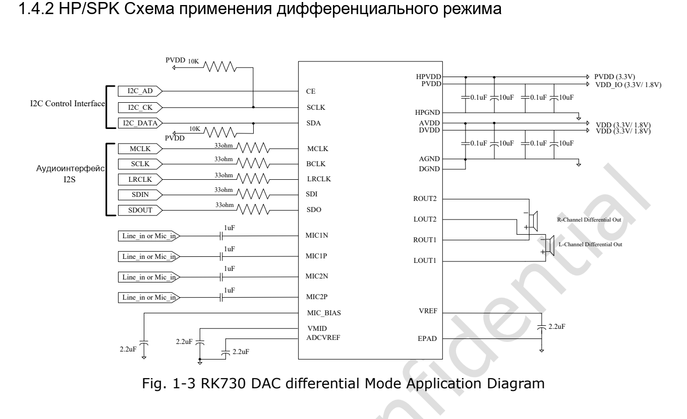

Статья основана на указанной редакции datasheet. Значения являются спецификациями производителя, а не измерениями ArmSoM; новых аппаратных испытаний не проводилось. Проверьте ревизию кристалла, схему платы, SDK/BSP, ядро и драйверы. Пояснения и редактируемые таблицы помогают чтению; полная спецификация и не рассмотренные подробно битовые поля находятся в исходном PDF.

**RK730 · Rockchip RK730 Datasheet V1.0-20241118.pdf · PDF 44–46.**

*Английский оригинал, PDF, стр. 10.*

## Это справочные последовательности, не исполняемый скрипт

Таблицы следуют стр. 44–46 сверху вниз. Присваивание поля меняет указанные биты, не весь регистр; сохраняйте остальные биты, блокировки драйвера и управление питанием. Неуказанные задержки не придуманы. Перед применением проверьте драйвер, такты, каналы и аналоговую схему.

## Шесть полных последовательностей

### Включение системы

| Порядок чтения | Номер в оригинале | Значение поля | Действие / группа |
|---|---|---|---|
| 1 | 0 | — | Подать аналоговое и цифровое питание |
| 2 | 1 | `0x1F[7]=1'b1` | Включить LDO VMID |
| 3 | 2 | `0x10[7:0]=8'b00000000` | Управление системным PLL |

### Выключение системы

| Порядок чтения | Номер в оригинале | Значение поля | Действие / группа |
|---|---|---|---|
| 1 | 0 | — | Сохранить питание; сначала выключить DAC и ADC |
| 2 | 1 | `0x10[7:0]=8'b11111111` | Выключить системный PLL |
| 3 | 2 | `0x1F[7]=1'b0` | Выключить LDO VMID |
| 4 | 3 | — | Снять аналоговое и цифровое питание |

### Включение ADC

| Порядок чтения | Номер в оригинале | Значение поля | Действие / группа |
|---|---|---|---|
| 1 | 0 | — | Выполнить включение системы |
| 2 | 1 | `0x01[7]=1'b0` | HK_TOP_1 |
| 3 | 2 | `0x0A[0]=1'b0` | MIC_BOOST_0 |
| 4 | 3 | `0x0B[0]=1'b0` | MIC_BOOST_1 |
| 5 | 4 | `0x0C[0]=1'b0` | MIC_BOOST_2 |
| 6 | 5 | `0x0D[0]=1'b0; 0x0D[7:6]=2'b01` | MIC_BOOST_3 |
| 7 | 6 | `0x0E[0]=1'b0` | ADC_PGA_BLOCK_0 |
| 8 | 7 | `0x0F[0]=1'b0; 0x0F[7:6]=2'b01` | ADC_PGA_BLOCK_1 |
| 9 | 8 | `0x04[1:0]=2'b00` | ADC_0 |
| 10 | 9 | `0x06[4]=1'b1; 0x06[3]=1'b1` | ADC_2 |
| 11 | 10 | `0x07[5:4]=2'b01` | ADC_3 |
| 12 | 11 | `0x41[2:0]=3'b010` | SRT |
| 13 | 12 | `0x44[7]=1'b1` | VUCTL |
| 14 | 13 | `0x69[0]=1'b0` | I2S_CKM |
| 15 | 14 | `0x6F[6]=1'b0` | I2S_TXCR1 |
| 16 | 15 | `0x71[7:0]=8'b10001000` | I2S_TXCMD |
| 17 | 16 | `0x40[7:6]=2'b11` | DIGEN |
| 18 | 17 | `0x40[5:4]=2'b11` | DIGEN |
| 19 | 18 | — | Начать запись |

### Выключение ADC (исходные номера сохранены)

| Порядок чтения | Номер в оригинале | Значение поля | Действие / группа |
|---|---|---|---|
| 1 | 0 | — | Остановить запись, временно сохранить каналы |
| 2 | 1 | `0x40[5:4]=2'b00` | DIGEN |
| 3 | 2 | `0x40[7:6]=2'b00` | DIGEN |
| 4 | 3 | `0x71[7:0]=8'b00000000` | I2S_TXCMD |
| 5 | 8 | `0x04[1:0]=2'b11` | ADC_0 |
| 6 | 7 | `0x0F[0]=1'b1; 0x0E[0]=1'b1` | ADC_PGA_BLOCK_1 / ADC_PGA_BLOCK_0 |
| 7 | 6 | `0x0D[0]=1'b1` | MIC_BOOST_3 |
| 8 | 4 | `0x0C[0]=1'b1` | MIC_BOOST_2 |
| 9 | 3 | `0x0B[0]=1'b1` | MIC_BOOST_1 |
| 10 | 2 | `0x0A[0]=1'b1` | MIC_BOOST_0 |
| 11 | 1 | `0x01[7]=1'b1` | HK_TOP_1 |

### Включение DAC

| Порядок чтения | Номер в оригинале | Значение поля | Действие / группа |
|---|---|---|---|
| 1 | 0 | — | Выполнить включение системы |
| 2 | 1 | `0x01[7:6]=2'b00` | HK_TOP_1 |
| 3 | 2 | `0x41[6:4]=3'b010` | SRT |
| 4 | 3 | `0x44[6]=1'b1` | VUCTL |
| 5 | 4 | `0x69[7:0]=8'b00111010` | I2S_CKM |
| 6 | 5 | `0x40[7:4]=4'b0101` | DIGEN |
| 7 | 6 | `0x40[7:4]=4'b0000` | DIGEN |
| 8 | 7 | `0x69[7:0]=8'b00000000` | I2S_CKM |
| 9 | 8 | `0x6E[7]=1'b1` | I2S_RXCMD |
| 10 | 9 | `0x40[3:0]=4'b0101` | DIGEN |
| 11 | 10 | `0x40[3:0]=4'b1111` | DIGEN |
| 12 | 11 | `0x4F[7:4]=4'b0000` | DDAC_FILTER |
| 13 | 12 | `0x08[2:0]=3'b000` | DAC_0 |
| 14 | 13 | `0x09[6:4]=3'b000` | DAC_1 |
| 15 | 14 | `0x21[7:0]=8'b10000000` | HP_0 |
| 16 | 15 | `0x24[7:0]=8'b10000000` | SPK_0 |
| 17 | 16 | — | Начать воспроизведение |

### Выключение DAC

| Порядок чтения | Номер в оригинале | Значение поля | Действие / группа |
|---|---|---|---|
| 1 | 0 | — | Сначала включить mute |
| 2 | 1 | `0x24[3:2]=2'b11` | SPK_0 |
| 3 | 2 | `0x21[3:2]=2'b11` | HP_0 |
| 4 | 3 | `0x09[6:4]=3'b111` | DAC_1 |
| 5 | 4 | `0x08[2:0]=3'b111` | DAC_0 |
| 6 | 5 | `0x40[3:0]=4'b0101` | DIGEN |
| 7 | 6 | `0x40[3:0]=4'b0000` | DIGEN |
| 8 | 7 | `0x6E[7]=1'b0` | I2S_RXCMD |
| 9 | 8 | `0x01[7:6]=2'b11` | HK_TOP_1 |

## Конфликт номеров и перенос страницы

Номера выключения ADC: 0,1,2,3,8,7,6,4,3,2,1, с повторами и обратным порядком. Они сохранены рядом с порядком чтения, не отсортированы. Шаг 9 включения ADC пересекает страницу; обе записи 0x06[4] и 0x06[3] сохранены. Переход DIGEN 0101 → 0000 при включении DAC также не удалён; промежуточные операции нельзя объединять по совпадению итогов.

## Что фиксировать при проверке платы

Фиксируйте питание, MCLK/BCLK/LRCLK, версию драйвера, параметры дискретизации и изменения регистров. Проверяйте ADC известным входным уровнем, затем DAC на заданной нагрузке; оценивайте mute, шум, щелчки и восстановление. Перед снятием питания выключайте аудиотракты. Это рекомендации, не утверждение о завершённых испытаниях ArmSoM.

## Продукты ArmSoM и границы применения

CM1 и Forge1 приведены как платформы для проектов с аудиопериферией. Наличие RK730 на этих платах и готовая поддержка драйвера здесь не утверждаются. Сначала проверьте доступность I2S, I2C, тактовых сигналов и нужных уровней напряжения.

- [CM1](https://www.armsom.org/cm1) · [Docs](https://docs.armsom.org/armsom-cm1)
- [Forge1](https://www.armsom.org/forge1) · [Docs](https://docs.armsom.org/armsom-forge1)

## Серия по datasheet и исходный PDF

- [RK730 обзор](/ru/articles/rk730-audio-codec-design/)
- [RK730: корпус QFN28, выводы и питание аудиокодека](/ru/articles/rk730-package-power-pinout/)
- [RK730: PLL, I2S, sidetone и адресация I2C](/ru/articles/rk730-clocks-audio-i2c/)
- [RK730: 65 регистров, значения сброса и группы управления](/ru/articles/rk730-register-map-reference/)
- [RK730: питание, запуск и останов ADC/DAC](/ru/articles/rk730-power-adc-dac-sequences/)
- [Скачать полный исходный PDF](/assets/datasheet-series-20261110/Rockchip-RK730-Datasheet-V1.0-20241118.pdf)
