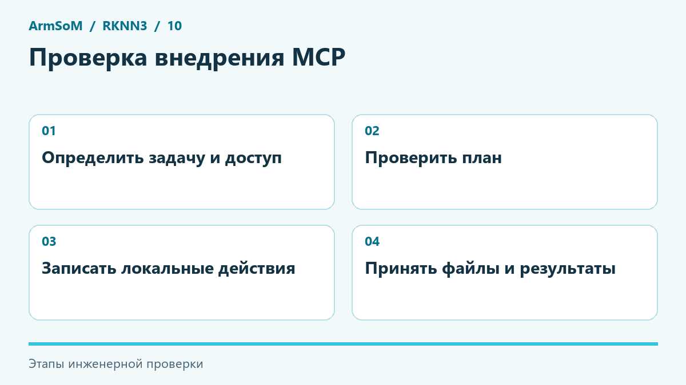

Естественный язык облегчает работу с инструментами, но инженерная поставка требует прослеживаемого плана, входов и критериев приёмки. RKNN3 MCP помогает организовать процесс; фразы «развёртывание завершено» недостаточно.

> Это авторское техническое объяснение и рекомендации по внедрению на основе официальной документации. Этот процесс не проверялся на оборудовании ArmSoM. Перед внедрением согласуйте целевой чип, SDK, Runtime, драйвер и прошивку.

[](/assets/rknn3-v120/rknn3-v010-mcp-deployment-ru.svg)

*Оригинальная схема ArmSoM: порядок работы, а не результаты аппаратных испытаний. Нажмите для открытия векторной версии.*

## Разделяйте сервис и исполнителя

Руководство V0.1.0 относит знания, планирование, проверку параметров и состояние задачи к MCP Server. Обработка модели и действия с платой выполняются клиентским Agent в локальном или рабочем серверном окружении. По руководству, MCP Server сам не читает файлы клиента и не запускает его программы.

Оценивайте также, что реально отправляют, читают и исполняют инструменты Agent. Граница сервера не доказывает отсутствие передачи данных во всём процессе.

## Опишите конкретную задачу

Редакционный шаблон требований не выполняет команды:

```text
Target chip and board revision:
SDK, Runtime and firmware versions:
Model path and checksum:
Input shapes and preprocessing:
Required output and quality threshold:
Allowed directories and device access:
Actions requiring human approval:
Evidence required for completion:
```

Чёткие цели и ограничения помогают заранее обнаружить неподходящую модель, недостающие зависимости и избыточный доступ.

## Введите проверяемые этапы

| Этап | Что оценить |
| --- | --- |
| Анализ | Соответствие модели, платформы и окружения |
| План | Изменения и ожидаемые файлы |
| Исполнение | Команды, журналы, статусы, результаты |
| Проверка | Точность, устройство, незавершённая работа |
| Передача | Пути, версии, порядок восстановления |

Выполненный вызов инструмента не равен завершённому проекту. Получение файлов, конвертация, запуск устройства и бизнес-приёмка — разные результаты.

## Поймите доступ до подключения

Документированный адрес — `https://rknn-mcp.rock-chips.com/mcp`, транспорт Streamable HTTP. В рамках статьи сервис не подключался, Agent не настраивался, модели не загружались и доступ к плате не предоставлялся.

Подготовьте согласованные инструменты и начните с ограниченной задачи анализа модели. Данные подключения платы нужны только для работ с реальной проверкой устройства.

## Сохраняйте основание для продолжения

Запишите последний успешный этап, хеши файлов, окружение и нерешённые проблемы. Перед возобновлением сверяйте состояние, чтобы не использовать устаревшие результаты. В проекте ArmSoM приёмку определяют воспроизводимая работа устройства и критерии приложения, а не последний шаг автоматизации.

## Планирование проекта на ArmSoM

Если плата ArmSoM рассматривается как хост приложения, изучите сведения о [Sige7](https://www.armsom.org/sige7), [Sige5](https://www.armsom.org/sige5) и [CM5](https://www.armsom.org/cm5). Проверьте интерфейсы, питание, образ ОС и драйверы для фактической ревизии платы и носителя. Это ориентиры для выбора хоста, а не заявление о совместимости модулей RK182X без доработок. Встроенные NPU RK3588 / RK3576 используют соответствующий стек RKNN Toolkit2; выбор такого хоста не переводит его внутренний NPU на RKNN3.

Материалы по интерфейсам и модулям: [RK182X M.2](/ru/articles/rk182x-m2-module-guide/) · [RK182X SO-DIMM](/ru/articles/rk182x-sodimm-module-datasheet/) · [RK3572 Datasheet V1.0](/ru/articles/rk3572-datasheet-v10/)

## Официальные документы и версия

Основа — фиксированный снимок официального репозитория `141883c8e11b0`, проверенный 2026-11-14. Полные интерфейсы, параметры и ограничения смотрите в оригинале. Статья не заменяет руководство и не воспроизводит PDF целиком.

- <a href="https://github.com/airockchip/rknn3-toolkit/blob/141883c8e11b05ef4cca4a69d8a7572c4d855191/doc/EN/09_RKNN3_MCP_QuickStart_V0.1.0.pdf">Официальный PDF на английском (V0.1.0)</a>
- <a href="https://github.com/airockchip/rknn3-toolkit/blob/141883c8e11b05ef4cca4a69d8a7572c4d855191/doc/CN/09_RKNN3_MCP_%E5%BF%AB%E9%80%9F%E5%85%A5%E9%97%A8_V0.1.0.pdf">Официальный PDF на китайском (V0.1.0)</a>
- [Все официальные документы](https://github.com/airockchip/rknn3-toolkit/tree/main/doc)

## Порядок чтения

- [Обзор серии](/ru/articles/rknn3-v120-platform-guide/)
- Предыдущая статья: [Экспорт MoE в RKNN3: проверка экспертов перед полной моделью](/ru/articles/rknn3-v120-moe-export/)
