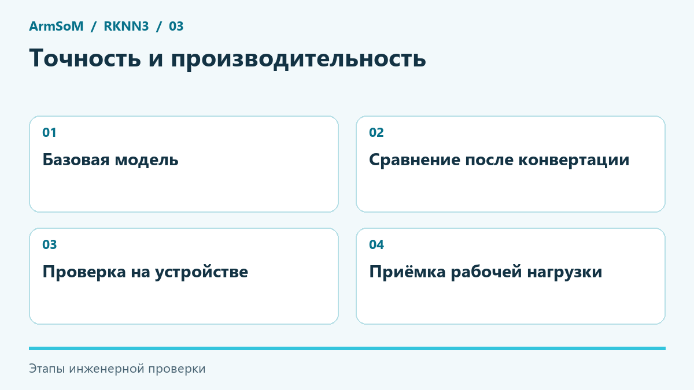

Успешная конвертация означает получение файлов, но не доказывает правильность ответов, приемлемую задержку или стабильность длительной работы. Критерии приёмки нужны до оптимизации: ускорение может скрывать потерю точности или рост памяти.

> Это авторское техническое объяснение и рекомендации по внедрению на основе официальной документации. Этот процесс не проверялся на оборудовании ArmSoM. Перед внедрением согласуйте целевой чип, SDK, Runtime, драйвер и прошивку.

[](/assets/rknn3-v120/rknn3-v120-accuracy-performance-ru.svg)

*Оригинальная схема ArmSoM: порядок работы, а не результаты аппаратных испытаний. Нажмите для открытия векторной версии.*

## Сохраните надёжный эталон

Руководство разработчика рассматривает конвертацию, квантование, оценку и развёртывание, а также KV Cache, LoRA и PagedAttention. Для инженерного сравнения зафиксируйте исходную модель и предобработку, затем используйте тот же тестовый набор.

Для зрения сохраняйте изображение и подготовленный тензор. Для языковых моделей — текст, шаблон, конфигурацию токенизатора и условия генерации. Одно имя файла не отражает порядок цветов, масштабирование или изменение запроса.

## Задайте отдельные критерии

| Измерение | Полезные данные | Недостаточное доказательство |
| --- | --- | --- |
| Точность | Прикладная метрика и распределение ошибок | Один удачный снимок |
| Задержка | Первый запуск, установившийся режим, хвост распределения | Только лучший результат |
| Память | Пик и поведение повторных запусков | Значение после старта |

Порог определяется задачей. Интерактивному устройству важно время ожидания; детектору — также пропуски событий и накопление очереди. Единственная метрика не описывает все требования.

## Меняйте один существенный фактор

Поэтапно сравните исходную модель, конвертацию без квантования, квантованный вариант и устройство. При расхождении сначала докажите идентичность входов, затем найдите первое значимое отклонение.

Разные формулировки генеративной модели не всегда означают ошибку. Подготовьте фактические вопросы, требования к формату, длинные и некорректные входы с явной системой оценки. Включайте неудачные случаи.

## Измеряйте полный запрос

Отдельно учитывайте захват, предобработку, очередь, инференс и обработку ответа. Ускорение вычисления не всегда устраняет задержку пользователя. Асинхронные этапы перекрываются; значения из разных временных окон нельзя просто складывать.

Редакционный шаблон записи результатов:

```text
case_id,model_sha256,input_sha256,run_mode,
load_ms,queue_ms,inference_ms,end_to_end_ms,
peak_memory_mb,quality_score,error
```

Заполняйте его измерениями, а не ожидаемыми оценками.

## После оптимизации повторяйте проверки

Сохраните постоянный регрессионный набор и добавляйте полевые примеры. После изменения квантования, кеша или параллелизма проверяйте точность, освобождение ресурсов и восстановление. Документированные функции не являются измерениями ArmSoM; аппаратные тесты для статьи не выполнялись.

## Планирование проекта на ArmSoM

Если плата ArmSoM рассматривается как хост приложения, изучите сведения о [Sige7](https://www.armsom.org/sige7), [Sige5](https://www.armsom.org/sige5) и [CM5](https://www.armsom.org/cm5). Проверьте интерфейсы, питание, образ ОС и драйверы для фактической ревизии платы и носителя. Это ориентиры для выбора хоста, а не заявление о совместимости модулей RK182X без доработок. Встроенные NPU RK3588 / RK3576 используют соответствующий стек RKNN Toolkit2; выбор такого хоста не переводит его внутренний NPU на RKNN3.

Материалы по интерфейсам и модулям: [RK182X M.2](/ru/articles/rk182x-m2-module-guide/) · [RK182X SO-DIMM](/ru/articles/rk182x-sodimm-module-datasheet/) · [RK3572 Datasheet V1.0](/ru/articles/rk3572-datasheet-v10/)

## Официальные документы и версия

Основа — фиксированный снимок официального репозитория `141883c8e11b0`, проверенный 2026-11-14. Полные интерфейсы, параметры и ограничения смотрите в оригинале. Статья не заменяет руководство и не воспроизводит PDF целиком.

- <a href="https://github.com/airockchip/rknn3-toolkit/blob/141883c8e11b05ef4cca4a69d8a7572c4d855191/doc/EN/02_RKNN3_SDK_Development_Guide_V1.2.0.pdf">Официальный PDF на английском (V1.2.0)</a>
- <a href="https://github.com/airockchip/rknn3-toolkit/blob/141883c8e11b05ef4cca4a69d8a7572c4d855191/doc/CN/02_RKNN3_SDK_%E5%BC%80%E5%8F%91%E6%8C%87%E5%8D%97_V1.2.0.pdf">Официальный PDF на китайском (V1.2.0)</a>
- [Все официальные документы](https://github.com/airockchip/rknn3-toolkit/tree/main/doc)

## Порядок чтения

- [Обзор серии](/ru/articles/rknn3-v120-platform-guide/)
- Предыдущая статья: [Первый запуск RKNN3: от проверки окружения до воспроизводимого результата](/ru/articles/rknn3-v120-first-deployment/)
- Следующая статья: [RKNN3 Toolkit Python: воспроизводимая и прослеживаемая конвертация](/ru/articles/rknn3-v120-toolkit-python-workflow/)
