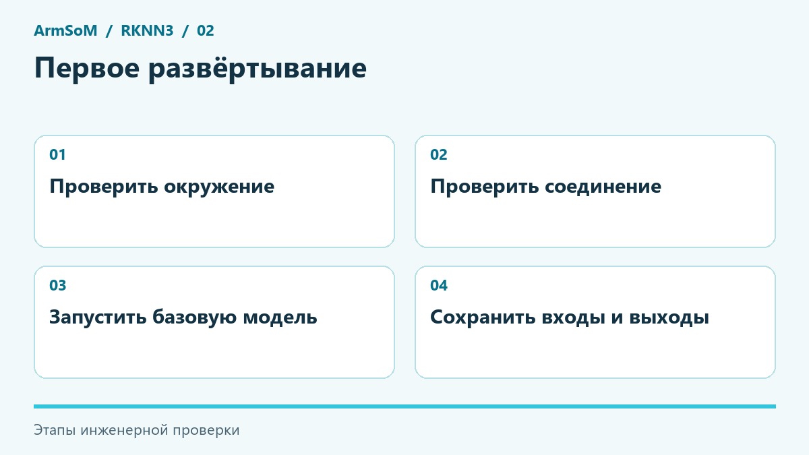

У первого запуска должна быть конкретная цель: получить проверяемый выход для известного входа при зафиксированных версиях и соединении. Камеры, контейнеры, сервисы и несколько моделей лучше добавлять после этого.

> Это авторское техническое объяснение и рекомендации по внедрению на основе официальной документации. Этот процесс не проверялся на оборудовании ArmSoM. Перед внедрением согласуйте целевой чип, SDK, Runtime, драйвер и прошивку.

[](/assets/rknn3-v120/rknn3-v120-first-deployment-ru.svg)

*Оригинальная схема ArmSoM: порядок работы, а не результаты аппаратных испытаний. Нажмите для открытия векторной версии.*

## Укажите три места выполнения

Запишите компьютер конвертации, хост приложения и чип инференса. В системе с сопроцессором это могут быть разные устройства. Одного слова «Linux» недостаточно: нужны версия ОС, архитектура, Python ABI и расположение библиотек.

Quick Start разделяет пути RK182X и RK3572, а также хост-плату и ПК. Описанный там USB-режим хоста macOS не означает поддержку оценки на плате средствами Toolkit. Ограничения Toolkit для macOS проверяются отдельно по справочнику API.

## Подготовьте запись для передачи проекта

| Пункт | Сохраняемые сведения |
| --- | --- |
| Устройство | Плата, ревизия, целевой чип |
| ПО | Источник образа, пакеты, контрольные суммы модели |
| Соединение | Порт, кабель, результат обнаружения |
| Корректность | Фиксированный вход и ожидаемый выход |
| Восстановление | Журнал ошибки и порядок действий |

Другой инженер должен воспроизвести результат по этой записи. Фраза «вчера работало» не позволяет отличить замену кабеля от изменения образа, модели или окружения Python.

## Запишите окружение до установки

Эти редакционные команды только показывают сведения о выбранном Python. Они ничего не устанавливают и не подключаются к плате:

```bash
python -c "import sys, platform; print(sys.executable); print(sys.version); print(platform.platform()); print(platform.machine())"
python -m pip --version
python -m pip check
```

После сохранения вывода выберите пакеты для нужной архитектуры, Python и выпуска. Сходство названий не доказывает совместимость. Разные инструментальные цепочки лучше не смешивать в одном давно используемом окружении.

## Добавляйте по одному уровню

Проверьте питание и обнаружение устройства, затем службы связи и официальный пример соответствующей версии. Только после успешного базового запуска меняйте входы. При сбое сохраняйте журнал нужного уровня, не заменяя одновременно Runtime, модель и кабель.

При подключении камеры сохраните кадр и сравните с файловым входом. При добавлении сетевого сервиса начните с одного запроса. Так проще отделить ошибки формата от вычисления и диспетчеризации.

## Сохраните воспроизводимый результат

Нужны команды, рабочий каталог, входы, выходы и журналы. Различайте первую загрузку и повторные запуски; повторите опыт после перезапуска процесса. Воспроизводимость предшествует оптимизации. Прошивка, инференс на устройстве и совместимость оборудования ArmSoM в рамках статьи не проверялись.

## Планирование проекта на ArmSoM

Если плата ArmSoM рассматривается как хост приложения, изучите сведения о [Sige7](https://www.armsom.org/sige7), [Sige5](https://www.armsom.org/sige5) и [CM5](https://www.armsom.org/cm5). Проверьте интерфейсы, питание, образ ОС и драйверы для фактической ревизии платы и носителя. Это ориентиры для выбора хоста, а не заявление о совместимости модулей RK182X без доработок. Встроенные NPU RK3588 / RK3576 используют соответствующий стек RKNN Toolkit2; выбор такого хоста не переводит его внутренний NPU на RKNN3.

Материалы по интерфейсам и модулям: [RK182X M.2](/ru/articles/rk182x-m2-module-guide/) · [RK182X SO-DIMM](/ru/articles/rk182x-sodimm-module-datasheet/) · [RK3572 Datasheet V1.0](/ru/articles/rk3572-datasheet-v10/)

## Официальные документы и версия

Основа — фиксированный снимок официального репозитория `141883c8e11b0`, проверенный 2026-11-14. Полные интерфейсы, параметры и ограничения смотрите в оригинале. Статья не заменяет руководство и не воспроизводит PDF целиком.

- <a href="https://github.com/airockchip/rknn3-toolkit/blob/141883c8e11b05ef4cca4a69d8a7572c4d855191/doc/EN/01_RKNN3_SDK_QuickStart_V1.2.0.pdf">Официальный PDF на английском (V1.2.0)</a>
- <a href="https://github.com/airockchip/rknn3-toolkit/blob/141883c8e11b05ef4cca4a69d8a7572c4d855191/doc/CN/01_RKNN3_SDK_%E5%BF%AB%E9%80%9F%E5%85%A5%E9%97%A8_V1.2.0.pdf">Официальный PDF на китайском (V1.2.0)</a>
- [Все официальные документы](https://github.com/airockchip/rknn3-toolkit/tree/main/doc)

## Порядок чтения

- [Обзор серии](/ru/articles/rknn3-v120-platform-guide/)
- Следующая статья: [Проверка моделей RKNN3: точность, задержка и память в одном плане](/ru/articles/rknn3-v120-accuracy-performance/)
