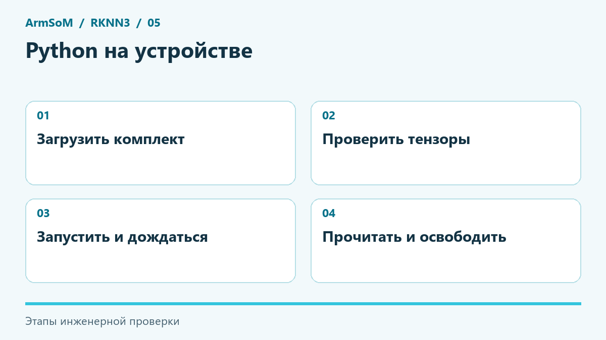

Python удобен для соединения инференса с камерой, очередью и прототипом. Однако высокоуровневый интерфейс не устраняет вопросы памяти устройства, асинхронных задач и состояния сеансов. Сначала проверьте одиночный запрос, затем параллелизм.

> Это авторское техническое объяснение и рекомендации по внедрению на основе официальной документации. Этот процесс не проверялся на оборудовании ArmSoM. Перед внедрением согласуйте целевой чип, SDK, Runtime, драйвер и прошивку.

*Оригинальная схема ArmSoM: порядок работы, а не результаты аппаратных испытаний. Нажмите для открытия векторной версии.*

## Lite исполняет подготовленные модели

Справочник V1.2.0 описывает `RKNN3Lite` как Python-интерфейс запуска конвертированных моделей с согласованным Runtime. Он рассматривает синхронное и асинхронное выполнение, атрибуты тензоров, LLM Session, callbacks и время жизни памяти. Конвертацией занимается Toolkit.

Импорт конвертера на рабочем компьютере не доказывает готовность платы. Отдельно проверьте пакет Python, разделяемые библиотеки и происхождение модели.

## Проверяйте вход на границе приложения

Контролируйте размеры, тип, раскладку и смысл batch. Безусловное приведение всех входов к одному типу может скрыть изменение источника и перенести ошибку на этап инференса.

| Граница | Рекомендуемая проверка |
| --- | --- |
| Вход приложения | Формат, размеры, отсутствующие значения, источник |
| Вход модели | Атрибуты, предобработка, непрерывность данных |
| Выход модели | Количество, структура, некорректные значения |
| Бизнес-результат | Пороги, координаты, разбор текста |

Храните заведомо правильный файловый вход, чтобы отделять поведение камеры, декодера и сети.

## Отправка не означает завершения

Интерфейс содержит `inference_async`. Возврат после отправки отличается от окончания вычисления: соблюдайте документированный порядок ожидания перед чтением результата или освобождением объектов. Callback также должен иметь определённое время жизни.

В пуле буферов отмечайте свободные, выполняемые и готовые слоты. Разрешайте только корректные переходы. Для заполненной очереди заранее выберите отбрасывание, блокировку или отказ, исключив бесконечное накопление.

## Свяжите разговоры приложения с Session

Определите очистку при отмене, тайм-ауте и выходе пользователя. Чередуйте запросы двух разговоров и проверяйте отсутствие смешения контекста и callback-объектов. Повторное использование памяти и сеансов проверяется отдельно.

## Проверьте длительную работу

Добавьте пустые входы, неверные размеры, отмену и повторное создание задач. Наблюдайте восстановление, возврат памяти и поведение следующего запроса. Аппаратных измерений здесь нет. Интеграция с хостом ArmSoM требует проверки конкретного ускорителя, образа и Runtime.

## Планирование проекта на ArmSoM

Если плата ArmSoM рассматривается как хост приложения, изучите сведения о [Sige7](https://www.armsom.org/sige7), [Sige5](https://www.armsom.org/sige5) и [CM5](https://www.armsom.org/cm5). Проверьте интерфейсы, питание, образ ОС и драйверы для фактической ревизии платы и носителя. Это ориентиры для выбора хоста, а не заявление о совместимости модулей RK182X без доработок. Встроенные NPU RK3588 / RK3576 используют соответствующий стек RKNN Toolkit2; выбор такого хоста не переводит его внутренний NPU на RKNN3.

Материалы по интерфейсам и модулям: [RK182X M.2](/ru/articles/rk182x-m2-module-guide/) · [RK182X SO-DIMM](/ru/articles/rk182x-sodimm-module-datasheet/) · [RK3572 Datasheet V1.0](/ru/articles/rk3572-datasheet-v10/)

## Официальные документы и версия

Основа — фиксированный снимок официального репозитория `141883c8e11b0`, проверенный 2026-11-14. Полные интерфейсы, параметры и ограничения смотрите в оригинале. Статья не заменяет руководство и не воспроизводит PDF целиком.

- <a href="https://github.com/airockchip/rknn3-toolkit/blob/141883c8e11b05ef4cca4a69d8a7572c4d855191/doc/EN/04_RKNN3_Toolkit_Lite_Python_API_Reference_V1.2.0.pdf">Официальный PDF на английском (V1.2.0)</a>
- <a href="https://github.com/airockchip/rknn3-toolkit/blob/141883c8e11b05ef4cca4a69d8a7572c4d855191/doc/CN/04_RKNN3_Toolkit_Lite_Python_API_%E5%8F%82%E8%80%83_V1.2.0.pdf">Официальный PDF на китайском (V1.2.0)</a>
- [Все официальные документы](https://github.com/airockchip/rknn3-toolkit/tree/main/doc)

## Порядок чтения

- [Обзор серии](/ru/articles/rknn3-v120-platform-guide/)
- Предыдущая статья: [RKNN3 Toolkit Python: воспроизводимая и прослеживаемая конвертация](/ru/articles/rknn3-v120-toolkit-python-workflow/)
- Следующая статья: [RKNN3 C Runtime: жизненный цикл контекста, модели, сеанса и памяти](/ru/articles/rknn3-v120-runtime-c-lifecycle/)
