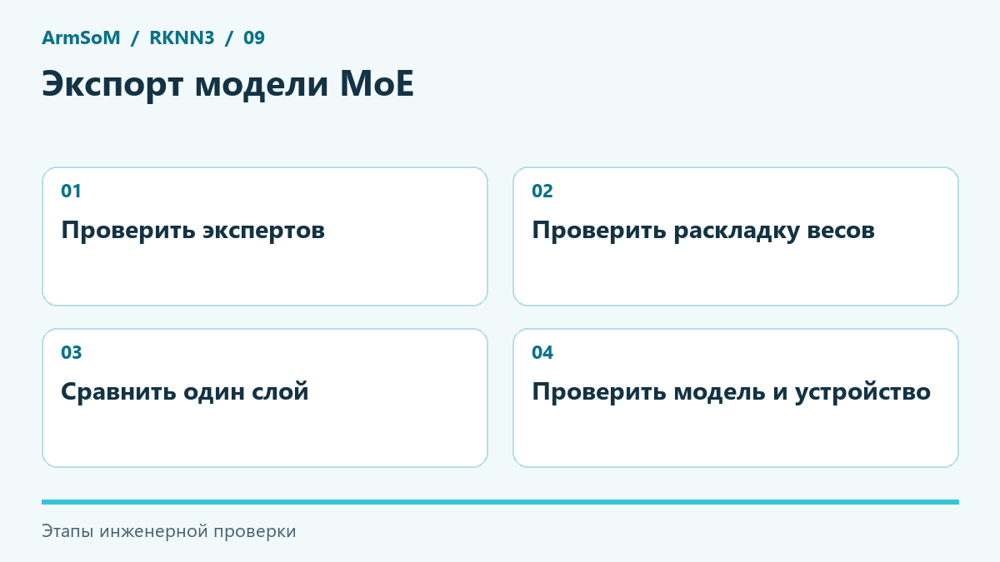

MoE разделяет число экспертов, используемых в одном вычислении, и общее количество хранимых параметров. Для периферийного устройства важны не только активные параметры, но и веса, маршрутизация, кеш и ресурсы полной модели.

> Это авторское техническое объяснение и рекомендации по внедрению на основе официальной документации. Этот процесс не проверялся на оборудовании ArmSoM. Перед внедрением согласуйте целевой чип, SDK, Runtime, драйвер и прошивку.

*Оригинальная схема ArmSoM: порядок работы, а не результаты аппаратных испытаний. Нажмите для открытия векторной версии.*

## Определите границу экспорта

Руководство V1.2.0 представляет маршрутизируемых экспертов через `rknn::exUnifiedMoE`; shared expert и объединение остаются снаружи. Текущий batch ограничен значением 1, матричные веса используют `[in,out]`.

Перед транспонированием установите исходную раскладку весов. Повторная операция может испортить корректные данные при внешне правдоподобных размерах.

## Разделяйте структуру и численные результаты

| Проверка | Доказательства |
| --- | --- |
| Структура | Эксперты, маршрутизация, входы/выходы, точка объединения |
| Веса | Раскладка, упаковка, dtype, контрольные суммы |
| Численные результаты | Эталон и ошибка на идентичных входах |
| Полная модель | Прикладные выходы и метрики качества |

Структурный анализ не находит все численные ошибки. Численный тест может не активировать отдельные ветви. Нужны оба вида проверки.

## Исследуйте слой отдельно

Фиксированный вход слоя полезнее для диагностики, чем только итоговый ответ модели. Уточните, содержит ли эталон лишь маршрутизируемых экспертов или весь модуль, и сравнивайте одинаковые величины.

Наряду со средней ошибкой изучайте максимум и его положение. При сильном отклонении нескольких token расширяйте покрытие, не скрывая локальную проблему усреднением. Меняйте раскладку, маршрутизацию или квантование по одному.

## Явно отмечайте неподдерживаемые параметры

Раздел 3.2 помечает `enable_moe_tc` как нереализованный/неподдерживаемый, хотя далее описывает включение. Здесь функция считается недоступной; при начальной оценке сохраняется отключённое значение по умолчанию.

Наличие имени параметра не подтверждает готовность функции. Версия, статус возможности и результаты проверки должны храниться вместе.

## Перейдите к приёмке изделия

После проверки слоя измеряйте память полной модели, запуск, длительный инференс и восстановление. Проверяйте разные размеры входа; короткий запрос не подтверждает работу любого контекста. Конвертация и измерение MoE здесь не выполнялись, ёмкость модели и скорость на продуктах ArmSoM не заявляются.

## Планирование проекта на ArmSoM

Если плата ArmSoM рассматривается как хост приложения, изучите сведения о [Sige7](https://www.armsom.org/sige7), [Sige5](https://www.armsom.org/sige5) и [CM5](https://www.armsom.org/cm5). Проверьте интерфейсы, питание, образ ОС и драйверы для фактической ревизии платы и носителя. Это ориентиры для выбора хоста, а не заявление о совместимости модулей RK182X без доработок. Встроенные NPU RK3588 / RK3576 используют соответствующий стек RKNN Toolkit2; выбор такого хоста не переводит его внутренний NPU на RKNN3.

Материалы по интерфейсам и модулям: [RK182X M.2](/ru/articles/rk182x-m2-module-guide/) · [RK182X SO-DIMM](/ru/articles/rk182x-sodimm-module-datasheet/) · [RK3572 Datasheet V1.0](/ru/articles/rk3572-datasheet-v10/)

## Официальные документы и версия

Основа — фиксированный снимок официального репозитория `141883c8e11b0`, проверенный 2026-11-14. Полные интерфейсы, параметры и ограничения смотрите в оригинале. Статья не заменяет руководство и не воспроизводит PDF целиком.

- <a href="https://github.com/airockchip/rknn3-toolkit/blob/141883c8e11b05ef4cca4a69d8a7572c4d855191/doc/EN/08_RKNN3_MoE_ONNX_Export_And_Conversion_Guide_V1.2.0.pdf">Официальный PDF на английском (V1.2.0)</a>
- <a href="https://github.com/airockchip/rknn3-toolkit/blob/141883c8e11b05ef4cca4a69d8a7572c4d855191/doc/CN/08_RKNN3_moe%E7%BB%93%E6%9E%84%E5%AF%BC%E5%87%BA%E9%80%82%E9%85%8D%E8%AF%B4%E6%98%8E_V1.2.0.pdf">Официальный PDF на китайском (V1.2.0)</a>
- [Все официальные документы](https://github.com/airockchip/rknn3-toolkit/tree/main/doc)

## Порядок чтения

- [Обзор серии](/ru/articles/rknn3-v120-platform-guide/)
- Предыдущая статья: [Операторы RKNN3: почему поддерживаемого имени недостаточно](/ru/articles/rknn3-v120-operator-audit/)
- Следующая статья: [RKNN3 MCP: проверяемый и возобновляемый процесс развёртывания](/ru/articles/rknn3-v010-mcp-deployment/)
