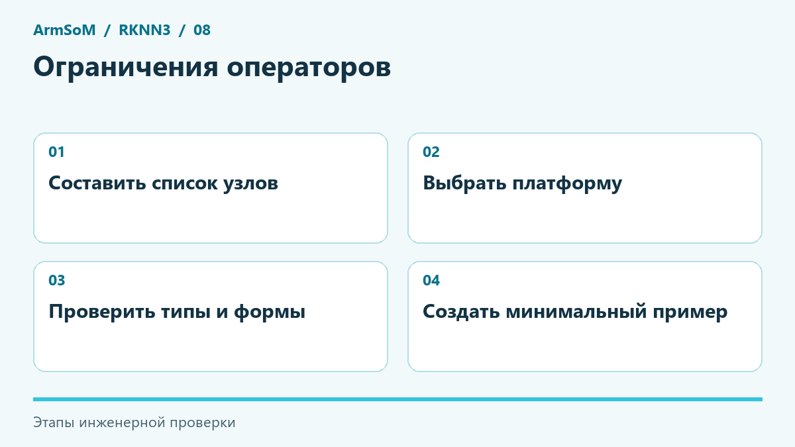

Частая ошибка — считать, что упомянутый в руководстве оператор работает в любой модели. На результат влияют платформа, типы, формы, сочетания атрибутов и доступность констант при компиляции.

> Это авторское техническое объяснение и рекомендации по внедрению на основе официальной документации. Этот процесс не проверялся на оборудовании ArmSoM. Перед внедрением согласуйте целевой чип, SDK, Runtime, драйвер и прошивку.

[](/assets/rknn3-v120/rknn3-v120-operator-audit-ru.svg)

*Оригинальная схема ArmSoM: порядок работы, а не результаты аппаратных испытаний. Нажмите для открытия векторной версии.*

## Выберите раздел целевой платформы

Справочник V1.2.0 разделяет RK182X и RK3572. Статьи описывают типы, размерности и ограничения параметров, используя обозначения Subgraph, RegEmit, NRV, NRVReg и Runtime/Simulator. Описание пути реализации не означает одинакового исполнения на всех целях.

Сохраняйте конкретный раздел и версию SDK, а не только снимок списка имён.

## Составьте список узлов графа

Редакционный пример ONNX читает структуру без загрузки внешних весов и не определяет совместимость с RKNN3:

```python
from collections import Counter
import onnx

model = onnx.load("model.onnx", load_external_data=False)
counts = Counter((node.domain or "ai.onnx", node.op_type)
                 for node in model.graph.node)
for (domain, op_type), count in sorted(counts.items()):
    print(domain, op_type, count)
```

Нужен установленный ONNX. Вывод — начало ручной проверки, а не сертификат поддержки.

## Проверяйте каждый экземпляр

| Пункт | Вопрос |
| --- | --- |
| Типы | Каковы типы входов, весов и выхода? |
| Формы | Определены ли размеры, batch и динамические диапазоны? |
| Атрибуты | Ограничено ли конкретное сочетание? |
| Константы | Доступны ли нужные значения при компиляции? |
| Соседние узлы | Меняют ли условия transpose, broadcast или fusion? |

Одинаковое имя оператора не означает одинаковую форму данных. Проверка только первого вхождения может пропустить ошибочный узел.

## Постройте минимальный пример

Сохраните необходимые входы и связи вокруг узла, затем проверьте воспроизведение на уменьшенном графе. Если проблема исчезла, запишите изменения и возвращайте условия поэтапно.

Для закрытой модели структурную ошибку можно сначала исследовать на синтетических данных подходящих размеров. Проверка точности всё равно требует настоящих входов или надёжного эталона.

## Повторно проверьте преобразованную модель

После замены оператора нужны и конвертация, и сравнение поведения. Успех сборки не исключает копирования, дополнительной работы CPU или численных изменений. Снова измерьте корректность, полное время и память. Компиляция RKNN3 здесь не выполнялась; скрипт не заменяет официальный справочник.

## Планирование проекта на ArmSoM

Если плата ArmSoM рассматривается как хост приложения, изучите сведения о [Sige7](https://www.armsom.org/sige7), [Sige5](https://www.armsom.org/sige5) и [CM5](https://www.armsom.org/cm5). Проверьте интерфейсы, питание, образ ОС и драйверы для фактической ревизии платы и носителя. Это ориентиры для выбора хоста, а не заявление о совместимости модулей RK182X без доработок. Встроенные NPU RK3588 / RK3576 используют соответствующий стек RKNN Toolkit2; выбор такого хоста не переводит его внутренний NPU на RKNN3.

Материалы по интерфейсам и модулям: [RK182X M.2](/ru/articles/rk182x-m2-module-guide/) · [RK182X SO-DIMM](/ru/articles/rk182x-sodimm-module-datasheet/) · [RK3572 Datasheet V1.0](/ru/articles/rk3572-datasheet-v10/)

## Официальные документы и версия

Основа — фиксированный снимок официального репозитория `141883c8e11b0`, проверенный 2026-11-14. Полные интерфейсы, параметры и ограничения смотрите в оригинале. Статья не заменяет руководство и не воспроизводит PDF целиком.

- <a href="https://github.com/airockchip/rknn3-toolkit/blob/141883c8e11b05ef4cca4a69d8a7572c4d855191/doc/EN/07_RKNN3_Supported_Operators_and_Constraints_Reference_V1.2.0.pdf">Официальный PDF на английском (V1.2.0)</a>
- <a href="https://github.com/airockchip/rknn3-toolkit/blob/141883c8e11b05ef4cca4a69d8a7572c4d855191/doc/CN/07_RKNN3_%E7%AE%97%E5%AD%90%E6%94%AF%E6%8C%81%E4%B8%8E%E7%BA%A6%E6%9D%9F%E5%8F%82%E8%80%83_V1.2.0.pdf">Официальный PDF на китайском (V1.2.0)</a>
- [Все официальные документы](https://github.com/airockchip/rknn3-toolkit/tree/main/doc)

## Порядок чтения

- [Обзор серии](/ru/articles/rknn3-v120-platform-guide/)
- Предыдущая статья: [RKLLM3 Server: от локальной модели к API приложения](/ru/articles/rknn3-v120-rkllm-server/)
- Следующая статья: [Экспорт MoE в RKNN3: проверка экспертов перед полной моделью](/ru/articles/rknn3-v120-moe-export/)
