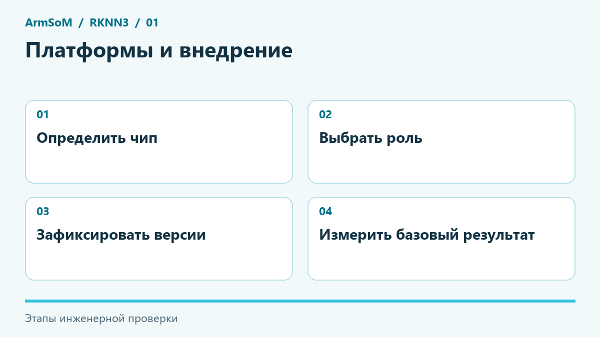

RKNN3 нужно оценивать как часть системы: где работает приложение, какой чип выполняет инференс, как передаются данные и как воспроизвести сбой. Для проекта ArmSoM новый номер SDK сам по себе не означает возможность обновить любой NPU Rockchip.

> Это авторское техническое объяснение и рекомендации по внедрению на основе официальной документации. Этот процесс не проверялся на оборудовании ArmSoM. Перед внедрением согласуйте целевой чип, SDK, Runtime, драйвер и прошивку.

*Оригинальная схема ArmSoM: порядок работы, а не результаты аппаратных испытаний. Нажмите для открытия векторной версии.*

## Разделяйте роли компонентов

В примечаниях к выпуску описаны сопроцессоры RK1820/RK1828 и встроенный NPU RK3572. Первому варианту нужны хост и канал связи; второй работает на целевой SoC. Встроенные NPU RK3588/RK3576 используют Toolkit2. Применение этих SoC в качестве хостов внешнего RK182X — другая архитектура.

| Проект | Что проверить сначала |
| --- | --- |
| Встроенный NPU существующей платы | Соответствие чипа, программного стека и образа |
| Внешний ускоритель | Соединения, питание, драйвер и транспорт |
| Проект на RK3572 | Конкретную ревизию платы и SDK |

## Связывайте обновление с задачей продукта

V1.2.0 включает возможности MoE, PagedAttention, экспорта отдельных весов LoRA и ограничений Grammar. Это направления для проверки, а не замена измерениям модели, памяти и времени ответа.

Для каждого изменения запишите решаемую задачу, необходимые входные данные, критерий приёмки и способ отката. Функцию без практической потребности можно отложить. Чем меньше одновременно меняется переменных, тем проще объяснить ошибку.

## Создайте паспорт версии проекта ArmSoM

Сохраните ревизии платы и носителя, источник образа, ядро, Runtime, Toolkit, контрольные суммы модели и версию тестовых данных. Окружение конвертации и окружение устройства учитывайте отдельно. Это позволяет при замене хоста отличить изменение модели от изменения библиотек или оборудования.

Успешный запуск официального примера подтверждает базовый путь. Для готовности изделия нужны реальные входы, восстановление после ошибок, проверка охлаждения и длительная работа.

## Используйте показатели для отбора кандидатов

Данные производителя помогают выбрать варианты, но критерии приёмки определяются вашей нагрузкой. Зафиксируйте входы, предобработку, длину ответа, параллелизм и длительность запуска. Помимо производительности измеряйте хвостовые задержки, максимум памяти и долю ошибок. Пиковое значение не показывает, будет ли при непрерывной работе расти очередь.

## Двигайтесь по серии последовательно

Начните с первого запуска и проверки точности. Затем выберите Toolkit Lite или C Runtime под приложение. Сервисный доступ, анализ операторов, MoE и MCP добавляйте по необходимости. На каждом этапе сохраняйте воспроизводимые входы и результаты для сравнения последующих улучшений.

## Планирование проекта на ArmSoM

Если плата ArmSoM рассматривается как хост приложения, изучите сведения о [Sige7](https://www.armsom.org/sige7), [Sige5](https://www.armsom.org/sige5) и [CM5](https://www.armsom.org/cm5). Проверьте интерфейсы, питание, образ ОС и драйверы для фактической ревизии платы и носителя. Это ориентиры для выбора хоста, а не заявление о совместимости модулей RK182X без доработок. Встроенные NPU RK3588 / RK3576 используют соответствующий стек RKNN Toolkit2; выбор такого хоста не переводит его внутренний NPU на RKNN3.

Материалы по интерфейсам и модулям: [RK182X M.2](/ru/articles/rk182x-m2-module-guide/) · [RK182X SO-DIMM](/ru/articles/rk182x-sodimm-module-datasheet/) · [RK3572 Datasheet V1.0](/ru/articles/rk3572-datasheet-v10/)

## Официальные документы и версия

Основа — фиксированный снимок официального репозитория `141883c8e11b0`, проверенный 2026-11-14. Полные интерфейсы, параметры и ограничения смотрите в оригинале. Статья не заменяет руководство и не воспроизводит PDF целиком.

- <a href="https://github.com/airockchip/rknn3-toolkit/blob/141883c8e11b05ef4cca4a69d8a7572c4d855191/doc/EN/00_RKNN3_SDK_Release_Notes_V1.2.0.pdf">Официальный PDF на английском (V1.2.0)</a>
- <a href="https://github.com/airockchip/rknn3-toolkit/blob/141883c8e11b05ef4cca4a69d8a7572c4d855191/doc/CN/00_RKNN3_SDK_%E5%8F%91%E5%B8%83%E8%AF%B4%E6%98%8E_V1.2.0.pdf">Официальный PDF на китайском (V1.2.0)</a>
- [Все официальные документы](https://github.com/airockchip/rknn3-toolkit/tree/main/doc)

## Порядок чтения

| # | Тема |
| --- | --- |
| 01 | RKNN3 V1.2.0: RK182X, RK3572 и варианты интеграции с ArmSoM |
| 02 | [Первый запуск RKNN3: от проверки окружения до воспроизводимого результата](/ru/articles/rknn3-v120-first-deployment/) |
| 03 | [Проверка моделей RKNN3: точность, задержка и память в одном плане](/ru/articles/rknn3-v120-accuracy-performance/) |
| 04 | [RKNN3 Toolkit Python: воспроизводимая и прослеживаемая конвертация](/ru/articles/rknn3-v120-toolkit-python-workflow/) |
| 05 | [RKNN3 Toolkit Lite: Python-инференс и ресурсы асинхронных задач](/ru/articles/rknn3-v120-lite-python-inference/) |
| 06 | [RKNN3 C Runtime: жизненный цикл контекста, модели, сеанса и памяти](/ru/articles/rknn3-v120-runtime-c-lifecycle/) |
| 07 | [RKLLM3 Server: от локальной модели к API приложения](/ru/articles/rknn3-v120-rkllm-server/) |
| 08 | [Операторы RKNN3: почему поддерживаемого имени недостаточно](/ru/articles/rknn3-v120-operator-audit/) |
| 09 | [Экспорт MoE в RKNN3: проверка экспертов перед полной моделью](/ru/articles/rknn3-v120-moe-export/) |
| 10 | [RKNN3 MCP: проверяемый и возобновляемый процесс развёртывания](/ru/articles/rknn3-v010-mcp-deployment/) |
