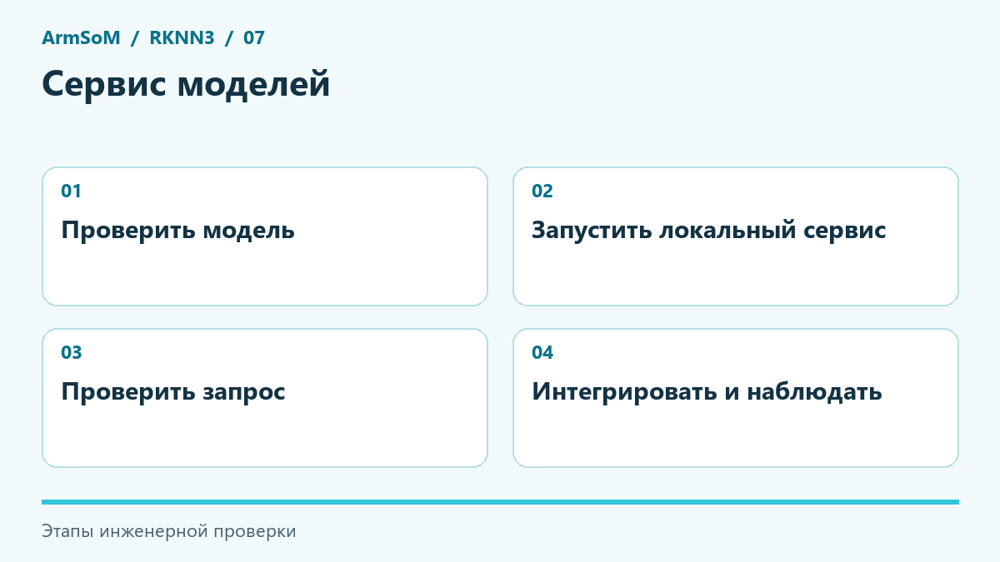

После локального запуска модели приложению часто нужен API. Сервис добавляет очереди, состояние диалога, отмену, тайм-ауты и контроль доступа. Открытый порт не означает завершённое внедрение.

> Это авторское техническое объяснение и рекомендации по внедрению на основе официальной документации. Этот процесс не проверялся на оборудовании ArmSoM. Перед внедрением согласуйте целевой чип, SDK, Runtime, драйвер и прошивку.

[](/assets/rknn3-v120/rknn3-v120-rkllm-server-ru.svg)

*Оригинальная схема ArmSoM: порядок работы, а не результаты аппаратных испытаний. Нажмите для открытия векторной версии.*

## Совместимость имеет границы

RKLLM3 Server V1.2.0 предоставляет OpenAI-compatible интерфейс чата и описывает `/health`, `/v1/models`, `/v1/chat/completions`. Руководство также рассматривает мультимодальность, LoRA, кеш, Grammar и несколько карт. Конкретные модели и параметры требуют проверки.

Клиент должен использовать только проверенные поля и поведение. Отдельно проверьте потоковые ответы, ошибки, остановку генерации и приоритет параметров, не перенося автоматически всю семантику другого сервиса.

## Начните с минимальных проверок

Если сервис уже запущен локально на порту 8080, следующие редакционные команды только читают состояние:

```bash
curl --fail --max-time 10 http://127.0.0.1:8080/health
curl --fail --max-time 10 http://127.0.0.1:8080/v1/models
```

Используйте свой адрес и порт. Успешная проверка состояния не доказывает правильность ответов: нужны фиксированные запросы для оценки структуры и качества. При подготовке статьи сервис инференса не запускался.

## Проверьте четыре уровня

| Уровень | Что проверить |
| --- | --- |
| Модель | Полноту файлов и корректность входов/выходов |
| Сервис | Запуск, состояние, журналы сбоев |
| Протокол | Поля, потоковый режим, тайм-ауты, ошибки |
| Приложение | Качество, параллелизм, восстановление |

Непроверенные уровни отмечайте явно, чтобы интеграция не зависела от необъяснённого поведения нижних компонентов.

## Отдельно тестируйте новые форматы

Для изображений и аудио подготовьте наборы форматов, размеров и типов содержимого. Для JSON проверяйте смысл наряду со структурой: синтаксически правильный объект может содержать неверный ответ. Реальное выполнение запрошенных моделью инструментов контролирует бизнес-слой.

Начните с одной модели, одного запроса и короткого входа. Затем увеличивайте контекст, параллелизм и комбинации моделей, наблюдая очередь и пик памяти.

## Определите границы передачи проекта ArmSoM

Документируйте адрес прослушивания, аутентификацию, журналы, перезапуск и версии модели. Перед внешним доступом примените сетевые требования приложения. Это руководство по архитектуре и приёмке, а не обещание производительности платы ArmSoM.

## Планирование проекта на ArmSoM

Если плата ArmSoM рассматривается как хост приложения, изучите сведения о [Sige7](https://www.armsom.org/sige7), [Sige5](https://www.armsom.org/sige5) и [CM5](https://www.armsom.org/cm5). Проверьте интерфейсы, питание, образ ОС и драйверы для фактической ревизии платы и носителя. Это ориентиры для выбора хоста, а не заявление о совместимости модулей RK182X без доработок. Встроенные NPU RK3588 / RK3576 используют соответствующий стек RKNN Toolkit2; выбор такого хоста не переводит его внутренний NPU на RKNN3.

Материалы по интерфейсам и модулям: [RK182X M.2](/ru/articles/rk182x-m2-module-guide/) · [RK182X SO-DIMM](/ru/articles/rk182x-sodimm-module-datasheet/) · [RK3572 Datasheet V1.0](/ru/articles/rk3572-datasheet-v10/)

## Официальные документы и версия

Основа — фиксированный снимок официального репозитория `141883c8e11b0`, проверенный 2026-11-14. Полные интерфейсы, параметры и ограничения смотрите в оригинале. Статья не заменяет руководство и не воспроизводит PDF целиком.

- <a href="https://github.com/airockchip/rknn3-toolkit/blob/141883c8e11b05ef4cca4a69d8a7572c4d855191/doc/EN/06_RKLLM3_Server_User_Guide_V1.2.0.pdf">Официальный PDF на английском (V1.2.0)</a>
- <a href="https://github.com/airockchip/rknn3-toolkit/blob/141883c8e11b05ef4cca4a69d8a7572c4d855191/doc/CN/06_RKLLM3_Server_%E4%BD%BF%E7%94%A8%E6%8C%87%E5%8D%97_V1.2.0.pdf">Официальный PDF на китайском (V1.2.0)</a>
- [Все официальные документы](https://github.com/airockchip/rknn3-toolkit/tree/main/doc)

## Порядок чтения

- [Обзор серии](/ru/articles/rknn3-v120-platform-guide/)
- Предыдущая статья: [RKNN3 C Runtime: жизненный цикл контекста, модели, сеанса и памяти](/ru/articles/rknn3-v120-runtime-c-lifecycle/)
- Следующая статья: [Операторы RKNN3: почему поддерживаемого имени недостаточно](/ru/articles/rknn3-v120-operator-audit/)
