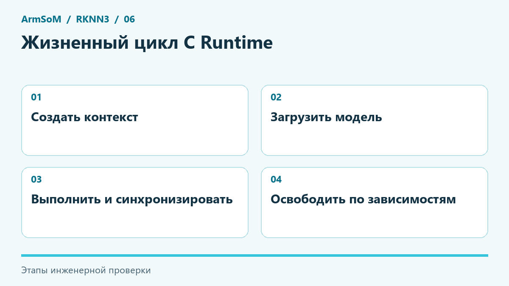

Длительная работа C/C++-приложения требует явного управления ресурсами. Момент освобождения объекта не менее важен, чем запуск инференса. Полезно представлять Runtime как набор зависимых ресурсов.

> Это авторское техническое объяснение и рекомендации по внедрению на основе официальной документации. Этот процесс не проверялся на оборудовании ArmSoM. Перед внедрением согласуйте целевой чип, SDK, Runtime, драйвер и прошивку.

*Оригинальная схема ArmSoM: порядок работы, а не результаты аппаратных испытаний. Нажмите для открытия векторной версии.*

## Различайте объекты

Справочник V1.2.0 разделяет создание контекста, загрузку и инициализацию модели, а также LLM Session. Среди интерфейсов — `rknn3_init`, `rknn3_load_model_from_path`, `rknn3_model_init`, `rknn3_destroy`. Для кешируемой памяти предусмотрены правила синхронизации через `rknn3_mem_sync`.

Это не компилируемый пример. Структуры параметров, ограничения платформ и коды возврата должны соответствовать установленным заголовкам и библиотеке.

## Назначьте владельца каждого ресурса

| Ресурс | Вопрос |
| --- | --- |
| Context | Кто создаёт и окончательно уничтожает? |
| Model | Как обрабатываются файлы, веса и сбой инициализации? |
| Session | Что происходит при завершении, отмене и повторном использовании? |
| Buffer | Кто выделяет, читает, пишет и освобождает? |
| Callback | Живёт ли связанное состояние до последнего вызова? |

При ревью сопоставляйте каждому созданию путь освобождения. Успех, частичную инициализацию и остановку рассматривайте отдельно.

## Отразите зависимости в очистке

Прекратите принимать задачи, учтите активную работу, затем освобождайте зависимые ресурсы. Нельзя уничтожать объект, на который ещё может обратиться callback. В многопоточном коде нужен один ответственный за остановку, чтобы два обработчика не освободили ресурс повторно.

C++-обёртка помогает организовать владение, но вызов деструктора сам по себе не доказывает завершение асинхронной работы устройства. Это отдельное условие.

## Общая память требует координации

Видимость данных, раскладка и владение — разные вопросы. При редких неверных результатах проверьте порядок записи CPU, чтения устройства, синхронизации выхода и чтения CPU. Фиксированная пауза не заменяет корректное управление состояниями.

## Сделайте ошибки диагностируемыми

Записывайте этап, код возврата, идентификаторы модели, устройства и запроса. Полные бизнес-данные в журнале необязательны, но ошибка должна связываться с воспроизводимым примером. После сбоя проверяйте повторную инициализацию.

Статья не заявляет компиляцию или запуск C-кода на устройстве и не подтверждает прямую совместимость конкретной платы ArmSoM.

## Планирование проекта на ArmSoM

Если плата ArmSoM рассматривается как хост приложения, изучите сведения о [Sige7](https://www.armsom.org/sige7), [Sige5](https://www.armsom.org/sige5) и [CM5](https://www.armsom.org/cm5). Проверьте интерфейсы, питание, образ ОС и драйверы для фактической ревизии платы и носителя. Это ориентиры для выбора хоста, а не заявление о совместимости модулей RK182X без доработок. Встроенные NPU RK3588 / RK3576 используют соответствующий стек RKNN Toolkit2; выбор такого хоста не переводит его внутренний NPU на RKNN3.

Материалы по интерфейсам и модулям: [RK182X M.2](/ru/articles/rk182x-m2-module-guide/) · [RK182X SO-DIMM](/ru/articles/rk182x-sodimm-module-datasheet/) · [RK3572 Datasheet V1.0](/ru/articles/rk3572-datasheet-v10/)

## Официальные документы и версия

Основа — фиксированный снимок официального репозитория `141883c8e11b0`, проверенный 2026-11-14. Полные интерфейсы, параметры и ограничения смотрите в оригинале. Статья не заменяет руководство и не воспроизводит PDF целиком.

- <a href="https://github.com/airockchip/rknn3-toolkit/blob/141883c8e11b05ef4cca4a69d8a7572c4d855191/doc/EN/05_RKNN3_Runtime_C_API_Reference_V1.2.0.pdf">Официальный PDF на английском (V1.2.0)</a>
- <a href="https://github.com/airockchip/rknn3-toolkit/blob/141883c8e11b05ef4cca4a69d8a7572c4d855191/doc/CN/05_RKNN3_Runtime_C_API_%E5%8F%82%E8%80%83_V1.2.0.pdf">Официальный PDF на китайском (V1.2.0)</a>
- [Все официальные документы](https://github.com/airockchip/rknn3-toolkit/tree/main/doc)

## Порядок чтения

- [Обзор серии](/ru/articles/rknn3-v120-platform-guide/)
- Предыдущая статья: [RKNN3 Toolkit Lite: Python-инференс и ресурсы асинхронных задач](/ru/articles/rknn3-v120-lite-python-inference/)
- Следующая статья: [RKLLM3 Server: от локальной модели к API приложения](/ru/articles/rknn3-v120-rkllm-server/)
