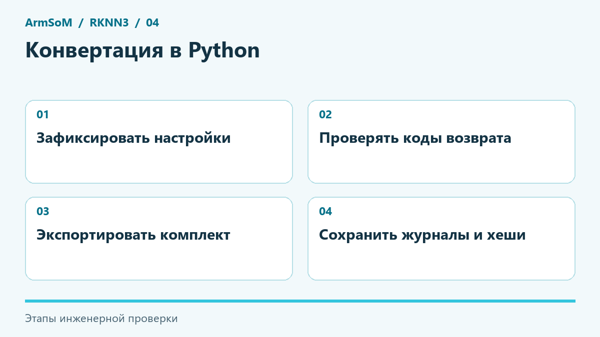

Скрипт конвертации одновременно служит инструментом разработки и записью поставки. Для сопровождения нужно знать входы, настройки, версии ПО и точный этап возникновения ошибки.

> Это авторское техническое объяснение и рекомендации по внедрению на основе официальной документации. Этот процесс не проверялся на оборудовании ArmSoM. Перед внедрением согласуйте целевой чип, SDK, Runtime, драйвер и прошивку.

[](/assets/rknn3-v120/rknn3-v120-toolkit-python-workflow-ru.svg)

*Оригинальная схема ArmSoM: порядок работы, а не результаты аппаратных испытаний. Нажмите для открытия векторной версии.*

## Не угадывайте импорт по названию SDK

Справочник V1.2.0 импортирует класс через `from rknn.api import RKNN`. Цепочка конвертации использует `config`, `load_onnx`, `build`, `export_rknn` и `release`. Файлы `.rknn` и сопровождающие `.weight` следует хранить как комплект одной сборки.

Похожие пространства имён Python могут скрывать неверное окружение. До отладки модели проверьте фактический путь импорта.

## Узнайте, какое окружение использует скрипт

Редакционная диагностика только читает сведения и не конвертирует модель:

```python
import sys
from importlib.util import find_spec

print("python:", sys.executable)
spec = find_spec("rknn")
print("rknn:", None if spec is None else spec.origin)
```

Сохраните вывод вместе с журналом установки. Наличие модуля не подтверждает правильную версию или работоспособность модели.

## Разделите процесс на проверяемые этапы

| Этап | Что сохранить |
| --- | --- |
| Вход | Хеш модели, внешние веса, описание входов |
| Настройка | Цель, предобработка, квантование |
| Сборка | Статус, журнал, длительность |
| Экспорт | Комплект файлов, размеры, хеши |
| Проверка | Фиксированные входы, выходы и сравнение |

Ошибка любого этапа должна останавливать поставку. Старый файл в выходном каталоге не доказывает успех новой сборки. Разделяйте каталоги по идентификатору сборки и переносите результат в кандидаты выпуска только после проверки.

## Освобождение ресурсов тоже часть интерфейса

Назначьте владельца объектов и временных файлов. Обработчик ошибки должен освобождать полученные ресурсы и сохранять диагностику. Не подавляйте исключения и не считайте существование файла критерием успеха.

## Подготовьте комплект для интеграции

Для проекта ArmSoM передавайте настройки, требования к окружению и фиксированные тестовые входы. Отдельно отмечайте завершение конвертации и приёмку на конкретной аппаратной ревизии ArmSoM. Конвертация SDK для статьи не выполнялась; полные параметры и ограничения смотрите в справочнике нужной версии.

## Планирование проекта на ArmSoM

Если плата ArmSoM рассматривается как хост приложения, изучите сведения о [Sige7](https://www.armsom.org/sige7), [Sige5](https://www.armsom.org/sige5) и [CM5](https://www.armsom.org/cm5). Проверьте интерфейсы, питание, образ ОС и драйверы для фактической ревизии платы и носителя. Это ориентиры для выбора хоста, а не заявление о совместимости модулей RK182X без доработок. Встроенные NPU RK3588 / RK3576 используют соответствующий стек RKNN Toolkit2; выбор такого хоста не переводит его внутренний NPU на RKNN3.

Материалы по интерфейсам и модулям: [RK182X M.2](/ru/articles/rk182x-m2-module-guide/) · [RK182X SO-DIMM](/ru/articles/rk182x-sodimm-module-datasheet/) · [RK3572 Datasheet V1.0](/ru/articles/rk3572-datasheet-v10/)

## Официальные документы и версия

Основа — фиксированный снимок официального репозитория `141883c8e11b0`, проверенный 2026-11-14. Полные интерфейсы, параметры и ограничения смотрите в оригинале. Статья не заменяет руководство и не воспроизводит PDF целиком.

- <a href="https://github.com/airockchip/rknn3-toolkit/blob/141883c8e11b05ef4cca4a69d8a7572c4d855191/doc/EN/03_RKNN3_Toolkit_Python_API_Reference_V1.2.0.pdf">Официальный PDF на английском (V1.2.0)</a>
- <a href="https://github.com/airockchip/rknn3-toolkit/blob/141883c8e11b05ef4cca4a69d8a7572c4d855191/doc/CN/03_RKNN3_Toolkit_Python_API_%E5%8F%82%E8%80%83_V1.2.0.pdf">Официальный PDF на китайском (V1.2.0)</a>
- [Все официальные документы](https://github.com/airockchip/rknn3-toolkit/tree/main/doc)

## Порядок чтения

- [Обзор серии](/ru/articles/rknn3-v120-platform-guide/)
- Предыдущая статья: [Проверка моделей RKNN3: точность, задержка и память в одном плане](/ru/articles/rknn3-v120-accuracy-performance/)
- Следующая статья: [RKNN3 Toolkit Lite: Python-инференс и ресурсы асинхронных задач](/ru/articles/rknn3-v120-lite-python-inference/)
