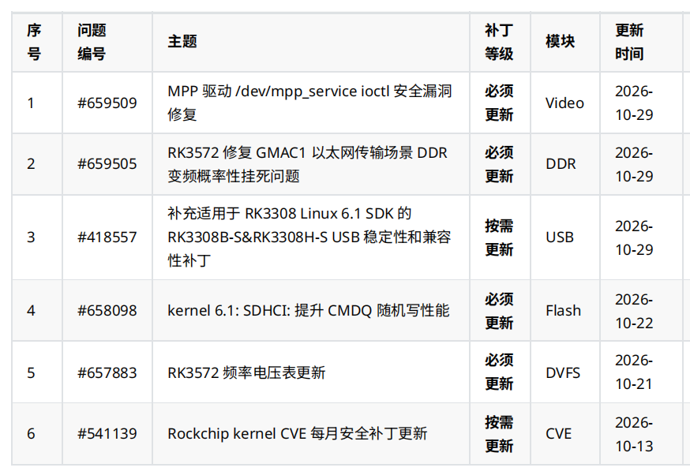

Предоставленный список патчей Rockchip за октябрь 2026 года охватывает безопасность видеодрайвера, настройки DDR и частот/напряжений RK3572, USB на RK3308, хранение данных и безопасность ядра. Для проекта ArmSoM сначала следует сопоставить каждую запись с конкретным чипом, SDK/BSP и исходным состоянием ПО.

Статья объединяет исходную таблицу с описаниями, историей и перечнями вложений Rockchip Redmine, проверенными после входа **2026-11-06**. **Это не полный каталог за месяц и не подтверждение наличия исправлений во всех образах ArmSoM.** В таблице сохранены даты исходного бюллетеня; даты создания записей, вложений и последующих изменений поясняются отдельно. Результаты испытаний принадлежат производителю. Инженерные рекомендации в этой статье не проверялись на оборудовании ArmSoM.

## 1. Шесть обновлений

| Номер | Тема в исходном списке | Уровень в списке | Модуль | Дата |
| --- | --- | --- | --- | --- |
| [#659509](https://redmine.rock-chips.com/issues/659509) | Исправление уязвимости ioctl-интерфейса `/dev/mpp_service` драйвера MPP | Обязательное обновление | Video | 2026-10-29 |
| [#659505](https://redmine.rock-chips.com/issues/659505) | RK3572: исправление периодических зависаний при смене частоты DDR во время передачи Ethernet через GMAC1 | Обязательное обновление | DDR | 2026-10-29 |
| [#418557](https://redmine.rock-chips.com/issues/418557) | Дополнение применимости патчей стабильности и совместимости USB для RK3308B-S & RK3308H-S к RK3308 Linux 6.1 SDK | По необходимости | USB | 2026-10-29 |
| [#658098](https://redmine.rock-chips.com/issues/658098) | kernel 6.1: повышение производительности случайной записи SDHCI CMDQ | Обязательное обновление | Flash | 2026-10-22 |
| [#657883](https://redmine.rock-chips.com/issues/657883) | RK3572: обновление таблицы частот и напряжений | Обязательное обновление | DVFS | 2026-10-21 |
| [#541139](https://redmine.rock-chips.com/issues/541139) | Ежемесячные исправления CVE для ядра Rockchip | По необходимости | CVE | 2026-10-13 |

Пометка «обязательное» относится к **подходящей программной базе**, а не разрешает устанавливать один патч на любые платы Rockchip. Пометка «по необходимости» также требует проверки применимости и безопасности.

## 2. MPP: вместо исходных 17 исправлений теперь 19

[#659509](https://redmine.rock-chips.com/issues/659509) относится к `drivers/video/rockchip/mpp/` в `kernel: develop-6.1`. Указаны чтение/запись за границами буфера, использование после освобождения (UAF)/двойное освобождение, произвольная запись в ядро и межпроцессная утечка данных через ioctl устройства `/dev/mpp_service`. Это не подтверждение удалённой атаки; номера CVE и оценки CVSS в записи нет.

Изначально перечислены 17 исправлений. **В истории от 2026-11-04 добавлены ещё два, всего теперь 19**: `4e950a32a45f7` исправляет выход за границы в `mpp_check_req()`, а `531cdbdcfe94` — чрезмерно строгую проверку границ offset в fd translate. Одних исходных 17 недостаточно для подтверждения полноты обновления. Выбирать только два новых коммита без анализа зависимостей также нельзя.

Изменения затрагивают границы входных данных, жизненный цикл сеансов/DMA, путаницу типов и права procfs. Согласно записи, нормальное поведение userspace сохраняется, а некорректные запросы отклоняются с `-EINVAL` / `-EOPNOTSUPP`. Rockchip сообщает об успешной сборке Jenkins без новых предупреждений сверх существовавших. Это результат сборки, а не полная проверка видеоприложений ArmSoM.

Список SDK включает различные ветки Linux 6.1 и Android для RK3576, RK3588, RK3566/3568. Сопоставляйте код драйвера и BSP, а не только название чипа. RK3572/RK3572S явно удалены из списка в истории. Для проектов CM5/Sige5 и семейства RK3588 требуется проверка соответствующего BSP; обновление пользовательской библиотеки MPP не доказывает исправление ядра. Рекомендуются проверки кодирования/декодирования, запуска/остановки, перезапуска процессов, длительной работы и средств диагностики через procfs.

## 3. RK3572: согласовать BL31 V1.15 и таблицы напряжений

[#659505](https://redmine.rock-chips.com/issues/659505) описывает конфликт путей доступа при трафике GMAC1 и переключении частоты DDR на RK3572/RK3572S, способный вызвать чёрный экран и зависание. Исправление находится в `rkbin: master`, требуется **BL31 V1.15 или новее**. Change-Id: `I34c7b43db47b2fa8c763154969c2f79c9140adde`. Вложения включают патч V1.15 и `rk3572_bl31_v1.15.elf`. Производитель сообщает о нормальной работе в тесте, но не указывает длительность и набор нагрузок.

[#657883](https://redmine.rock-chips.com/issues/657883) относится к `kernel: develop-6.12` и `rkbin: master`. Старые таблицы частот/напряжений дают недостаточный запас стабильности для части чипов. Вложения охватывают OPP CPU/GPU/NPU и DMC, настройки питания, ISP devfreq/OPP и BL31 V1.14. Результат испытаний — «pass», без данных о приросте производительности или снижении потребления.

**Не понижайте версию прошивки, удовлетворяющей исправлению GMAC1, из-за вложения V1.14 в более ранней записи.** Сопровождающий BSP должен подтвердить совместимый набор V1.15 или новее со всеми нужными изменениями. Произвольно смешивать ядро, дерево устройств и прошивку нельзя. Код вложений для этой статьи не анализировался; имена файлов не подтверждают значения напряжений и полный набор зависимостей.

Указаны RK3572 Linux 6.12 и несколько Android SDK. Для [планов ArmSoM на RK3572](/ru/articles/rockchip-rk3572-armsom-zero-preview/) рекомендуются длительный трафик GMAC1, смена нагрузки, регулирование DDR, холодный запуск и температурные режимы с записью последовательной консоли. Короткий тест скорости не доказывает устранение редкого зависания.

## 4. USB RK3308: в октябре добавлен пакет для Linux 6.1

[#418557](https://redmine.rock-chips.com/issues/418557) поддерживается с 2023 года и описывает нестабильность и несовместимость USB после длительной работы RK3308B-S/RK3308H-S. Программа проверяет DP/DM linestate и корректирует аномальные уровни для успешного высокоскоростного рукопожатия. Указанное успешное испытание выполнено на RK3308B-S EVB, не на P2 Pro.

**2026-10-29** добавлены файл `RK3308B-S&RK3308H-S_USB_Compatible_Linux6.1_SDK_Patch_V1.0.0_20261013.zip` и применимость к RK3308 Linux 6.1 SDK. Дата 13 октября в имени файла отличается от даты загрузки 29 октября. Старые поля описания/репозитория всё ещё указывают Linux 4.4; история также содержит Linux 5.10. Это не делает старые пакеты взаимозаменяемыми с пакетом 6.1.

В бюллетене уровень — «по необходимости», а соответствующее поле подробной записи пустое. Мы сохраняем классификацию бюллетеня и отмечаем расхождение. Предыдущие обновления касаются событий отключения OTG gadget, инициализации при горячем подключении и HOST suspend/resume; пакет выбирается по SDK.

[Документация P2 Pro](https://docs.armsom.org/armsom-p2pro) указывает RK3308B-S, поэтому запись актуальна для проверки, но состояние каждого образа определяется веткой и уже внесёнными исправлениями. Рекомендуется проверить обнаружение устройств, повторные подключения, длительную передачу, сон/пробуждение и уведомления об отключении gadget на реальной периферии.

## 5. SDHCI и CVE: различать результаты тестов и месяц списка

[#658098](https://redmine.rock-chips.com/issues/658098) относится к `rk/kernel: develop-6.1-android14` и `develop-6.1`; Change-Id: `I5f8cfd9d62228e62fd0ad71d7b69698d80b21f80`. Некоторые eMMC возвращают только один готовый SLOT на запрос CMDQ. Большой интервал опроса ухудшает случайную запись; исправление уменьшает этот интервал.

Rockchip сообщает для RK3576 рост **со 160 MB/s до 200 MB/s** на некоторых eMMC с несколькими очередями и **с 19 MB/s до 70 MB/s** без такой поддержки. Это конкретные результаты производителя, не измерения ArmSoM и не гарантия для любого накопителя. Полная конфигурация теста не приведена. Дата бюллетеня — 2026-10-22, но даты начала записи и вложения — 2025-09-10. Включение в октябрьскую сводку не означает разработку впервые в октябре.

[#541139](https://redmine.rock-chips.com/issues/541139) содержит месячные списки CVE для `kernel: 4.19/5.10/6.1/6.12`. Markdown-вложения связывают CVE с коммитами и патчами. **Последний видимый при проверке файл — `2026-09.md`, загруженный 2026-10-13, а не `2026-10.md`.** В комментарии истории при этом написано August. Расхождение отмечено без самостоятельного исправления месяца. В таблице модуль назван CVE, в поле Component подробной записи — System.

Вложение размером около 575 KB не проверялось здесь построчно. Нельзя утверждать, что все его CVE затрагивают ArmSoM, или считать его тем же обновлением, что MPP. Проверяйте код, конфигурацию, доступные функции и обратные переносы отдельно. Уровень «по необходимости» не означает, что применимые исправления безопасности можно пропустить.

## 6. Прослеживаемое обновление проекта ArmSoM

Сохраните модель и ревизию платы, SoC, название и контрольную сумму образа, ветку SDK/BSP, версию ядра, источник патча и коммит, результаты тестов и образ для отката. Эти команды только читают сведения о системе; **их вывод не доказывает устранение уязвимости**:

```sh
uname -a
cat /etc/os-release
cat /proc/device-tree/model
```

В некоторых системах нет `/etc/os-release` или указанного узла дерева устройств; вывод `model` может не завершаться переводом строки. Одинаковые строки версии ядра могут скрывать разные обратные переносы исправлений. Нужны записи сборки и пояснения сопровождающего.

Порядок работы: проверить применимость, получить подходящие патчи и зависимости, интегрировать на тестовых устройствах, провести регрессионные испытания приложения, затем развёртывать поэтапно с возможностью отката. При обращении в ArmSoM укажите программную базу и номера проблем — это помогает определить нужный образ или обновление BSP. Кнопки связи предназначены для консультаций и не означают обещания сроков исправления для какой-либо модели.

## Исходная таблица и ограничения



Исходное изображение сохранено на китайском; в каждой языковой версии есть копируемая таблица. Шесть ссылок ведут к проверенным официальным записям; подробности и вложения могут требовать прав Redmine. Проверены описания, история и имена вложений, но не исходный код каждого патча. Патчи не запускались, не применялись и не испытывались на оборудовании. Получайте пакеты через официальный канал для нужного SDK; статья их не размещает.
