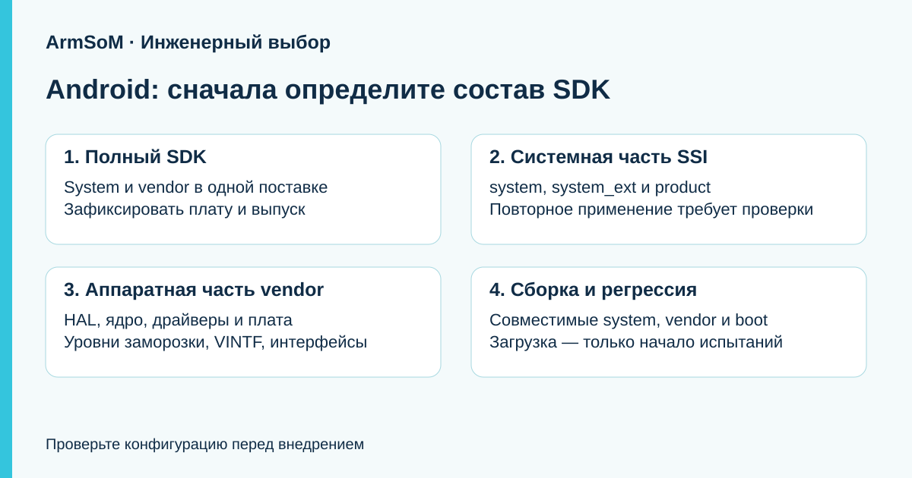

**Спрашивая о версии Android для Rockchip, уточняйте форму поставки: полный SDK или отдельно поставляемые системная и аппаратная части.** Номер Android не определяет структуру исходников, вход сборки, базовую версию vendor и процедуру обновления.

Руководство помогает планировать Android-проекты ArmSoM. Таблица ниже — предоставленный сторонний обзор, а не перечень образов ArmSoM, сертификаций GMS или актуальных обязательств производителя. Для продукта определяющими остаются документация платы, release notes и испытания.



## 1. Три понятия разных уровней

| Термин | Инженерный смысл | Ошибочная трактовка |
| --- | --- | --- |
| Полный SDK | Поставка содержит исходные компоненты system и аппаратной части | Любая плата работает без адаптации |
| SSI | Shared System Image, общий системный образ | Любой vendor совместим с любым system |
| GRF | Google Requirements Freeze, заморозка требований к vendor | Один образ, заменяющий все драйверы |

SSI позволяет повторно использовать систему на совместимых устройствах, сохраняя ограничения интерфейсов system, system_ext, product и vendor/odm. [AOSP SSI](https://source.android.com/docs/core/architecture/partitions/shared-system-image)

Команда BSP проверяет HAL, VINTF, ядро и ресурсы платы. Разработчики приложений — framework, разрешения, ABI и API. Раздельная сборка не отменяет общей регрессии.

## 2. Как читать таблицу версий

Ниже сохранены диапазоны из исходного обзора для поиска соответствующих выпусков. Дата источника — **2026-11-06**. Все ветки не были получены и собраны в этой работе; комбинации Android 16/17 не объявляются проверенной поддержкой. Прочерк означает отсутствие записи, а не техническую невозможность.

| Семейство | Источник: Android в полном SDK | Источник: Android с SSI + GRF |
| --- | --- | --- |
| RK3572 / RK3572S | 16 | 17 |
| RK3576 | 14, 15 | 16, 17 |
| RK3588 / RK3588S | 12–15 | 16, 17 |
| RK3568 / RK3566 | 11–15 | 16, 17 |
| RK3562 | 13–15 | 16, 17 |
| RK3399 | 6–15 | 16, 17 |
| RK3399PRO | 8, 9 | — |
| RK3326 / RK3326-S | 8–15 | 16, 17 |
| PX30 / PX30-S | 8–15 | 16, 17 |
| RK3368 | 5–11 | — |
| RK3288W | 5–12 | — |
| RK3126C | 8–10 | — |
| RK312X | 5–7 | — |
| PX5 | 6, 8 | — |
| PX3SE | 7 | — |

Диапазон не гарантирует каждый промежуточный выпуск, плату и периферийное устройство. В отдельной таблице источника по версиям Android встречается RK3528 вне этого списка; противоречие не используется для обещания поддержки. До закупки или обновления получите точный manifest, release notes и образ продукта.

## 3. Проверяем ветки Android 16/17

Источник описывает Android 16 для RK3572 как полный SDK, а несколько других платформ — как SSI с vendor Android 14. Это сведения об исследованных поставках, а не следствие номера Android. `rk3572_a16-*`, `ssi_16_arm64`, `rkbuild` и `build.sh -M / -T` необходимо проверить в своём SDK.

Указанные источником требования vendor для Android 17 сохранены **только для прослеживаемости**:

| Платформа | Vendor SDK | Минимальный выпуск по источнику | Выпуск SSI |
| --- | --- | --- | --- |
| RK3572 | Android 16 | RKR5+ | RKR1 / RKR2 |
| RK3588 / RK3576 | Android 14 | RKR9+ | RKR1 / RKR2 |
| RK3568 / RK3566 / RK3562 / RK3399 / RK3326 / PX30 | Android 14 | RKR10+ | RKR2 |

Android API level и vendor API level используют разные правила. AOSP отдельно определяет заморозку vendor-интерфейсов и их API. [AOSP API flags](https://source.android.com/docs/core/architecture/api-flags)

## 4. Сначала устройство, затем фиксация исходников

```bash
adb shell getprop ro.build.fingerprint
adb shell getprop ro.vendor.build.fingerprint
adb shell getprop ro.build.version.release
adb shell getprop ro.build.version.sdk
adb shell getprop ro.product.first_api_level
adb shell getprop ro.board.first_api_level
adb shell getprop ro.board.api_level
adb shell getprop ro.vendor.api_level
adb shell getprop ro.board.api_frozen
adb shell uname -a
```

Пустое свойство записывайте как недоступное, не подставляя номер Android. `ro.build.version.release` относится к системе и не устанавливает происхождение vendor. Сохраните оба fingerprint, ядро, хеши образов и ревизию платы.

Исследуйте уже полученный SDK из его корневого каталога:

```bash
repo manifest -r -o manifest-pinned.xml
find device/rockchip -name AndroidProducts.mk -o -name BoardConfig.mk
rg -n 'ssi_16_arm64|rk3572_a16|GRF|VINTF|PRODUCT_SHIPPING_API_LEVEL' \
  device/rockchip build.sh
rg -n 'getopts|rkbuild|merge|vendor|system' build.sh
```

`repo manifest` создаёт локальную запись версий. Команды не собирают и не прошивают устройство. Отсутствующий путь означает иную структуру ветки: сначала найдите её инструкции. Не переносите lunch-цели и параметры `build.sh` из чужого SDK автоматически.

## 5. Разделяем задачи двух частей

| Работа | Системная сторона | Аппаратная сторона |
| --- | --- | --- |
| Обновление приложения | Разрешения, фоновые ограничения, framework API, WebView | Поведение HAL камеры, медиа и датчиков |
| Новая плата-носитель | Функции и конфигурация продукта | DTS, питание, частоты, экран, сенсор и сеть |
| Сборка образа | Разделы, подпись, OTA и откат | boot/vendor/odm, VINTF и совместимость ядра |
| Сопровождение | Безопасность и зависимости приложений | BSP, прошивки, драйверы и vendor |

SSI уменьшает дублирование только при соблюдении совместимости. Одна замена `system.img` не завершает обновление платформы. Отключение AVB, SELinux или проверок интерфейсов ради загрузки не является приёмкой.

## 6. Приёмка проекта ArmSoM

Сначала получите базовые результаты приложения на известном рабочем образе CM5/Sige5 либо Sige7/AIM7/LM7. Затем оценивайте новую комбинацию SDK. Помимо запуска проверяйте экран и сенсор, восстановление сети, камеры, звук и видео, NPU, накопитель, сон/пробуждение и OTA. Выбирайте тесты совместимости по требованиям продукта; успешные тесты и коммерческая сертификация — разные результаты.

В поставку включайте закреплённый manifest, параметры сборки, связку system/vendor/boot, подпись и откат, результаты и неподдержанные функции. Тогда поддержка Android становится воспроизводимым результатом, а не только номером версии.

Источники: [предоставленный обзор SDK/GRF](https://mp.weixin.qq.com/s/_M3UC7uYivdxHesFIhAVTw) и AOSP выше. Далее: [сопровождение CA Android](/ru/articles/android-ca-trust-store-emudhra-audit/) и [интеграция VendorStorage](/ru/articles/rockchip-vendor-storage-android-aidl-guide/).

## Продукты и дальнейшее чтение

Для проекта ArmSoM можно оценить [Sige7](https://www.armsom.org/sige7), [AIM7](https://www.armsom.org/aim7) и [LM7](https://www.armsom.org/lm7) на RK3588 либо [CM5](https://www.armsom.org/cm5) и [Sige5](https://www.armsom.org/sige5) на RK3576. Интерфейсы и доступные образы проверяйте в документации [Sige7](https://docs.armsom.org/armsom-sige7), [CM5](https://docs.armsom.org/armsom-cm5) и [Sige5](https://docs.armsom.org/armsom-sige5). Ссылки помогают выбрать продукт, но не подтверждают проверку всех описанных сочетаний SDK на этих платах.
