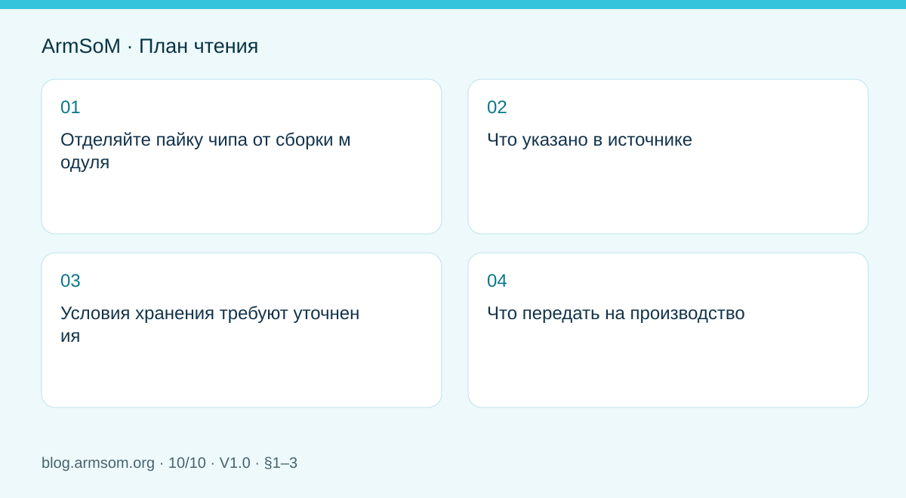
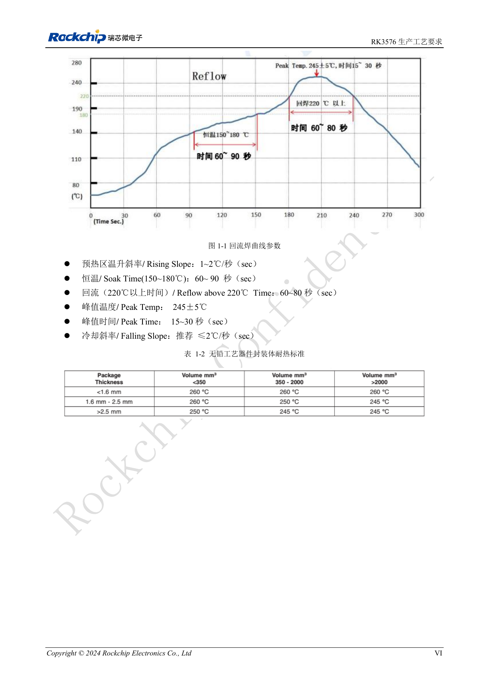

# От прототипа Rockchip к серии: технологические требования и испытания

## Область применения и источники

Это тематическое инженерное руководство, а не постраничный перевод всего PDF. Примеры источника не являются измерениями ArmSoM. Напряжения, выводы, SDK/BSP и ядро сверяйте с фактической ревизией платы.

**Rockchip:** `RK3576_Production_Process_Requirements_V10_20240522_CN.pdf` · V1.0 · §1–3

## Отделяйте пайку чипа от сборки модуля

Профиль оплавления относится к конкретному корпусу, а не автоматически к повторному оплавлению целого CM5, CM7s или AIM7. Разъёмы, термоинтерфейс и корпус имеют собственные требования. Модуль сокращает работы по SoC, но качество носителя и изделия контролируют отдельно.

## Что указано в источнике

§1.3 даёт ориентиры для проверки технологом на реальной плате, пасте и оборудовании, а не готовый рецепт без измерения температуры.

| Параметр | Исходный ориентир |
| --- | --- |
| Паста | SAC305; доля flux 10%–11.5% |
| Нагрев | 1–2℃/s |
| Выдержка 150–180℃ | 60–90s |
| Выше 220℃ | 60–80s |
| Пик | 245±5℃; 15–30s |
| Охлаждение | Рекомендовано ≤2℃/s |

§3.2.2 задаёт квадратные отверстия со скруглением r=0.05mm, стороной 0.30–0.32mm и трафаретом 0.1mm. Это контекст RK3576, а не универсальная норма корпусов.

## Условия хранения требуют уточнения

§2.2 указывает MSL 3, ≤30℃/60%RH и рекомендацию использовать за 168 часов после вскрытия, но также содержит шестичасовое время до оплавления. Строка MSL 1 записана как «≤300℃/85%RH». Условия или значения неясны. Нельзя рекомендовать хранение при 300℃ или молча удалить шесть часов. Нужны пояснение поставщика, маркировка партии и применимая технология.

## Что передать на производство

- Версионные схему, BOM, PCB, инструкции сборки и проверки.
- Полные артикулы, ревизии и правила замен.
- Подтверждённые параметры процесса, измеренные профили и обработку отклонений.
- Сумму образа, прошивку, назначение серийных номеров и регистрацию результатов.

Разделяйте питание, запуск, функции интерфейсов и длительную нагрузку. Критерии выпуска определяют по пробной серии, а не по демонстрации на столе. После изменения процесса или компонентов сохраняйте решение и повторные испытания.

## Иллюстрация из источника

Китайский оригинал; соответствующая английская иллюстрация в материалах не найдена. Эталонный проект, а не схема платы ArmSoM.

`RK3576_Production_Process_Requirements_V10_20240522_CN.pdf` · PDF p. 7.

## Продукты и документация

- **CM5** — [Страница продукта](https://www.armsom.org/cm5) · [Документация](https://docs.armsom.org/armsom-cm5)
- **CM7s** — [Страница продукта](https://www.armsom.org/cm7s) · [Документация](https://docs.armsom.org/armsom-cm7s)
- **AIM7** — [Страница продукта](https://www.armsom.org/aim7) · [Документация](https://docs.armsom.org/armsom-aim7)

## Другие статьи серии

- [Запуск платы RK3576: минимальная система и проверка первого включения](/ru/articles/rk3576-hardware-bringup/)
- [Плата-носитель ArmSoM CM5: питание, загрузка и планирование интерфейсов](/ru/articles/019-cm5-carrier-production/)
- [Скоростные интерфейсы RK3576: совместная проверка схемы и PCB](/ru/articles/rk3576-high-speed-interface-design/)
- [Аппаратное проектирование RK3588S: от эталонной схемы к носителю CM7s](/ru/articles/rk3588s-cm7s-carrier-design/)
- [RK3588 для периферийного ИИ: питание, охлаждение и расширение](/ru/articles/rk3588-edge-ai-hardware-design/)
- [Проверка скоростной PCB RK3588: слои, импеданс и трассировка](/ru/articles/rk3588-high-speed-pcb-review/)
- [Аппаратная часть HMI на RK3506: выбор пути с CM1 или Forge1](/ru/articles/rk3506-industrial-hmi-hardware/)
- [Варианты RK3308: аппаратная совместимость для аудиопроектов P2 Pro](/ru/articles/rk3308-hardware-variant-compatibility/)
- [RK3588S и RK3588S2: что проверить перед изменением платы](/ru/articles/rk3588s-rk3588s2-hardware-differences/)
