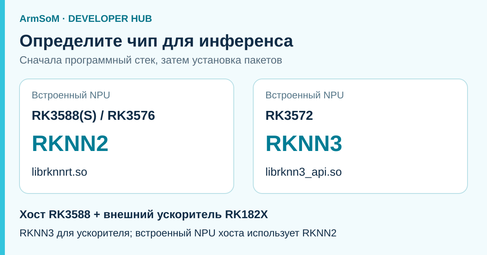
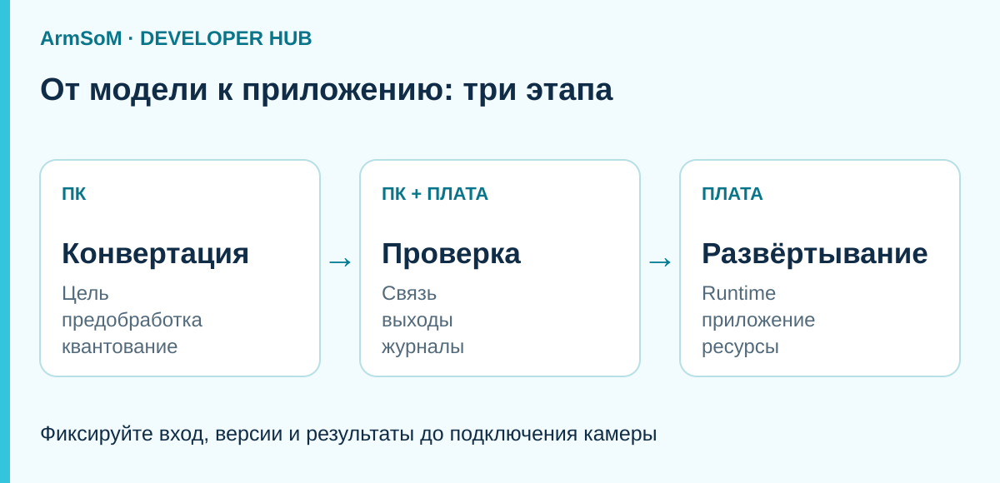

**Выбирайте программный стек по чипу, который действительно выполняет инференс: RK3588/RK3588S и RK3576 используют RKNN-Toolkit2, а RK3572 — RKNN3-Toolkit.** Если к хосту RK3588 подключён сопроцессор RK1820/RK1828, RKNN3 обслуживает внешний ускоритель. Встроенный NPU хоста по-прежнему работает через RKNN2.

Порядок работы в этой статье: выбрать стек, проверить плату, подготовить отдельную среду, запустить эталонную модель и затем встроить её в приложение. За основу взяты RKNN-Toolkit2 2.5.0 и RKNN3-Toolkit 1.2.0. Команды для компьютера рассчитаны на Ubuntu x86_64 и Python 3.10.

> Область применения: справочное руководство для разработчиков Sige7, AIM7 и LM7 на RK3588, а также CM5 и Sige5 на RK3576. Раздел RK3572 основан на официальном SDK платформы. Образ системы, драйвер ядра и Runtime необходимо согласовать отдельно. Проверены документы и исходники примеров; аппаратный тест инференса на ArmSoM не проводился. Результаты стороннего автора не выдаются за измерения ArmSoM.



## 1. Сначала стек, затем установочные пакеты

| Компонент | Ветка RKNN2 | Ветка RKNN3 |
| --- | --- | --- |
| Основные платформы статьи | RK3588/RK3588S, RK3576; официальный список также включает RK3566/3568, RK3562, отдельные семейства RV и RK2118 | RK3572; RK1820/RK1828 работают как сопроцессоры |
| Конвертация на ПК | RKNN-Toolkit2 | RKNN3-Toolkit |
| Библиотеки Runtime | `librknnrt.so` | `librknn3_api.so`; для локального пути RK3572 также используется `librknn3_api_native.so` |
| Отладка с подключённой платой | `rknn_server` | `rknn3-server` для RK3572; `rknn3_transfer_proxy` для связи с RK182X |
| Python на плате | RKNN-Toolkit-Lite2 | RKNN3-Toolkit Lite |
| Файлы моделей в примерах | `.rknn` | `.rknn` и соответствующий `.weight` |
| Большие языковые модели | Отдельный SDK RKNN-LLM | Процессы RKNN3 для LLM и `rkllm3-server`; поддержку модели и платформы проверяют отдельно |

Примеры обеих версий Toolkit могут содержать `from rknn.api import RKNN`. **Одинаковый импорт или расширение файла не означает совместимость формата модели и Runtime.** При смене семейства инструментов или целевого чипа модель следует заново конвертировать из исходного формата, а не переименовывать `.rknn`. Сверяйтесь с конкретным выпуском: [RKNN2](https://github.com/airockchip/rknn-toolkit2/tree/2c723177a94fac65cbc036d722907ddbc91980cf), [RKNN3](https://github.com/airockchip/rknn3-toolkit/tree/141883c8e11b05ef4cca4a69d8a7572c4d855191).

| Продукты ArmSoM | Встроенный NPU | Что проверить в проекте |
| --- | --- | --- |
| [Sige7](https://www.armsom.org/sige7), [AIM7](https://www.armsom.org/aim7), [LM7](https://www.armsom.org/lm7) | RK3588 → RKNN2 | Плата или носитель, питание, охлаждение, образ ОС и драйвер |
| [CM5](https://www.armsom.org/cm5), [Sige5](https://www.armsom.org/sige5) | RK3576 → RKNN2 | Ревизия модуля/носителя, камера, SDK и интерфейс развёртывания |
| Платформа RK3572 | RKNN3 | Конкретная отладочная плата и BSP; описание платформы не подтверждает испытания продукта ArmSoM |

Параметры устройств приведены в [документации Sige7](https://docs.armsom.org/armsom-sige7) и [CM5](https://docs.armsom.org/armsom-cm5). Если в прошивке RK3588 есть `librknn3_api.so`, выясните, предназначена ли она для внешнего RK182X. Само присутствие библиотеки не меняет стек встроенного NPU.

## 2. Конвертация, проверка с ПК и самостоятельная работа



| Этап | Где выполняется | Необходимый результат |
| --- | --- | --- |
| Конвертация | Среда нужного Toolkit на ПК | Целевая платформа, формат входа, предобработка, калибровка и экспорт |
| Проверка с подключённой платой | ПК и плата | Корректность на реальном устройстве; коммуникационные компоненты для выбранного режима |
| Самостоятельное развёртывание | Runtime/C++ или Lite Python на плате | Приложение управляет моделью, входами, выходами и ресурсами |

`rknn_server` — прокси RKNN2 для отладки с ПК, а не конечное приложение. Самостоятельная программа C/C++ обращается к Runtime напрямую; отсутствие постоянно работающего отладочного сервиса ещё не означает ошибку развёртывания. Для RKNN3 также различайте подключённый и локальный режимы.

Начните с одной фиксированной картинки. Камеру, декодер, сетевые запросы и многопоточность добавляйте после проверки модели. Так проще отделить проблемы модели от захвата, порядка цветов, масштабирования и копирования памяти.

## 3. Сначала проверьте плату Android

Следующие команды только читают сведения; запускаются на компьютере разработчика. На плате Linux проверяйте соответствующие пути `/usr/lib` и `/usr/bin` через SSH: расположение Android `/vendor` не универсально.

```bash
adb devices
adb shell getprop ro.board.platform
adb shell uname -m
adb shell 'ls -l /vendor/lib64/librknn* /vendor/bin/rknn* /dev/rknpu* /dev/dri/renderD*'
adb shell 'cat /sys/kernel/debug/rknpu/version'
```

Последняя команда может не сработать из-за отсутствия смонтированного debugfs, прав или отличий BSP. Узел устройства не обязан называться `/dev/rknpu` или иметь определённый номер `renderD`. Сопоставляйте журналы драйвера, документацию прошивки и фактические узлы. Отсутствие предполагаемого пути не доказывает отсутствие NPU.

Запишите ревизии платы/носителя, источник образа, ядро, драйвер NPU, Runtime и Toolkit. Предпочтительны компоненты одного выпуска SDK. Для смешанных версий проверяйте совместимость, а не превращайте полное совпадение номеров в правило для всех будущих выпусков.

## 4. RK3588 / RK3576: пример работы с RKNN2

### 4.1 Репозитории и отдельная среда Python

Разместите официальные [Toolkit2](https://github.com/airockchip/rknn-toolkit2/tree/2c723177a94fac65cbc036d722907ddbc91980cf) и [Model Zoo](https://github.com/airockchip/rknn_model_zoo/tree/837db8e992815ff8647eadb709f07067f4bc3a71), либо полные соответствующие каталоги SDK, в `~/Projects/rknn-toolkit2` и `~/Projects/rknn_model_zoo`. Если SDK уже скачан, повторная загрузка не нужна, но версии должны соответствовать рассматриваемому выпуску. Предварительно установите Python 3.10 с поддержкой venv.

```bash
python3.10 -m venv ~/venvs/armsom-rknn2
source ~/venvs/armsom-rknn2/bin/activate
cd ~/Projects/rknn-toolkit2/rknn-toolkit2
python -m pip install -r packages/x86_64/requirements_cp310.txt
python -m pip install packages/x86_64/rknn_toolkit2-2.5.0-cp310-cp310-manylinux_2_17_x86_64.manylinux2014_x86_64.whl
python -m pip check
python -c "from rknn.api import RKNN; import importlib.metadata as m; print(m.version('rknn-toolkit2'))"
```

Сначала установите зависимости конкретного выпуска, затем подходящий wheel. `cp310` не подходит Python 3.8, а пакет хоста x86_64 не является пакетом для платы aarch64. Здесь используется venv; изолированные среды можно создать и через Conda.

### 4.2 Запускайте rknn_server, когда он нужен для связи с ПК

Если прошивка уже содержит сервис, проверьте его состояние и не запускайте вторую копию. Если сервиса нет, а отладочная прошивка разрешает запуск NPU-программ из shell, скопируйте Android arm64 бинарник из SDK во временный каталог. Запустите его на переднем плане в отдельном терминале, чтобы видеть ошибки:

```bash
cd ~/Projects/rknn-toolkit2
adb push rknpu2/runtime/Android/rknn_server/arm64/rknn_server /data/local/tmp/rknn_server
adb shell 'chmod +x /data/local/tmp/rknn_server'
adb shell /data/local/tmp/rknn_server
```

Оставьте терминал открытым, а инференс с ПК запускайте в другом. Временный каталог не исправляет отсутствующие библиотеки, права на устройство или политику SELinux. Диагностируйте соответствующий уровень. В серийной прошивке компоненты и запуск интегрируют через сборку BSP; запись в защищённый `/vendor` или отключение защитных политик не должны быть стандартным способом установки.

### 4.3 Первая проверка цели с YOLOv5

Используется `yolov5s_relu.onnx` из официального Model Zoo. До конвертации убедитесь, что присутствуют `datasets/COCO/coco_subset_20.txt` и все перечисленные картинки. Небольшой набор примера подходит для начала, но рабочей модели нужны репрезентативные данные. [Пример и параметры](https://github.com/airockchip/rknn_model_zoo/blob/837db8e992815ff8647eadb709f07067f4bc3a71/examples/yolov5/README.md)

```bash
source ~/venvs/armsom-rknn2/bin/activate
cd ~/Projects/rknn_model_zoo/examples/yolov5/model
bash download_model.sh
cd ../python
python convert.py ../model/yolov5s_relu.onnx rk3588 i8 ../model/yolov5s_relu.rknn
python yolov5.py --model_path ../model/yolov5s_relu.rknn --target rk3588 --img_save
```

`i8` включает квантование. `--img_save` удобен без графического сеанса, тогда как `--img_show` требует дисплея. Для RK3576 на CM5/Sige5 измените **и цель конвертации, и цель инференса**, сохранив модель отдельно:

```bash
python convert.py ../model/yolov5s_relu.onnx rk3576 i8 ../model/yolov5s_relu_rk3576.rknn
python yolov5.py --model_path ../model/yolov5s_relu_rk3576.rknn --target rk3576 --img_save
```

Критерии проверки: завершение без ошибки, классы объектов соответствуют входу, изображение результата доступно для просмотра, в логах указаны ожидаемые цель и версии. Измерения FPS или задержки ArmSoM здесь не приводятся. Далее доступны [развёртывание C/C++](/ru/articles/rknn-v250-sdk-guide-c-deployment/) и [Lite2 на плате](/ru/articles/rknn-v250-sdk-guide-lite-deployment/).

## 5. RK3572: отдельная среда и модель RKNN3

### 5.1 Создайте вторую среду Python

Разместите [RKNN3 Toolkit](https://github.com/airockchip/rknn3-toolkit/tree/141883c8e11b05ef4cca4a69d8a7572c4d855191) и [RKNN3 Model Zoo](https://github.com/airockchip/rknn3-model-zoo/tree/7f8c7d848448fa14cf16ba359ca98405c8bb94b5) в `~/Projects/rknn3-toolkit` и `~/Projects/rknn3-model-zoo`. Если venv сейчас не активна, пропустите первую строку `deactivate`.

```bash
deactivate
python3.10 -m venv ~/venvs/armsom-rknn3
source ~/venvs/armsom-rknn3/bin/activate
cd ~/Projects/rknn3-toolkit/rknn3-toolkit
python -m pip install -r packages/requirements_cp310-1.2.0.txt
python -m pip install packages/x86_64/rknn3_toolkit-1.2.0-cp310-cp310-manylinux2014_x86_64.whl
python -m pip check
python -c "from rknn.api import RKNN; import importlib.metadata as m; print(m.version('rknn3-toolkit'))"
```

Проверенные зависимости Python 3.10 требуют `numpy<=1.26.4` для RKNN2 2.5.0 и `numpy>=2.0` для RKNN3 1.2.0. Совмещать их в одной среде нельзя. После импорта проверьте имя установленного пакета и версию: иначе можно незаметно загрузить другой модуль `rknn`.

Эти команды проверяют компоненты подключённого режима на RK3572 Android; пути уточняйте по BSP. Далее запускается локальный C++ demo, а не приложение на основе отладочного сервиса ПК:

```bash
adb shell 'ls -l /vendor/lib64/librknn3_api.so /vendor/lib64/librknn3_api_native.so'
adb shell '/vendor/bin/rknn3-server -v'
```

### 5.2 Явно выберите YOLOv6 для RK3572

Официальное руководство 1.2.0 использует **`yolov6n.onnx`** для RK3572. В проверенном скрипте загрузки активирована команда для оптимизированного под RK182X файла `yolov6n_rknn3.onnx`, а строка стандартной модели закомментирована. Поэтому запуск скрипта по умолчанию не гарантирует нужную модель. Ниже используется адрес стандартной модели из этого же скрипта:

```bash
source ~/venvs/armsom-rknn3/bin/activate
cd ~/Projects/rknn3-model-zoo/examples/yolov6/model
wget -O yolov6n.onnx https://ftrg.zbox.filez.com/v2/delivery/data/95f00b0fc900458ba134f8b180b3f7a1/examples/yolov6/yolov6n.onnx
cd ../python
python convert.py ../model/yolov6n.onnx rk3572 i8
ls -lh ../model/yolov6n.rknn ../model/yolov6n.weight
```

Убедитесь, что `.rknn` и `.weight` получены одной конвертацией. Старая строка справки `convert.py` перечисляет только `rk1820`, но руководство 1.2.0 явно приводит `rk3572`, а скрипт передаёт этот аргумент в `target_platform`. [Официальная документация](https://github.com/airockchip/rknn3-toolkit/tree/141883c8e11b05ef4cca4a69d8a7572c4d855191/doc) · [Проверенный скрипт](https://github.com/airockchip/rknn3-model-zoo/blob/7f8c7d848448fa14cf16ba359ca98405c8bb94b5/examples/yolov6/python/convert.py)

### 5.3 Соберите и запустите пример Android arm64

Установите CMake и поддерживаемый SDK выпуск Android NDK, затем задайте в `ANDROID_NDK_PATH` реальный каталог NDK. На плате нужны согласованные Runtime, драйвер и права выполнения. Скрипт сборки заново формирует собственный установочный каталог demo.

```bash
cd ~/Projects/rknn3-model-zoo
: "${ANDROID_NDK_PATH:?Set ANDROID_NDK_PATH to your Android NDK directory}"
./build-android.sh -t rk3572 -a arm64-v8a -b Release -d yolov6
adb push install/rk3572_android_arm64-v8a/rknn_yolov6_demo /data/local/tmp/
```

Запустите программу в shell платы, затем вернитесь на компьютер и заберите изображение:

```bash
adb shell
cd /data/local/tmp/rknn_yolov6_demo
export LD_LIBRARY_PATH=./lib${LD_LIBRARY_PATH:+:$LD_LIBRARY_PATH}
./rknn_yolov6_demo model/yolov6n.rknn model/yolov6n.weight model/bus.jpg 1
exit
adb pull /data/local/tmp/rknn_yolov6_demo/out.png .
```

Последний аргумент `1` — маска ядер примера, соответствующая конвертации с `core_num=1`. Не переносите многопроцессорную маску другой платформы. Проверьте `out.png`, классы, уверенность и координаты, сохраните журналы. Официальный пример вывода или чужое время выполнения не являются замерами вашей платы.

Для Linux нужны соответствующие `build-linux.sh`, кросс-компилятор aarch64 и Linux Runtime. Нельзя просто перенести Android ELF и библиотеки. Подробности API и освобождения ресурсов — в [руководстве Runtime RKNN3](/ru/articles/rknn3-v120-runtime-c-lifecycle/).

## 6. Интеграция в Android-приложение

| Вариант | Подходящие задачи | Что спроектировать |
| --- | --- | --- |
| APK + JNI | Интерфейс камеры и интерактивная детекция | ABI, предобработка, поток инференса, зависимости, права, жизненный цикл |
| Системный сервис + IPC | Несколько приложений используют общие модели | Контракт API, идентичность процесса, очереди, восстановление, интеграция BSP |
| Локальный HTTP-сервис | Прототип, веб-интерфейс, клиенты на разных языках | Протокол входа/результата, лимиты, тайм-ауты; по умолчанию слушать loopback |

Официальный [APK-пример RKNN2](https://github.com/airockchip/rknn-toolkit2/tree/2c723177a94fac65cbc036d722907ddbc91980cf/rknpu2/examples/rknn_yolov5_android_apk_demo) показывает разделение Java/JNI. Замена имени библиотеки не превращает его в реализацию RKNN3. Загрузка vendor-библиотек зависит также от Android linker namespace и SELinux; копирования `.so` недостаточно. [Изоляция библиотек](https://source.android.com/docs/core/architecture/vndk/linker-namespace) · [SELinux](https://source.android.com/docs/security/features/selinux)

Локальный HTTP — архитектурный выбор приложения, а не стандартный REST API `rknn_server`. Сервис `rkllm3-server` предоставляет OpenAI-совместимые возможности для LLM/VLM, но не готовый интерфейс детекции YOLO. Сначала определите тип модели, затем API.

## 7. Диагностика по уровням

| Симптом | Что проверить в первую очередь |
| --- | --- |
| `No module named 'torch'` | Правильная venv, полный список зависимостей выпуска, случайное применение `--no-deps` |
| Нет `libcublas.so` или похожей зависимости | Сборка PyTorch и зависимости; если CUDA не нужна, подходящая официальная CPU-сборка |
| Импорт работает, связи с платой нет | Авторизация ADB, кабель/порт, сервис, Runtime, права и логи |
| `.rknn` не загружается | Семейство Toolkit, целевой чип, версия экспорта, соответствующий `.weight` RKNN3 |
| Неверные объекты | RGB/BGR, resize/padding, нормализация, layout тензора, калибровка, постобработка |
| Картинка работает, видео тормозит | Отдельные измерения захвата, предобработки, инференса, постобработки, копирования и вывода |
| Нельзя записать в `/vendor` | Политика раздела и интеграция BSP; shell-тест не доказывает права серийного APK |

Например, только в среде RKNN2 с Python 3.10, при отсутствии потребности в CUDA и допустимости этой версии для проекта, можно выбрать CPU-пакет по официальной инструкции. Это не обязательная переустановка для всех:

```bash
python -m pip install --force-reinstall torch==2.4.0 --index-url https://download.pytorch.org/whl/cpu
python -m pip check
```

[Официальная установка версий PyTorch](https://pytorch.org/get-started/previous-versions/). Для офлайн-работы подготовьте все зависимости под ту же архитектуру/Python, модели, изображения калибровки и файлы репозиториев. Одного wheel для воспроизводимой среды недостаточно.

## 8. Сохраните воспроизводимую исходную точку

Сохраните данные платы/носителя, образ ОС, версии Toolkit/Runtime/сервиса/драйвера, коммиты репозиториев, контрольные суммы модели и входа, предобработку, команды и результаты. Разделяйте первую загрузку, прогретый инференс и полный цикл обработки; без этих условий два значения FPS обычно нельзя напрямую сравнивать.

Выберите основу проекта: [CM5](https://www.armsom.org/cm5), [Sige5](https://www.armsom.org/sige5), [Sige7](https://www.armsom.org/sige7). Дальнейшее чтение: [YOLOv5 и оценка точности RKNN2](/ru/articles/rknn-v250-sdk-quickstart-yolov5/), [платформы и стек RKNN3](/ru/articles/rknn3-v120-platform-guide/).

## Источники и границы проверки

Исходный материал — предоставленный читателем скриншот «RK 平台 NPU 开发快速入门：RK3588 与 RK3572», автор RK软件开发-吴工, 2026-11-14 ([оригинал](https://mp.weixin.qq.com/s/67VJOwm3z00N_u6xIudwdA)). Скриншот обрывается в начале раздела 3.3. Последующие шаги ArmSoM заново организовала по официальным материалам; это не полное извлечение исходной статьи.

На 2026-11-17 проверены снимки: RKNN2 `2c723177a94f`, RKNN3 `141883c8e11b0`, RKNN Model Zoo `837db8e99281`, RKNN3 Model Zoo `7f8c7d848448`. На них основаны команды, пути и зависимости. Совместимость образа и аппаратная проверка остаются задачами конкретного проекта. Обе схемы — редакционные иллюстрации ArmSoM, не снимки работающего устройства и не результаты измерений.
