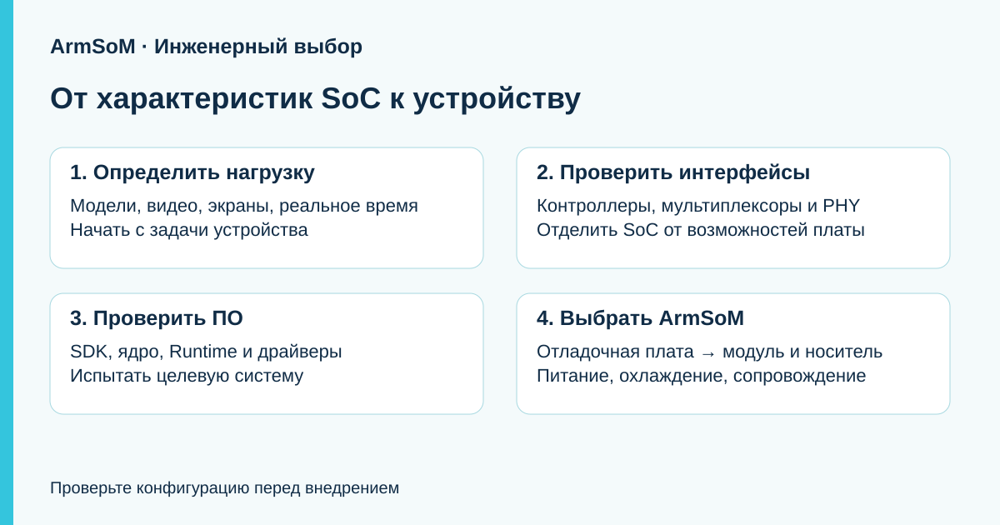

**Выбирать Rockchip следует по всей цепочке обработки модели, видео и интерфейсов, а уже затем по CPU и TOPS.** Для проектов ArmSoM платформы RK3588 стоит оценивать при сложной мультимедийной нагрузке и расширении; RK3576 — для компактных вычислительных систем и встроенного AI. RK3572 требует отдельной проверки нового стека NPU и готовности конкретной платы.

Предоставленное сравнение девяти чипов переработано в инженерное руководство. Характеристики кристалла не гарантируют функции платы ArmSoM. Чужие измерения не выдаются за наши испытания; техпроцесс, потребление, частоты, поставки и жизненный цикл не выводятся из названия модели.

## 1. Сужаем выбор по CPU и ускорителям

| SoC | CPU | Семейство GPU | Указанная производительность NPU |
| --- | --- | --- | --- |
| RK3588 | 4 × Cortex-A76 + 4 × Cortex-A55 | Mali-G610 | 6 TOPS |
| RK3576 | 4 × Cortex-A72 + 4 × Cortex-A53 | Mali-G52 | 6 TOPS* |
| RK3572 | 2 × Cortex-A73 + 6 × Cortex-A53 | Mali-G310 | 4 TOPS* |
| RK3562 | 4 × Cortex-A53 | Mali-G52 | 1 TOPS |
| RK3568 | 4 × Cortex-A55 | Mali-G52 | 1 TOPS |
| RK3566 | 4 × Cortex-A55 | Mali-G52 | 1 TOPS |
| RK3399 | 2 × Cortex-A72 + 4 × Cortex-A53 | Mali-T860 | — |
| RK3326 | 4 × Cortex-A35 | Mali-G31 | — |
| PX30 | 4 × Cortex-A35 | Mali-G31 | — |

Звёздочка сохраняет оговорку исходного сравнения о разреженных вычислениях для RK3576 и RK3572. Таблица не является рейтингом при одинаковых условиях. Для GPU указано семейство без смешивания API разных драйверов. Прочерк означает отсутствие указанного отдельного NPU, **а не невозможность выполнять AI на CPU или GPU**.

Базовые сведения можно сверить с официальными страницами [RK3562](https://www.rock-chips.com/a/en/products/RK35_Series/2024/0626/1983.html) и [RK3572](https://www.rock-chips.com/a/cn/news/rockchip/2026/0518/2168.html). Реализуемость модели зависит также от операторов, точности квантования, памяти и полной задержки.

### Для AI недостаточно сравнить TOPS

Зафиксируйте разрешение входа, версию модели, квантование, размер пакета и требуемую частоту кадров. Отдельно измеряйте предобработку, инференс и постобработку. Для нескольких камер учитывайте декодирование, преобразование цвета и копирование памяти: быстрый инференс не гарантирует быструю видеосистему.

Встроенные NPU RK3588 и RK3576 используют RKNN2, RK3572 — RKNN3. Внешний RK182X образует отдельный путь развёртывания. Инструмент конвертации, модель и Runtime должны соответствовать друг другу: [руководство ArmSoM по RKNN2/RKNN3](/ru/articles/rockchip-npu-rknn2-rknn3-getting-started/).

## 2. Формируем список по ограничениям проекта

| Проект | Кандидаты | Что проверить |
| --- | --- | --- |
| Несколько видеопотоков, сложные дисплеи, расширение | RK3588; Sige7, AIM7, LM7 | Кодеки, одновременная работа, накопители, охлаждение и разводка |
| Умные терминалы, шлюзы, компактный AI | RK3576; CM5, Sige5 | Точность модели, выведенные интерфейсы и образ Android/Linux |
| Баланс цены и функций новой платформы | RK3572 | RKNN3, готовность BSP, планы платы и производства |
| Шлюзы, управление, существующие разработки | RK3568 / RK3566 | Нельзя считать выводы и интерфейсы одинаковыми |
| Несложные экраны и встроенные терминалы | RK3562 | Нативные видеовыходы; при HDMI учесть мост и драйвер |
| Обновление и сопровождение существующих устройств | RK3399 / RK3326 / PX30 | Имеющееся ПО, память, безопасность и фактические поставки |

Это порядок отбора, а не рейтинг тестов. Рекомендация для сопровождения не означает снятие с производства. Выгода новой платы должна покрывать перенос ПО, сертификацию и регрессионные испытания.

## 3. Разбираем мультимедийный максимум на пять вопросов

1. **Кодек:** пределы разрешения, кадровой частоты и профиля различаются у H.264, H.265, VP9 и AV1. Максимум нельзя переносить на все форматы.
2. **Пиксельный формат:** согласованы ли глубина, YUV420/422/444, stride и размещение буферов между ISP, RGA, MPP и экраном?
3. **Параллельность:** помещаются ли нужные камеры, кодирование и дисплеи в ресурсы и пропускную способность?
4. **Подключение:** проверьте комбинации HDMI/eDP/DP, линии MIPI, режимы Type-C и разъёмы платы.
5. **ОС:** драйверы Linux и Android, пользовательские библиотеки, настройка камеры и приложения проверяются отдельно.

[Документация ArmSoM по видеокодекам](https://docs.armsom.org/advanced-manual/rockchip-video-codec) помогает составить программу проверки, но сама по себе не подтверждает конкретную одновременную нагрузку.

## 4. Память, сеть и накопители на уровне платы

Предел адресации SoC не равен доступной комплектации RAM. Для инференса учитывайте веса, активации, входы и выходы, видеобуферы и запас для ОС. Для NAS нужны длительная запись, сетевая нагрузка, файловая система и температурные испытания.

| Упрощённый вывод | Что требуется установить |
| --- | --- |
| Два MAC дают два сетевых порта | PHY, режим, разъём, драйвер и скорость на плате |
| Количества PCIe, SATA и USB складываются | Совместное использование combo PHY и распределение линий |
| Поддержка UFS означает наличие UFS на плате | Контакты, питание, загрузка и BOM |
| Контроллер CAN подключается прямо к шине | Трансивер, изоляция, терминаторы и device tree |
| Модуль выводит все интерфейсы SoC | Распиновка модуля, плата-носитель, напряжения и ПО |

Для CM5 ведите отдельные списки интерфейсов модуля и платы-носителя. Для Sige начинайте со схемы и разъёмов готовой платы. Не заполняйте пробелы спецификациями другого чипа.

## 5. Сохраняем проверяемую основу выбора

В предоставленном сравнении указаны следующие datasheet. Это **заявленные источником версии**, а не утверждение о постраничной проверке всех этих редакций здесь. Официальные краткие описания иных версий используются для сверки, без скрытой подмены.

| Модель | Версия в предоставленном материале |
| --- | --- |
| RK3588 | V1.8 · 20240821 |
| RK3576 | V1.3 · 20240826 |
| RK3572 | V1.0 · 20260324 |
| RK3562 | V2.0 · 20241104 |
| RK3568 / RK3568B2 | V2.1 · 20240621 |
| RK3566 | V1.4 · 20240621 |
| RK3399 | V1.8 · 20180529 |
| RK3326 | V1.4 · 20190110 |
| PX30 | V1.2 · 20190110 |

Сохраните полный суффикс чипа, ревизию платы и схемы, RAM/накопитель, выпуск SDK, commit ядра, NPU Runtime, нагрузку, результаты и непроверенные пункты. Особенно важно различать RK3568B2 и RK3568, RK3588 и RK3588S.

## 6. Переходим к прототипу ArmSoM

До выбора модуля и носителя проверьте реальный рабочий процесс на отладочной плате. Для зрения используйте свои данные, для дисплея — целевую панель, для накопителей — длительную нагрузку. Добавьте холодный старт, восстановление питания, длительную работу и обновление системы.

Итог должен описывать выполненные требования и оставшиеся ограничения, а не универсально лучший чип. Источники: [предоставленная статья](https://mp.weixin.qq.com/s/Li61_e6BUuoQ_YPQWkJuKg), официальные материалы выше и документация ArmSoM.

## Продукты и дальнейшее чтение

Для проекта ArmSoM можно оценить [Sige7](https://www.armsom.org/sige7), [AIM7](https://www.armsom.org/aim7) и [LM7](https://www.armsom.org/lm7) на RK3588 либо [CM5](https://www.armsom.org/cm5) и [Sige5](https://www.armsom.org/sige5) на RK3576. Интерфейсы и доступные образы проверяйте в документации [Sige7](https://docs.armsom.org/armsom-sige7), [CM5](https://docs.armsom.org/armsom-cm5) и [Sige5](https://docs.armsom.org/armsom-sige5). Ссылки помогают выбрать продукт, но не подтверждают проверку всех описанных сочетаний SDK на этих платах.
